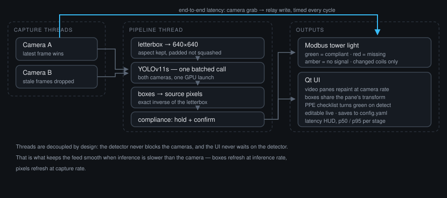
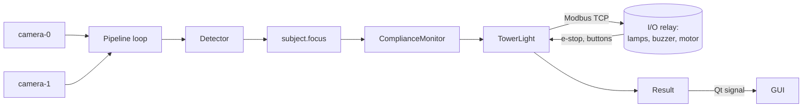

# PPE Detection Station

Two camera feeds → YOLOv11s → a Modbus tower light, with a live checklist of the
PPE each class is or is not wearing.



- **Two cameras, paced to the device.** On a GPU both frames go into one
  batched `predict`, launching it once per cycle instead of twice. On a CPU
  batching costs nearly twice as much and makes each frame wait for the
  other's, so the cameras take turns instead — same update rate, half the
  latency.
- **Smooth video.** Capture, inference and drawing run on separate threads. The
  panes repaint at camera rate no matter how slow the model is, and stale frames
  are dropped rather than queued — the feed stays live instead of drifting
  further behind the longer it runs.
- **Boxes that land where the objects are.** Frames are letterboxed (scaled by
  one factor and padded, never squashed) and every box is mapped back through
  the exact inverse. Capture and inference sizes are free to change.
- **An editable checklist.** Required PPE is listed in the UI; each row turns
  green the moment its class is detected. Toggle, add, remove or re-threshold a
  class and it takes effect on the next frame — no restart.
- **Latency you can see.** Every cycle is timed from the camera grab to the
  relay write, broken down per stage, shown in the HUD and appended to CSV.
  `--profile` adds a cProfile hotspot report covering the worker threads.

## Install

```bash
pip install -r requirements.txt
```

The station ships with `models/ppe-yolo11s.pt`, a YOLOv11s fine-tuned on PPE
(150 epochs at 640, `rect=False` — the same square letterbox this code uses at
inference). Point `model.weights` elsewhere to swap it.

## Run

```bash
python main.py                     # the UI, on the cameras in config.yaml
python main.py -c other.yaml       # a different config
python main.py --headless          # no UI; prints the latency breakdown
python main.py --profile           # add a hotspot report on exit
python main.py --headless --seconds 30 --profile   # a fixed benchmark run
```

## Two faces: operator and debug

```bash
python main.py              # operator — what the floor sees
python main.py --debug      # everything above, plus the numbers behind it
```

The header carries the identity and the notice: logo top-left at 76 px with
room around it, and the privacy notice as a full-width banner rather than a
caption. People are filmed at this station all shift; the line that says why,
and that nobody is recording them, is not a footnote and does not get footnote
treatment.

One window, two layouts — deliberately not two windows. A separate debug
window would drift from the operator one, and then debug would no longer be
showing you what production actually does. The mode gates which panels exist,
not which pipeline runs.

| | operator | debug |
| --- | --- | --- |
| Status, checklist, video | yes | yes |
| Checklist rows | read-only, `OK` / `MISSING` / `1/2` | editable, with confidence floors |
| Latency HUD | hidden | shown |
| Decision panel | hidden | shown |
| Annunciator | **speaks** | **muted** |

**Debug mutes the speaker but keeps the timing running.** The decision panel
still counts down to the prompt that would have played. Muting by skipping the
evaluation would hide the behaviour you opened the debug view to look at.

The **decision panel** is what makes hold and confirm times tunable rather than
guesswork — it shows the raw verdict, what is waiting to be confirmed and for
how long, and how much hold each class has left before it stops counting as
seen:

```
raw       violation
candidate violation  (0.14s of 0.40s, in 0.26s)
applied   violation
audio     muted, next would be 2.9s
CLASS HOLD REMAINING
headnet       0/1  hold 0.78/0.80s
Gloves        1/2  hold 0.62/1.00s
```

`ui.mode` in `config.yaml` sets the default; `--debug` and `--operator`
override it per run. The shipped default is `operator` — a station that boots
into debug on the floor is a mistake.

## Slow to appear on launch?

The window and the video feed do not wait on the model. On this machine:
window shown in 60 ms, live video within 113 ms of launch, the model itself
taking ~4 s to load and warm up in the background. If the app used to look
like it was hanging for several seconds before anything appeared, that was
the model load blocking window creation — fixed by moving model loading onto
the pipeline thread instead of the constructor, so a UI can show and start
painting frames immediately.

While the model loads, the banner reads `LOADING MODEL…`, then `MODEL
READY — WAITING FOR FIRST FRAME` if the cameras are the slower part (the
common case on a real industrial PC — see the camera troubleshooting above),
then the real compliance status once the first cycle completes. A model that
fails to load — a bad path, missing weights — reports `MODEL FAILED TO LOAD:
<reason>` instead of leaving the window stuck on "loading" forever.

## No video signal?

Run this first — no threads, no detector, no UI, just OpenCV opening each
configured source directly:

```bash
python -m ppe.camcheck            # probes every camera in config.yaml
python -m ppe.camcheck --scan     # also enumerates cameras this machine sees
python -m ppe.camcheck -v         # + OpenCV's own diagnostic
python -m ppe.camcheck --save frame.jpg   # save what each camera actually sees
python -m ppe.camcheck --modes    # what each camera will ACTUALLY deliver
```

`--modes` answers the question the others cannot: OpenCV reports what you got,
never what was on offer, so a camera stuck at 10 fps leaves you guessing whether
it has no compressed mode or something else is throttling it. It asks for every
size in both MJPG and YUY2, measures the rate that actually comes back, and
takes the frame size from a decoded frame rather than the driver's claim —
drivers report modes they are not delivering, which is the whole problem:

```
    asked            delivered      claims   measured
    MJPG   640x480       640x480    YUY2      30.0 fps
    MJPG  1280x720      1280x720    YUY2      10.0 fps

  MJPG buys nothing here — the rates match, so the camera is almost certainly
  uncompressed whatever it reports.
  fastest measured: 640x480 at 30 fps
```

It works the same on Windows and Linux — `--scan` and the printed causes adapt
to whichever it finds itself running on — and reports exactly where things
stand for each camera: cannot open, opens but never delivers a frame, delivers
a frame that is one flat colour (lens cap, dead sensor), or works. The main
app only ever logs "unavailable, retrying": that message survives on purpose,
so the station keeps trying rather than crashing when a cable comes loose
mid-shift, but it is not built to be a diagnostic.

**Two USB webcams sharing one port's bandwidth is the single most common
reason two cameras "get no signal" together while either works alone** — see
the bandwidth note under `cameras[].fourcc` below before chasing anything
else; it is now the shipped default specifically because of this.

### On Windows

Ranked by how often each one is the actual cause:

0. **Raw video format eating the USB budget — check this first for TWO
   cameras that individually work but not together.** `cameras[].fourcc:
   MJPG` (the shipped default) asks each camera to compress its own frames
   before sending them; without it most UVC webcams — the Logitech C920
   included — hand back raw YUY2, which is **~55 MB/s at 1280x720@30 for one
   camera**, comfortably more than a single USB 2.0 port carries and roughly
   3x over what two share on one hub. That reads as "no signal" or "opens but
   never delivers a frame," not a visible error. `camcheck` (below) prints
   the actual format each camera negotiated and warns if it is not MJPG.
1. **The camera privacy setting, silently.** Settings → Privacy & security →
   Camera → **"Let desktop apps access your camera."** If this is off, a
   Python/OpenCV process is blocked while the built-in Windows Camera app
   keeps working fine — which is what makes this one so easy to chase in the
   wrong direction. Extremely common on a locked-down industrial/kiosk image,
   and it usually fails with no error at all rather than a clear one. Check
   this before anything else.
2. **Another process already has it open.** Most UVC devices allow only one
   reader. Close Teams/Zoom/the Camera app, and check Task Manager for a
   previous crashed run of this program still holding the device.
3. **Wrong backend, in either direction — try the other one.** `api: any`
   normally resolves to MSMF (Media Foundation); `api: dshow` is DirectShow.
   Neither is reliably the right answer:
   - **MSMF can stall opening for minutes** rather than failing outright —
     indistinguishable from a hang until you have waited long enough to doubt
     it. This app now sets `OPENCV_VIDEOIO_MSMF_ENABLE_HW_TRANSFORMS=0`
     automatically before opening any camera, which is what fixes it; you no
     longer need to set this by hand.
   - **DirectShow can silently ignore `fourcc: MJPG`** and still report
     success — `camcheck` (below) will show it claiming a format other than
     what was asked for. Measured on a Logitech C920: DirectShow opened fast
     but stayed at 10 fps at 720p because the format request never actually
     applied; MSMF, once the stall above is fixed, opened just as fast **and**
     reached the full 30 fps on the same camera and port.

   So if one backend is slow or capped, the fix is usually the other one, not
   persisting with either. `--scan` shows which backend answers for which
   index; `camcheck --modes` (below) measures real throughput per backend so
   you are comparing numbers, not guessing.
4. **Driver problem.** Device Manager → Cameras (or "Imaging devices") — a
   yellow warning icon means the driver did not install.
5. **USB power management.** Device Manager → the camera's USB Root Hub →
   Power Management → uncheck *"Allow the computer to turn off this device to
   save power."* Looks identical to a camera that "randomly" stops, and is
   common on industrial PCs with aggressive power profiles.
6. **USB bandwidth.** Two cameras at high resolution can exceed one shared
   hub/controller — the second fails to open while the first works alone.
   Move them to separate controllers, or lower `width`/`height`.
7. **Wrong index.** Windows can renumber cameras after a reboot or a replug;
   `--scan` opens indices 0–5 against both backends and reports what answers,
   so this stops being a guess.

### On Linux

1. **Wrong index.** A UVC webcam commonly exposes *two* `/dev/video` nodes —
   one real, one metadata-only — so `source: 1` can be the wrong node of
   camera 0, not camera 1 at all. `--scan` lists every node.
2. **Permissions.** `groups` needs `video`, or root. `sudo usermod -aG video
   $USER`, then log out and back in.
3. **USB bandwidth.** Same as Windows above; split across controllers or
   lower the requested resolution.
4. **Device busy.** `sudo fuser -v /dev/video0`, or reboot.
5. **Backend mismatch.** Set `api: v4l2` explicitly if `api: any` guesses
   wrong.
6. **Containers.** `/dev/video0`/`/dev/video1` need explicit `--device`
   passthrough — not visible by default even in a privileged container.

`-v` prints OpenCV's own diagnostic under any of the above, and it usually
names the cause directly.

## Configure

Everything lives in `config.yaml`, and the parts you tune most often are also
editable in the UI (the checklist's **Save to config** button writes them back).

| Key | What it does |
| --- | --- |
| `model.weights` | Any YOLOv11 `.pt`, `.onnx` or TensorRT `.engine` |
| `model.imgsz` | Inference size, a multiple of 32. Lower = faster, worse on small objects |
| `model.device` | `auto`, `cpu`, `cuda:0`, `mps` |
| `model.threads` | Inference threads; 0 = every core this process may use |
| `model.batch` | `auto` (batch on GPU, take turns on CPU), or force `true`/`false` |
| `model.half` | fp16 on CUDA — usually ~1.5-2x faster, no measurable accuracy cost |
| `cameras[].source` | Camera index, RTSP/HTTP URL, or a video file |
| `cameras[].width/height` | Requested capture size (see below) |
| `ppe.classes[].required` | Only required classes drive the tower light |
| `ppe.classes[].expect` | `present` (must be worn) or `absent` (detecting it *is* the violation) |
| `cameras[].fourcc` | Compression the camera is asked to use — `MJPG` (default) or `""` for the driver's raw default |
| `ppe.classes[].count` | How many must be on the subject — 2 gloves, 2 sleeves (default 1) |
| `ppe.classes[].any_of` | Alternatives: required classes sharing a name are satisfied by any one of them — `sleeves` OR `Apron` |
| `ppe.subject` | Class the checks are applied to; empty checks every detection |
| `ppe.containment` | Fraction of a PPE box that must lie on the subject to count |
| `ppe.classes[].conf` | Per-class confidence floor, overriding `model.conf`; also editable live in the UI |
| `ppe.hold_ms` | How long a class stays "present" after its last sighting |
| `ppe.confirm_sec` | Seconds a status must hold before the lamp follows, per status |
| `ppe.classes[].hold_ms` | Per-class hold override; falls back to `ppe.hold_ms` |
| `tower.*` | Transport, address, and the coil behind each lamp |
| `tower.channels` | Channels on the relay board; all are driven low at connect |
| `tower.reconnect_sec` | Wait between reconnect attempts after a bus failure |
| `tower.contacts` | Per input: `normally_open` or `normally_closed` (the default) |
| `audio.file` | Spoken prompt while a violation stands; empty = silent |
| `audio.grace_sec` | Pause before the first prompt — time to comply |
| `audio.repeat_sec` | Gap between repeats while the violation stands |
| `ui.mode` | `operator` (floor) or `debug` (diagnostics, muted audio) |
| `telemetry.csv` | Per-cycle latency log; empty string disables |
| `branding.name` / `.tagline` | Metadata only — not currently shown in the app |
| `branding.logo` | Your mark, shown top-left of the app; `.svg`, `.png` or `.jpg`, kept at its own aspect ratio; relative paths resolve from the config file; empty or missing hides the strip |

### Capture size and accuracy

Capture resolution and `imgsz` are independent, and changing either is safe:
frames are scaled by a single factor and padded to a square, so nothing is
distorted, and `INTER_AREA` is used when shrinking so small objects survive the
downscale. What actually costs accuracy is **effective object size in pixels**:

- Raising capture resolution above `imgsz` buys nothing on its own — the frame
  is scaled down to `imgsz` before inference either way. It does cost bandwidth
  and decode time.
- Lowering `imgsz` is the real trade. 640 is the trained default; 480 or 416 is
  noticeably faster and starts to miss small or distant items. Measure it on
  your own footage rather than guessing.
- If workers are far from the camera, prefer a tighter lens or a higher `imgsz`
  over a higher capture resolution.

`tests/test_detector.py` pins this down: the same scene captured at 0.5x, 0.75x
and 1.5x yields the same detections in the same places, to within 3% of the
frame.

### The shipped model

`models/ppe-yolo11s.pt` detects seven classes, and they are not all the same
kind of thing:

| Class | Configured as | Why |
| --- | --- | --- |
| `headnet` | required | worn PPE |
| `Safetyglasses` | required | worn PPE |
| `Mask` | required | worn PPE |
| `Gloves` | required, `count: 2` | two hands |
| `sleeves` | required, `count: 2` | two arms, correct sleeve type |
| `Wrong Sleeve` | required, `expect: absent` | **a violation class** — see below |
| `person` | `subject` | who the checks are applied to |

**`Wrong Sleeve` is inverted.** Detecting it is the fault, not the pass. Listed
as ordinary required PPE it would turn the tower **green** on exactly the
condition it exists to catch, so it is configured `expect: absent`: the class
gates the light, but compliance means *not* seeing it. The UI marks such rows
with `⊘`, and green keeps its usual meaning — "as the site rules want it" —
so an inverted row reads green while absent and red the moment it appears.

**Two gloves, not "gloves".** A worker has two hands and two arms, so
`Gloves` and `sleeves` carry `count: 2`. A class is only compliant once that
many are on the subject; one glove reads `VIOLATION` and the banner says
`Gloves (1 of 2)` rather than a bare label. The checklist marks these rows
`×2` and shows the tally — `1/2` — instead of a confidence score, because the
tally is the fault.

Counts are the **best single camera's view, never the sum.** Two cameras
watching one worker both see the same two gloves; adding them up would report
four and pass a one-gloved worker on a doubled count. So the front camera
seeing both gloves gives 2, and a side view that can only see one does not veto
it. The hold window applies to the count as well, so a glove the model loses
for a frame does not read as a bare hand.

**`person` is the subject.** PPE only means anything relative to someone
wearing it, so `ppe.subject: person` gates the whole check:

- **Nobody in view → `STANDBY`.** An empty cell has no PPE in it; reporting
  every item as missing would be a nuisance alarm, and nuisance alarms get
  systems ignored.
- **Someone in view → only their equipment counts.** A detection is credited
  to the subject when at least `ppe.containment` of its box (0.5 by default)
  lies inside the subject's. A helmet on a bystander at the back of the cell
  does not dress the person at the door.
- **The largest person is the subject** — the one nearest the camera. Each
  camera picks its own: with two views of one cell, a single global "largest"
  would silently discard whatever the other camera could see.

Off-subject detections are drawn faint in the video panes rather than dropped,
so it stays obvious that the model saw them and the rules set them aside, and
the chosen person is ringed `SUBJECT`. During standby the checklist goes
neutral grey — a screen full of red items under a `STANDBY` banner would read
as violations nobody committed.

**This is fail-open, by construction.** If the model misses the person, the
station stands by instead of alarming. That is the trade you accept for
silencing empty-cell alarms; `ppe.hold_ms` keeps the subject alive across
dropped frames, and setting `ppe.subject:` empty restores checking everything,
everywhere, all the time.

### Choosing a different model

Point `model.weights` at any YOLOv11 `.pt`, `.onnx` or `.engine` and list its
class names in `ppe.classes`. Any name the model does not have is flagged amber
in the UI and forces the tower to `DEGRADED` rather than silently passing — a
class that can never be detected must never read as compliant.

To run a checkpoint you trained yourself on a CPU, export it first and point the
config at what comes out:

```bash
python -m ppe.export -w runs/detect/train/weights/best.pt
```

`-w` matters: without it the exporter reads `model.weights` from the config,
which normally points at an export already — and only a `.pt` can be exported.

## Audio

A lamp only works on someone facing it. Point `audio.file` at an .mp3 or .wav
and the station speaks while a violation stands:

```yaml
audio:
  file: assets/please_wear_ppe.mp3
  grace_sec: 3.0     # time to comply before the first prompt
  repeat_sec: 3.0    # gap between repeats while it stands
```

`grace_sec` is the part worth keeping. Prompting the instant PPE is missing
trains people to tune it out; a few seconds to finish putting a glove on means
the prompt only ever fires at someone who actually needed telling. Leave `file`
empty for a silent station — nothing else changes.

## The tower light

| Condition | Grinder | Lamp | Meaning |
| --- | --- | --- | --- |
| e-stop hit | — | red | Somebody hit the e-stop; outranks everything below |
| `OK` | running | green | Compliant, and the machine is actually running |
| `OK` | idle | amber | Compliant — press the button to start |
| `VIOLATION` | — | red | A required class is missing, or a forbidden one appeared |
| `STANDBY` | — | dark | No subject in view — nothing to judge |
| `DEGRADED` | — | amber | No usable video, or a required class the model lacks |

Green reports the **machine**, not just the verdict on the worker: it
means the grinder is turning. A station with no `belt_grinder` coil wired
has nothing for green to wait on, so there compliant is green as before.

A hit e-stop is red over any status, an empty cell included — a dark
tower above an e-stopped machine says nothing about why it will not
start. An e-stop that cannot be *read* (bus down) is treated as unknown
rather than hit: the lamp falls back to the compliance status instead of
crying wolf on the one colour that has to mean something. A station with
no `estop` input configured never shows it.

Detections are unioned across cameras: an item seen by either camera counts as
present. That is what you want for two views of one cell — a front camera sees
the mask and safety glasses, a side camera sees the gloves and sleeves, and
between them they see the whole worker. Each camera selects its own subject
first, so the union is over what both views saw *on the person each is looking
at*.

With one worker in the cell both cameras lock onto the same person and this is
exactly right. With two people in view the cameras can pick different subjects
and the union would blend them — resolving that needs cross-camera identity,
which this does not attempt.

Standby leaves the tower dark: an unlit tower cannot be mistaken for a
compliance verdict. Amber is the one lamp that carries two meanings —
`DEGRADED` (a fault) and compliant-but-idle (not a fault). A lamp alone
cannot tell those apart; the screen names which it is.

Two guards keep the relay from chattering: `hold_ms` bridges a class that
flickers out for a frame or two, and `confirm_sec` requires a status to stand
for a set time before the lamp follows it.

Both are timed in **seconds, not frames**. Inference rate moves with CPU load,
so a frame count is a different amount of real time from one minute to the
next — the same setting would debounce for 0.1 s under light load and 1.5 s
under heavy load.

### The buzzer

A pulse, not a tone held for the duration: it sounds for `buzzer_sec`
(default 3 s) at the moment a **PPE violation cuts a running grinder**.

```yaml
tower:
  buzzer_on_violation: true
  buzzer_sec: 3.0
```

What it deliberately does *not* do:

- A violation that finds the grinder already idle is **silent** — nothing
  was taken away, so there is nothing to announce.
- An e-stop, a camera loss (`DEGRADED`) or the worker stepping out of view
  (`STANDBY`) all stop the grinder just as hard, and all stay silent. Only
  a violation sounds it.
- It does not re-sound while the violation stands. One stop, one pulse.
- A station with no `belt_grinder` coil never sounds it at all, since
  there is no grinder for a violation to cut.

Set `buzzer_on_violation: false`, or `buzzer_sec: 0`, to disable.

`confirm_sec` is asymmetric on purpose:

```yaml
confirm_sec:
  ok: 1.0             # slow to go green — a safety claim
  violation: 0.4      # quick to go red — an alarm
  standby: 1.0        # slow to conclude nobody is there
  degraded: 0.5
```

Going green asserts that a worker is protected; going red asserts that they
might not be. Those are not equally weighty claims and should not take equally
long. `standby: 1.0` matters for the same reason: slow to conclude the cell is
empty, so a blinked `person` detection cannot quietly drop the alarm.

### Occlusion is not a dropout

Counts are the **best single camera's** view, never the sum — both cameras
see the same two gloves, so adding them would report four and pass a
one-gloved worker. The consequence is that `count: 2` needs *one* camera
to see both gloves in one frame, and with a side view that catches one
hand and a front view that catches neither, that never happens.

`occluded_ms` is the lever for it. Two windows, because "I can see one
glove" and "I can see no gloves" are different claims:

```yaml
- {name: Gloves, count: 2, hold_ms: 1000, occluded_ms: 5000, containment: 0.1}
```

| what the cameras see | window | why |
| --- | --- | --- |
| none of them | `hold_ms` (1 s) | it may be off the worker — stay short |
| some but not all | `occluded_ms` (5 s) | one glove plainly on the hand is evidence the pair is worn |
| all of them | — | credited outright, and the clock restarts |

So one glove visible keeps the pair credited for 5 s, while **no** gloves
visible still expires in 1 s. That split is what makes a long tolerance
safe to set: a single window long enough for the occlusion would also let
a bare-handed worker coast for the same span. `occluded_ms` defaults to
`hold_ms`, so leaving it out is exactly the old behaviour, and it can
never invent evidence — a worker who only ever shows one glove never
passes.

It does not fix a camera that can never see the second glove at all.
Check the debug decision panel first: if the row never reaches `2/2`,
no window helps and the camera needs moving.

**Alternatives (`any_of`).** Arm protection is two sleeves *or* an apron:

```yaml
- {name: sleeves, label: Sleeves, required: true, count: 2, any_of: arms, ...}
- {name: Apron,   label: Apron,   required: true,           any_of: arms, ...}
```

One compliant member satisfies the group; each keeps its own count, conf,
hold and grace. Nothing outside the group is excused: an apron does not
stand in for gloves, and `Wrong Sleeve` stays forbidden. A worker with
neither sees one fault, `Sleeves (0 of 2) or Apron`; the grace window is the
shortest among the group; and in the checklist the member not worn reads
**NOT NEEDED** in grey rather than a red MISSING. A member the loaded model
cannot detect is dropped from the group instead of degrading the station.
The shipped model has no `Apron` class yet, so until it is retrained the
station judges arm protection on sleeves alone, says so in `--selftest`,
and never tells a worker to put on an apron it cannot credit. Capture mode
already lists `Apron` in its `data.yaml`, so frames kept now can be labelled
for that retraining.

**Per-class `containment`** is the other half. One global threshold has to
be loose enough for the worst case, which then lets a bystander's gear
count for everything else. Gloves and sleeves ride the ends of
outstretched arms and routinely fall outside the person box, so they take
a looser threshold while a mask or headnet keeps the strict global one.

Hold windows are per class, because detection stability is not uniform —
`sleeves` are large and viewpoint-dependent (1.2 s), a `Mask` is reliably seen
head-on (0.7 s), and `Wrong Sleeve` is short (0.4 s) so a violation clears
promptly once the worker fixes it. Only coils that actually changed are written,
and a bus that drops out is retried in the background without stalling
detection — the UI says `tower offline` while that lasts.

**Relay channel numbering.** These boards label their channels from 1 while
Modbus addresses coils from 0, so **board channel N is coil N−1**. A reference
station on this hardware wires green to channel 1 (coil 0) and red to channel 3
(coil 2) — which is what `tower.coils` ships with. That station has no amber or
buzzer at all, so if yours is wired the same way, check what `DEGRADED` and the
buzzer actually reach before relying on them.

At connect the station drives every channel on the board low, not just the ones
it manages, so a coil left energised by a run that crashed cannot survive into
this one.

Wiring is `tower.coils`: a Modbus coil address per lamp. Set
`tower.transport: rtu` with `serial_port`/`baudrate` for a serial relay, or
`tcp` with `host`/`port` for an Ethernet one. `tower.enabled: false` runs the
whole app with no bus at all, which is how the tests and a dev laptop run.

### The belt grinder interlock

A machine relay, gated on two digital inputs plus the compliance status —
separate from the lamps, on its own coil:

```yaml
tower:
  coils:
    belt_grinder: 4   # Digital Output 5 — channel N is coil N-1, as above
  inputs:
    estop: 0          # Digital Input 1
    push_button: 1    # Digital Input 2
  contacts:
    estop: normally_open
    push_button: normally_open
```

**Switch polarity** is set per input under `contacts`:

| | at rest | operated (hit, pressed) | a broken wire reads as |
|---|---|---|---|
| `normally_open` (shipped) | 0 | 1 | at rest |
| `normally_closed` | 1 | 0 | operated |

A name left out of `contacts` is `normally_closed`, the original wiring, so
a station upgraded without touching its config does not flip. Write the
values in full: YAML reads a bare `no` as *false*, and the config refuses
it rather than guess.

**What normally open costs on the e-stop input.** With normally closed, a
cut wire looks like the e-stop being hit, which is the safe direction. With
normally open, a cut wire looks like an e-stop at rest. The software stops
seeing the e-stop: the lamp does not go red and the latch below is not
dropped. Only a hard-wired e-stop circuit stops the motor in that case.

> **This software is not the e-stop.** Until the safety relay is fitted, an
> e-stop wired only to the relay module does nothing at all if the wire
> breaks, the PC or the program freezes, the network drops, or a relay
> contact sticks. None of those parts is safety-rated. A hard-wired
> e-stop (normally-closed contacts breaking the motor contactor circuit,
> stop category 0 or 1, ISO 13850 / IEC 60204-1) is required before
> operators rely on the station. This input then only *reports* the e-stop.

So:

- the e-stop's own contacts into the safety circuit are **normally closed**
  (ISO 13850 / IEC 60947-5-5 direct opening). Only the signal to this input
  is normally open;
- where the safety relay has a monitored status output, wire this input to
  that instead of to an auxiliary contact on the button;
- at commissioning, pull each input's wire with the station running and
  confirm what happens (FAT/SAT protocols).

The button is momentary, so the output **latches** — the seal-in of a
standard motor starter, read and driven every cycle:

- **start** on a press (a release-then-press the station actually saw)
  while the e-stop is not hit and the station shows `OK`
- **run** until something drops it — letting go of the button does not
- **drop** when the e-stop is hit (or, wired normally closed, its circuit broken), when the
  station leaves `OK` (missing PPE, STANDBY, DEGRADED), when either input
  cannot be read, or when the board is taken low by a connect or a close

**Nothing restarts on its own.** A released e-stop, restored compliance or
a recovered bus all leave the coil low until an operator presses the
button again. That restart interlock is the reason to latch at all — a
fault that clears must not spin the motor back up under someone's hands.
It is also why the press is tracked as an *edge*: a button taped or wedged
down cannot turn a cleared fault into a start, because the station has to
see it released first.

**This is strict about compliance blips.** Every drop out of `OK` — a
brief occlusion, a glove the model loses for longer than its `hold_ms` —
stops the grinder and costs the operator a re-press. If that gets
annoying on the floor, raise `ppe.confirm_sec.violation` and
`ppe.confirm_sec.standby` so a momentary miss never reaches the interlock,
rather than loosening the interlock itself.

All three keys are required together: `tower.coils.belt_grinder`,
`tower.inputs.estop` and `tower.inputs.push_button`. `config.validate()`
refuses a config with only some of them set, rather than silently reading
or writing nothing.

## Running on a CPU

The station is set up for CPU inference out of the box. Four things get it
there, measured on a 4-core Xeon with two 30 fps cameras:

| | end-to-end p50 | inference p50 | cycles in 25 s |
| --- | --- | --- | --- |
| PyTorch `.pt`, batched, untuned | 488 ms | 476 ms | 56 |
| **shipped defaults** | **48 ms** | **28 ms** | **793** |

**OpenVINO instead of PyTorch — 5.2x.** Same weights, same detections: on the
reference image every box lands within 1.2 px and 0.012 confidence of the
PyTorch output. `models/ppe-yolo11s_openvino_model/` is committed; regenerate it
for a different `imgsz` with `python -m ppe.export`.

**One camera per cycle, not two.** Batching makes each frame wait for the
other's result, and buys almost nothing on a CPU to pay for it. Measured on the
4-core Xeon, OpenVINO at 640:

| | per call | per-camera update | latency per frame |
| --- | --- | --- | --- |
| batch 1, taking turns | 64 ms | 129 ms | **64 ms** |
| batch 2, both at once | 122 ms | **122 ms** | 122 ms |

A batch of two costs 1.89x a single frame — just inside the 2.0x break-even, so
batching wins the update rate by 6% and loses latency by 89%. On a safety
station that is the wrong side of the trade, which is why `auto` takes turns on
a CPU and batches only on a GPU. (An older PyTorch measurement put the cost at
2.3x, where batching lost outright.)

`model.batch: auto` batches on a GPU and takes turns on a CPU; `true`/`false`
force it. It is a request, not a capability: an export is compiled for exactly
one frame count and refuses every other, in both directions — a batch-1 export
handed two frames raises, and a `--batch 2` export handed one raises just as
hard. Either way it raises inside the runtime, during warmup ("the model failed
to load") or mid-shift. So the detector asks the model at startup and settles
`batches` to whatever it will actually accept, with a warning naming the fix. To
batch for real, export for it:

`models/ppe-yolo11s_b2_openvino_model/` is committed alongside the batch-1 one
for exactly this; regenerate either with:

```bash
python -m ppe.export --batch 2     # writes models/<stem>_b2_openvino_model/
```

A batch-N export lands beside the batch-1 one rather than on top of it — the
shipped config runs the batch-1 one, and replacing it with a model that refuses
single frames would break every cycle. To run the batch-2 export, point
`model.weights` at it **and** set `model.batch: true`; the two go together.

**Threads that don't fight.** OpenCV defaults to a thread per core *inside each
camera thread*, so on 4 cores the decoders and the model were fighting over the
same hardware — inference measured 3x slower inside the app than on its own.
Capture is now pinned to one thread each and the model gets the cores
(`model.threads`, 0 = all). That alone closed the gap: in-app inference now
matches its isolated benchmark exactly.

**Capture paced to `cameras[].fps`.** A live camera paces itself inside
`read()`, but a file or a free-running source will decode flat out and burn a
core producing frames nobody consumes.

### Measuring it yourself

The right backend depends on your CPU, so measure rather than assume:

```bash
python -m ppe.bench                        # every model in models/
python -m ppe.bench --image shift.jpg      # on a real frame, with detection counts
python -m ppe.bench --imgsz 640 512 448    # what a smaller input buys
python -m ppe.export --format onnx         # if OpenVINO is not an option
python -m ppe.export --batch 2             # compile for both cameras at once
```

`bench` prints the detection count beside each timing, so a backend that is fast
because it stopped finding things is obvious.

### If it is still too slow

In the order I would try them:

1. **Lower `model.imgsz`.** 640 → 512 → 448 costs roughly 25% each step. Export
   at the size you intend to run (`python -m ppe.export --imgsz 512`), then
   check recall on your own footage — small or distant PPE goes first.
2. **`python -m ppe.export --int8 --data your-data.yaml`.** Usually ~2x again,
   and this CPU has AMX-INT8. It needs *your* dataset yaml: calibrating on
   someone else's images is how quantisation quietly loses recall. Validate
   before trusting it — I have not, since the calibration set is yours.
3. **Raise `ppe.confirm_sec`** rather than chasing frame rate. The tower does
   not need to react in 50 ms; it needs to be right.

## Latency and profiling

Latency is measured **from the camera grab**, not from the start of inference,
so it is the number that matters — how stale the lamp is relative to the world.

```
stage          p50 ms   p95 ms   max ms   share      n
wait             3.95     6.83     7.72    0.9%     58
preprocess       1.43     2.11     3.38    0.3%     58
inference      414.46   443.78   483.71   98.6%     58
postprocess      0.26     0.50     0.50    0.1%     58
logic            0.03     0.06     0.20    0.0%     58
relay            0.00     0.01     0.04    0.0%     58
------------------------------------------------------
end-to-end     417.75   450.92   491.10  100.0%     58
```

| Stage | Covers |
| --- | --- |
| `wait` | Grab → the pipeline picking the frame up |
| `preprocess` | Letterbox and batch |
| `inference` | The forward pass and NMS |
| `postprocess` | Boxes back to source pixels, per-class thresholds |
| `logic` | Compliance state machine |
| `relay` | The Modbus write |
| `render` | UI repaint (main thread, shown in the HUD) |

The HUD shows this live, `telemetry.csv` records every cycle for offline
analysis, and `telemetry.print_every` prints it to the console on an interval.

`--profile` writes `logs/profile.prof` and prints the top functions by self time
and by cumulative time. cProfile is per-thread, so the pipeline thread opts
itself in — without that, the profile would show only an idle main thread. Dig
in further with:

```bash
python -m pstats logs/profile.prof
pip install snakeviz && snakeviz logs/profile.prof
```

(The run above is CPU-only inference on a container — `inference` at 98.6% is
exactly what you would expect. On a GPU it drops to a few milliseconds and the
other stages start to matter.)

## How the code works

The full explanation — every module and function, line by line through the
parts that decide whether the motor runs, with worked timing examples — is in
[docs/CODE_WALKTHROUGH.md](docs/CODE_WALKTHROUGH.md). This is the short
version.

**What it does.** Two cameras film the operator. YOLOv11 finds people and PPE
in each frame. The code picks the person standing at the machine (the
*subject*), keeps only the gear on that person, and compares it with the
required list in `config.yaml`. The verdict is one of **OK**, **VIOLATION**,
**STANDBY** (nobody there) or **DEGRADED** (can't judge). It is smoothed so it
doesn't flicker, then drives the tower lamp, the buzzer and the motor's run
permission over Modbus TCP. That permission is a latch that only a button
press can set.

**Threads.** Each stage runs on its own thread, so a slow stage never holds up
a fast one:

| Thread | Code | Job | Hands its output to |
| --- | --- | --- | --- |
| camera-0, camera-1 | `capture.Camera.run` | read frames as fast as the camera delivers | a one-slot "latest frame" box; older frames are dropped, never queued |
| pipeline | `pipeline.Pipeline.run` | load the model, then loop: detect → judge → drive the relay | a `Result`, sent to the GUI by a Qt signal |
| main / GUI | `ui.MainWindow` | repaint video every 16 ms, apply each `Result`, handle clicks | the screen |
| dataset (capture mode only) | `dataset.DatasetRecorder` | write JPEGs and label files | disk |



**One cycle** (`Pipeline._cycle`, once per fresh frame):

1. **Pick frames** — `_take` chooses the fresh frame(s); on a CPU, one camera
   per cycle, taking turns.
2. **Letterbox** — `letterbox.letterbox` scales each frame into a 640×640
   square without squashing it, and remembers the exact inverse.
3. **Detect** — `Detector._predict` runs YOLO; `_decode` maps boxes back to
   frame pixels and drops anything under that class's confidence floor.
4. **Focus** — `subject.focus` picks the largest person per view and keeps
   only the detections that sit on them; bystanders' PPE doesn't count.
5. **Judge** — `ComplianceMonitor.update` counts each item from the best
   single camera, bridges short dropouts (hold window) and partial views
   (occlusion window), and decides the status; `_debounce` waits until that
   verdict has stood long enough before the lamp follows it.
6. **Motor** — `TowerLight.update_belt_grinder` reads the e-stop and buttons
   and sets, keeps or drops the motor latch, including the correction
   countdown. It never restarts the motor on its own.
7. **Lamps** — `TowerLight.apply` writes only the coils that changed.
8. **Side effects** — spoken prompt (`annunciator`), capture mode
   (`dataset`), stage timing (`latency`).
9. **Publish** — `_publish` packs everything into a `Result`; the trial log
   (`trials`) reads it and the GUI draws it.

**Failing safe.** On connect and on shutdown every relay channel is blanked.
Losing both cameras, failing to read the e-stop or button, or a model that
lacks a required class all drop the motor latch, and only a fresh button
press restarts it. If the board itself stops answering, that "off" cannot
reach it: its outputs hold their last state unless the board has its own
communication watchdog. The software e-stop input is a second line only; it
does not replace a hard-wired e-stop circuit.

## Installing on the station PCs

For the machines themselves there is a Windows installer, so nobody installs
Python by hand. `packaging/` builds it: PyInstaller turns the program into a
folder with `PPEStation.exe`, and Inno Setup wraps that in
`PPEStation-Setup-<version>.exe`. The *Windows installer* GitHub workflow
builds it, installs it silently on a clean Windows machine and self-tests the
result; `packaging\build.ps1` does the same on a Windows PC.

```bat
:: one line per PC; the machine number sets its relay module address from the IP plan
PPEStation-Setup-1.0.0.exe /VERYSILENT /SUPPRESSMSGBOXES /NORESTART /MACHINE=7
```

Installed, the program lives in `C:\Program Files\PPE Station` and each
machine's own `config.yaml` and logs in `C:\ProgramData\PPE Station`, kept
across upgrades. It starts at logon under a supervisor that restarts it after
a crash, and refuses to run twice. The same flags work from source:

```bash
python main.py --selftest          # load the model, run it once, exit 0 or 1
python main.py --supervise         # restart after a crash, not after a clean close
python main.py --set-relay-ip 192.168.1.56   # what the installer runs per machine
python main.py camcheck --scan     # the camera diagnostic
```

[docs/DEPLOYMENT.md](docs/DEPLOYMENT.md) is the guide for the IT department:
App Control allow-listing, silent installs, upgrades, the relay address per
machine and troubleshooting.

## Layout

```
main.py              CLI entry point
config.yaml          all configuration
ppe/
  config.py          typed config, load/save/validate
  capture.py         one thread per camera, latest frame wins
  letterbox.py       aspect-preserving resize + the exact box inverse
  detector.py        YOLOv11, both cameras in one batched call
  tower.py           compliance state machine + Modbus tower light
  pipeline.py        the loop tying it together
  latency.py         per-stage timing, CSV, thread-aware profiler
  runtime.py         CPU thread budget: capture vs inference
  annunciator.py     the spoken prompt, and when not to give it
  subject.py         who is being checked, and whose gear counts
  export.py          `python -m ppe.export` — OpenVINO / ONNX conversion
  bench.py           `python -m ppe.bench` — measure backends on your machine
  camcheck.py        `python -m ppe.camcheck` — diagnose "no video signal"
  dataset.py         capture mode: keep hard frames, pre-labelled for annotation
  trials.py          commissioning logs: why it stopped, what it couldn't see
  ui.py              Qt: video panes, editable checklist, latency HUD
  paths.py           source tree vs installed build: where config, models, logs live
  supervise.py       `--supervise` — restart the station after a crash
  provision.py       `--set-relay-ip` — the installer's per-machine setting
packaging/
  ppe_station.spec   PyInstaller: dist/PPEStation/PPEStation.exe
  installer.iss      Inno Setup: PPEStation-Setup-<version>.exe
  build.ps1          build both on a Windows PC
  constraints.txt    pinned library versions for the build
models/              the fine-tuned PPE weights
assets/logo.svg      placeholder personal mark — swap for your own
assets/thumbs_*.svg  checklist tick / cross icons
docs/layout.svg      architecture diagram
docs/CODE_WALKTHROUGH.md  how the code works, function by function
docs/DEPLOYMENT.md   installing on the station PCs (for IT)
tests/               472 tests
```

## About

<!--
  Replace the placeholder text below with your own background, and swap
  `assets/logo.svg` for your logo. The app only shows the logo mark itself
  (top-left, at its own aspect ratio) — `branding.name` and `branding.tagline`
  in config.yaml are metadata, not currently rendered anywhere in the UI.
-->


**Your Name** — Computer Vision & Industrial Automation

_Placeholder — replace with a short paragraph on your background: the domains
you build in, the kind of systems you have shipped, and what led to this
project._

<br clear="left">

| | |
| --- | --- |
| **Focus** | _e.g. real-time vision, industrial automation, edge deployment_ |
| **Built with** | Python · PyTorch · Ultralytics YOLO · OpenCV · Qt · Modbus |
| **Links** | _website · GitHub · LinkedIn_ |

The logo above is a placeholder mark. To use your own, drop the file in
`assets/` and point `branding.logo` at it — nothing in the code needs to
change, and an unreadable or missing file is ignored rather than fatal.

## Tests

```bash
pip install pytest ruff
pytest                       # 472 tests
ruff check ppe main.py tests
```

The suite runs without a camera, a GPU, a display or a Modbus device: cameras
are synthetic video files, the UI runs on Qt's offscreen platform, and the bus
is a fake that records coil writes. `tests/test_detector.py` does use the real
model — including a check that our box inverse agrees with Ultralytics' own
`scale_boxes` to within half a pixel — and skips itself if the weights are not
available.
