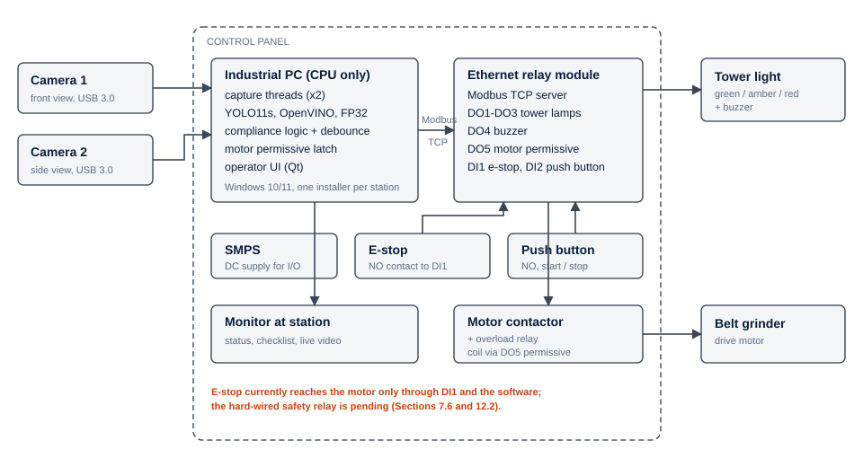
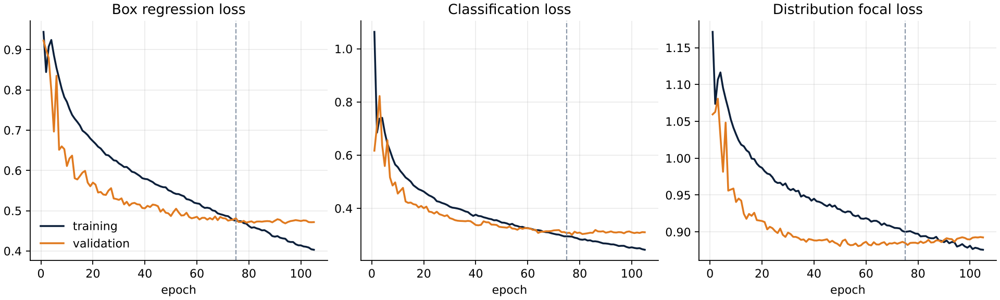
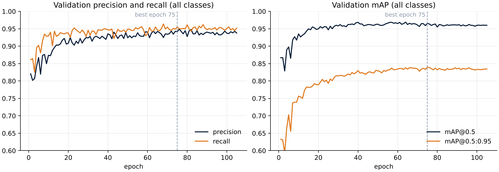
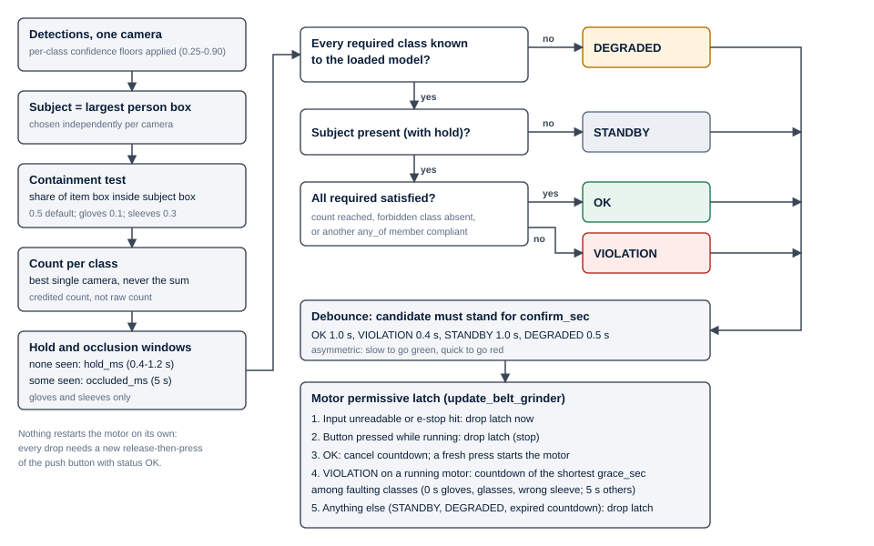
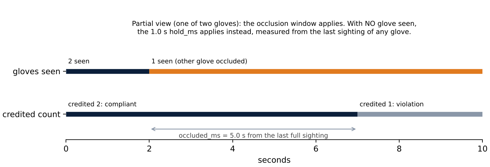
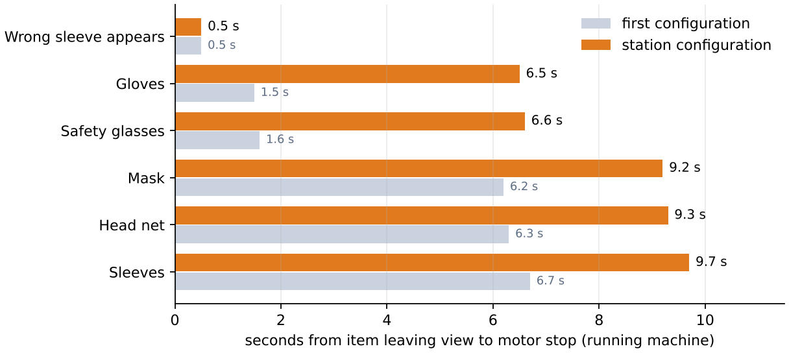
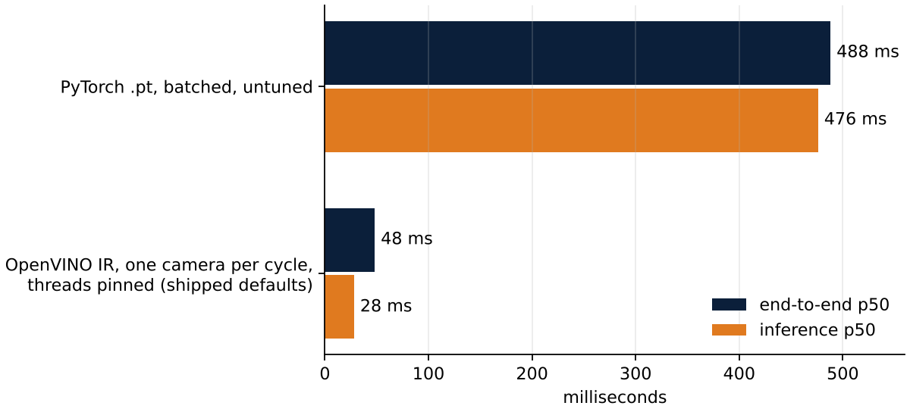

# Vision Guard: A Vision-Based PPE Compliance Interlock for Flat Belt Grinding

**Internship Report**

| | |
| --- | --- |
| Author | Arun Nair |
| Matriculation number | [matriculation number] |
| Programme | M.Sc. Robotic Systems, RWTH Aachen University |
| Prior degree | B.E. Mechanical Engineering, Savitribai Phule Pune University, 2019 |
| Host organisation | GE Aerospace |
| Site | Pune, India |
| Internship period | [start date] to [end date] |
| Industrial supervisor | [name, designation] |
| Academic supervisor | [name, chair] |
| Submitted as | Mandatory industrial internship |

**Submission statement.** This report is submitted to RWTH Aachen University in partial
fulfilment of the mandatory industrial internship of the M.Sc. Robotic Systems programme. It
describes work I carried out at GE Aerospace, Pune, India, during the period stated above.

**Confidentiality statement.** This report describes a safety system installed on a production
aerospace shopfloor. It has been prepared for academic assessment only and must not be
reproduced or distributed beyond the examiners without the written consent of the host
organisation. Part numbers, part geometry, production volumes, cycle times, supplier names,
commercial terms, network addresses, hostnames, credentials and the names of employees have
been excluded throughout. Code listings have been redacted where necessary and each redaction
is marked `[REDACTED]`. No image in this report shows a component, a drawing or an
identifiable person.

**Declaration on the use of AI tools.** [To be completed by the author in the form required by
the chair and the examination regulations. Parts of the station software were developed with an
AI coding assistant, as recorded in the repository's commit history, and this report was drafted
with AI assistance from the author's project record and the repository.]

**Note on configuration.** This draft describes the first configuration of the station. The
station has since been retuned, with one glove and one sleeve required, 5–8 s correction windows
and an apron-retrained model. The RWTH version of the report (`internship-report.md`) is current.

**A note on naming.** Ultralytics, the publisher of the detector family used in this work,
names it **YOLO11**. My project notes and parts of the source repository write *YOLOv11*. This
report uses YOLO11 throughout; the two names refer to the same architecture.

---

## Acknowledgements

I am grateful to my industrial supervisor, [name, designation], for entrusting me with a
project that began as an observation on the shopfloor rather than a prepared brief, and for
the latitude to carry it from first prototype to a plant-wide rollout decision. I thank
[name, designation of subject matter expert(s)] for the time they gave to explaining the
grinding and welding operations, and for their candour about what the shopfloor would and
would not accept.

The Environment, Health and Safety team reviewed the system through the Management of Change
process and helped me see it as a control within a wider safety system rather than as a
standalone device; their questions shaped the fail-safe analysis in Chapter 7. The maintenance
department carried out the electrical commissioning, the installation and the later relocation
of the station, and their practical knowledge of the machines saved me from more than one
error. The IT department evaluated the industrial PC against the site's standard configuration
and supported the software deployment.

I owe a particular debt to the operators of the flat belt grinding stations. They tolerated a
camera system watching them work, told me plainly when it stopped them for no reason, and
showed me how the operation is actually performed. The most consequential finding of this
project (Section 9.5) came from them.

Finally, I thank my academic supervisor, [name, chair], for supervising this internship on
behalf of RWTH Aachen University.

---

## Table of contents

- [Abstract](#abstract)
- [1. Introduction](#1-introduction)
  - [1.1 Industrial motivation](#11-industrial-motivation)
  - [1.2 Host organisation](#12-host-organisation)
  - [1.3 Scope of this internship](#13-scope-of-this-internship)
    - [1.3.1 Primary assignment: Vision Guard](#131-primary-assignment-vision-guard)
    - [1.3.2 Secondary assignments](#132-secondary-assignments)
  - [1.4 Objective](#14-objective)
  - [1.5 Structure of this report](#15-structure-of-this-report)
- [2. Technical background](#2-technical-background)
  - [2.1 PPE compliance as a decision rather than a detection](#21-ppe-compliance-as-a-decision-rather-than-a-detection)
  - [2.2 Single-stage object detection and the YOLO family](#22-single-stage-object-detection-and-the-yolo-family)
  - [2.3 Inference runtimes and CPU-only deployment](#23-inference-runtimes-and-cpu-only-deployment)
  - [2.4 Evaluation metrics](#24-evaluation-metrics)
  - [2.5 Error asymmetry in a safety interlock](#25-error-asymmetry-in-a-safety-interlock)
  - [2.6 Interlocks and Modbus TCP](#26-interlocks-and-modbus-tcp)
- [3. System overview](#3-system-overview)
  - [3.1 High-level architecture](#31-high-level-architecture)
  - [3.2 Hardware](#32-hardware)
  - [3.3 Software environment](#33-software-environment)
  - [3.4 Data flow through one cycle](#34-data-flow-through-one-cycle)
- [4. Dataset development](#4-dataset-development)
  - [4.1 Class schema](#41-class-schema)
  - [4.2 Capture strategy and the case for site-specific data](#42-capture-strategy-and-the-case-for-site-specific-data)
  - [4.3 Annotation workflow and the local auto-annotation tool](#43-annotation-workflow-and-the-local-auto-annotation-tool)
  - [4.4 Failure-mode-driven expansion](#44-failure-mode-driven-expansion)
  - [4.5 The compliance-state annotation question](#45-the-compliance-state-annotation-question)
  - [4.6 In-operation capture mode](#46-in-operation-capture-mode)
  - [4.7 Dataset composition](#47-dataset-composition)
- [5. Model training and selection](#5-model-training-and-selection)
  - [5.1 Training configuration](#51-training-configuration)
  - [5.2 Training hardware](#52-training-hardware)
  - [5.3 Convergence behaviour](#53-convergence-behaviour)
  - [5.4 Per-class performance](#54-per-class-performance)
  - [5.5 Model comparison and selection](#55-model-comparison-and-selection)
- [6. Inference pipeline implementation](#6-inference-pipeline-implementation)
  - [6.1 Pipeline architecture](#61-pipeline-architecture)
  - [6.2 Threading model](#62-threading-model)
  - [6.3 Camera scheduling](#63-camera-scheduling)
  - [6.4 Preprocessing: letterboxing and coordinate rescaling](#64-preprocessing-letterboxing-and-coordinate-rescaling)
  - [6.5 The USB bandwidth constraint and the resolution trade-off](#65-the-usb-bandwidth-constraint-and-the-resolution-trade-off)
  - [6.6 Compressed transport: the MSMF/MJPEG investigation and its rejection on deployment grounds](#66-compressed-transport-the-msmfmjpeg-investigation-and-its-rejection-on-deployment-grounds)
  - [6.7 Runtime migration to OpenVINO](#67-runtime-migration-to-openvino)
- [7. Compliance logic and interlock control](#7-compliance-logic-and-interlock-control)
  - [7.1 From detections to a compliance verdict](#71-from-detections-to-a-compliance-verdict)
  - [7.2 Operator isolation: the largest-bounding-box filter](#72-operator-isolation-the-largest-bounding-box-filter)
  - [7.3 Temporal stability: the debounce and hold-timer trade-off](#73-temporal-stability-the-debounce-and-hold-timer-trade-off)
  - [7.4 Warning before inhibition: the grace timer as a deliberate safety trade-off](#74-warning-before-inhibition-the-grace-timer-as-a-deliberate-safety-trade-off)
  - [7.5 Relay output mapping](#75-relay-output-mapping)
  - [7.6 Failure behaviour](#76-failure-behaviour)
- [8. Deployment and commissioning](#8-deployment-and-commissioning)
  - [8.1 Hardware specification and procurement](#81-hardware-specification-and-procurement)
  - [8.2 Electrical commissioning](#82-electrical-commissioning)
  - [8.3 Installation](#83-installation)
  - [8.4 Relocation and what it exposed](#84-relocation-and-what-it-exposed)
  - [8.5 Safety approval: Management of Change and the EHS risk assessment](#85-safety-approval-management-of-change-and-the-ehs-risk-assessment)
  - [8.6 Operator documentation](#86-operator-documentation)
  - [8.7 Demonstration and management review](#87-demonstration-and-management-review)
- [9. Results and discussion](#9-results-and-discussion)
  - [9.1 Latency](#91-latency)
  - [9.2 Detection performance](#92-detection-performance)
  - [9.3 Qualitative performance](#93-qualitative-performance)
  - [9.4 Residual failure modes](#94-residual-failure-modes)
  - [9.5 Operator feedback and the requirements finding](#95-operator-feedback-and-the-requirements-finding)
  - [9.6 Discussion: what the results mean for the interlock function](#96-discussion-what-the-results-mean-for-the-interlock-function)
- [10. Plant-wide rollout](#10-plant-wide-rollout)
  - [10.1 The rollout decision](#101-the-rollout-decision)
  - [10.2 Specification package: RFQ, BOQ and SOW](#102-specification-package-rfq-boq-and-sow)
  - [10.3 Site survey and why it was necessary](#103-site-survey-and-why-it-was-necessary)
  - [10.4 Industrial camera selection](#104-industrial-camera-selection)
  - [10.5 Standardisation: what is common across stations and what is station-specific](#105-standardisation-what-is-common-across-stations-and-what-is-station-specific)
- [11. Secondary assignments](#11-secondary-assignments)
  - [11.1 Shopfloor familiarisation](#111-shopfloor-familiarisation)
  - [11.2 Droplet transfer frequency measurement](#112-droplet-transfer-frequency-measurement)
  - [11.3 Automated trimming cell and laser profile cutting](#113-automated-trimming-cell-and-laser-profile-cutting)
  - [11.4 Aerospace welding automation roadmap](#114-aerospace-welding-automation-roadmap)
- [12. Conclusions and future scope](#12-conclusions-and-future-scope)
  - [12.1 What was delivered](#121-what-was-delivered)
  - [12.2 Open technical items](#122-open-technical-items)
  - [12.3 Future scope](#123-future-scope)
- [13. Internship experience](#13-internship-experience)
- [References](#references)
- [Appendix A — Code listings](#appendix-a--code-listings)
  - [A.1 The compliance decision](#a1-the-compliance-decision)
  - [A.2 The Modbus write](#a2-the-modbus-write)
  - [A.3 The thread set-up](#a3-the-thread-set-up)
  - [A.4 The camera scheduler](#a4-the-camera-scheduler)
  - [A.5 The letterbox function](#a5-the-letterbox-function)
  - [A.6 Verification of two failure paths](#a6-verification-of-two-failure-paths)
- [Appendix B — Configuration](#appendix-b--configuration)
  - [B.1 Station configuration (`config.yaml`), compliance and interlock sections](#b1-station-configuration-configyaml-compliance-and-interlock-sections)
  - [B.2 Training hyperparameters](#b2-training-hyperparameters)
- [Appendix C — Reconciliation of the project record against the code](#appendix-c--reconciliation-of-the-project-record-against-the-code)

---

## List of figures

This report is a Markdown document and has no fixed pagination; each entry links to the section that contains the figure. Entries marked [Required] are placeholders for figures still to be produced.

| No. | Caption | Section |
| --- | --- | --- |
| Figure 1 | System architecture: two cameras feed the industrial PC, which drives the tower light, buzzer and motor permissive through an Ethernet relay module over Modbus TCP and reads the e-stop and push button through the same module | [3.1](#31-high-level-architecture) |
| Figure 2 | [Required] screenshot of the operator interface in operator mode showing the status headline, the PPE checklist and both camera views | [3.4](#34-data-flow-through-one-cycle) |
| Figure 3 | [Required] annotation workflow diagram | [4.3](#43-annotation-workflow-and-the-local-auto-annotation-tool) |
| Figure 4 | Training and validation losses over 105 epochs: box regression, classification and distribution focal loss | [5.3](#53-convergence-behaviour) |
| Figure 5 | Validation precision, recall, mAP@0.5 and mAP@0.5:0.95 over 105 epochs, all classes | [5.3](#53-convergence-behaviour) |
| Figure 6 | [Required] normalised confusion matrix from the validation run, with rows and columns for all seven classes and background | [5.4](#54-per-class-performance) |
| Figure 7 | Thread structure and data flow | [6.1](#61-pipeline-architecture) |
| Figure 8 | Decision flow from one camera's detections to the motor permissive | [7.1](#71-from-detections-to-a-compliance-verdict) |
| Figure 9 | The two windows for a pair of gloves | [7.3](#73-temporal-stability-the-debounce-and-hold-timer-trade-off) |
| Figure 10 | Time from an item leaving view to the motor permissive being withdrawn, shipped configuration | [7.4](#74-warning-before-inhibition-the-grace-timer-as-a-deliberate-safety-trade-off) |
| Figure 11 | [Required] photograph or 3D model view of the installed station showing the control panel, tower light, camera stands and monitor | [8.3](#83-installation) |
| Figure 12 | End-to-end and inference latency (median) before and after the CPU optimisation, 4-core development host, two 30 fps sources | [9.1](#91-latency) |
| Figure 13 | [Required] three-panel examples of correct operation | [9.3](#93-qualitative-performance) |
| Figure 14 | [Required] three-panel examples of failure cases | [9.3](#93-qualitative-performance) |

---

## List of tables

Each entry links to the section that contains the table.

| No. | Caption | Section |
| --- | --- | --- |
| Table 1 | The two error directions of the PPE interlock and their consequences | [2.5](#25-error-asymmetry-in-a-safety-interlock) |
| Table 2 | Hardware items and their functions | [3.2](#32-hardware) |
| Table 3 | Software environment | [3.3](#33-software-environment) |
| Table 4 | Class schema of the deployed model and the role of each class in the compliance decision | [4.1](#41-class-schema) |
| Table 5 | Failure modes targeted by dataset expansion, classified by type | [4.4](#44-failure-mode-driven-expansion) |
| Table 6 | Dataset composition (to be completed from the dataset definition and label files) | [4.7](#47-dataset-composition) |
| Table 7 | Training configuration of the deployed model, as recorded in the checkpoint | [5.1](#51-training-configuration) |
| Table 8 | Validation metrics of the deployed model at its best epoch (75), all classes | [5.4](#54-per-class-performance) |
| Table 9 | Per-class validation metrics (to be completed from a validation run) | [5.4](#54-per-class-performance) |
| Table 10 | Model and runtime configurations evaluated, with end-to-end latency on the station hardware | [5.5](#55-model-comparison-and-selection) |
| Table 11 | Threads as implemented | [6.2](#62-threading-model) |
| Table 12 | One camera per cycle against both cameras per call, OpenVINO at 640 × 640, 4-core development host | [6.3](#63-camera-scheduling) |
| Table 13 | Capture configuration before and after the change | [6.5](#65-the-usb-bandwidth-constraint-and-the-resolution-trade-off) |
| Table 14 | OpenVINO export settings of the deployed model | [6.7](#67-runtime-migration-to-openvino) |
| Table 15 | Confirmation periods per status | [7.3](#73-temporal-stability-the-debounce-and-hold-timer-trade-off) |
| Table 16 | Per-class thresholds and time windows of the shipped configuration (`config.yaml:94-124`), with the resulting dropout tolerance and removal time | [7.3](#73-temporal-stability-the-debounce-and-hold-timer-trade-off) |
| Table 17 | Glove dropout hold remaining after a period of partial view, before the fix (configured hold 1.0 s) | [7.3](#73-temporal-stability-the-debounce-and-hold-timer-trade-off) |
| Table 18 | Modbus map of the relay module | [7.5](#75-relay-output-mapping) |
| Table 19 | Fail-safe analysis of the implemented system | [7.6](#76-failure-behaviour) |
| Table 20 | Latency before and after the CPU optimisation | [9.1](#91-latency) |
| Table 21 | Stage breakdown of end-to-end latency, untuned PyTorch on a CPU, 58 cycles | [9.1](#91-latency) |
| Table 22 | Residual failure modes of the deployed system | [9.4](#94-residual-failure-modes) |
| Table 23 | Common and station-specific elements of the rollout | [10.5](#105-standardisation-what-is-common-across-stations-and-what-is-station-specific) |
| Table 24 | Open technical items | [12.2](#122-open-technical-items) |
| Table 25 | Discrepancies between the project record and the source code | [Appendix](#appendix-c--reconciliation-of-the-project-record-against-the-code) |

---

## Abstract

I designed, built and commissioned **Vision Guard**, a camera-based interlock that converts
personal protective equipment (PPE) compliance at a flat belt grinding station from an
administrative control into an engineering control. Two cameras observe the operator; an
industrial PC without a discrete GPU runs a YOLO11s object detector, compiled with OpenVINO, and
decides whether the operator is wearing the required equipment; an Ethernet relay module,
addressed over Modbus TCP, drives a tower light and buzzer and grants or withholds the run
permissive of the grinder motor.

Migrating inference from PyTorch to OpenVINO on the CPU was the decisive engineering result.
End-to-end latency, measured from the camera grab to the relay write, fell from 300–400 ms to
approximately 40 ms on the station hardware. A controlled benchmark on a 4-core development
host reproduced the effect: median end-to-end latency fell from 488 ms to 48 ms, of which a
5.2-fold reduction in per-call inference time was the largest single contribution. A smaller
nano variant of the model was unexpectedly slower and was not adopted; a transformer detector
(RF-DETR) was accurate but required approximately 1500 ms per frame and was rejected on latency.

The deployed model detects seven classes, including the subject person and an explicit
non-compliant *Wrong Sleeve* class, and reached a precision of 0.942, a recall of 0.955, an
mAP@0.5 of 0.966 and an mAP@0.5:0.95 of 0.840 on its validation set. The compliance logic around
it isolates the operator as the largest person in view, credits equipment only where it lies
on that person, bridges detection dropouts and partial occlusions with separate per-class
windows, and confirms a status change only after it has persisted for a period that is
deliberately asymmetric: slow to declare compliance, quick to raise an alarm. A correction
window allows an operator to restore a slipped item of low-hazard PPE without the machine
stopping; it is suppressed for gloves, safety glasses and the wrong-sleeve condition.

The system was taken through the site's Management of Change process twice, installed,
relocated, demonstrated to site and corporate leadership, and approved for deployment across
all flat belt grinders at the plant. The most consequential finding was not a model result:
operators habitually stand at an angle to the machine to inspect their work, outside the
viewing geometry the cameras were placed for. This is a requirements failure rather than a
detection failure, and it changed how camera placement must be specified across the rollout.

The report also records, from a reconciliation of the source code against the project record,
where the implementation departs from what was intended. Three of these bear directly on
safety: the emergency stop currently reaches the motor only through the relay module and the
software, pending a hard-wired safety relay; a single frozen camera can leave its last
detections in force; and an exception during inference leaves the relay outputs in their last
state. Each is analysed in Section 7.6 and listed with a remedy in Section 12.2.

## 1. Introduction

### 1.1 Industrial motivation

Flat belt grinding is a manual finishing operation, and its hazards reach the operator through
exactly the parts of the body that PPE is meant to cover. The operator holds a component by hand
and presents it against a moving abrasive belt. The process throws off abrasive dust and
sparks, and the belt itself can abrade or burn a hand or forearm that touches it. The station's
required PPE responds to each hazard in turn: safety glasses against sparks and particles,
gloves and sleeves against contact with the belt and hot material, and a mask against dust. The
deployed system also checks a head net, which the site requires at the station (Section 4.1).
Operators additionally want to wear an apron against grinding dust; at the time of writing the
model cannot yet detect one (Section 4.1).

Before this project, PPE compliance at the station was assured by training, signage and
supervision. In the hierarchy of controls, which orders risk reduction measures from
elimination and substitution, through engineering controls, to administrative controls and
finally PPE itself, all three of these sit on the administrative tier. They share a structural
weakness: each depends on a person's decision at the moment of use. Training relies on the
operator recalling it; signage relies on the operator reading it; supervision relies on a
supervisor being present at the moment an operator decides that a glove is not needed for one
short job. None of them acts on the machine. When the decision goes the wrong way, the grinder
runs regardless.

Vision Guard moves the control up one tier. It detects the absence of PPE from camera images
and inhibits the machine, so that compliance no longer depends on a decision being made
correctly every time. This does not make PPE itself any more effective, and it does not replace
the guarding, extraction and emergency stop that already protect the operator. It closes the gap
between the rule that PPE must be worn and the fact of the machine running.

That gap matters in a particular way at a grinding station. The operations are short and
repetitive, and a missing glove is rarely the result of a deliberate choice to work unprotected.
It is the result of a glove taken off to handle paperwork and not put back, or of a quick job
that did not seem to warrant the full set. These are exactly the lapses that administrative
controls handle worst, because each one feels too small to need a rule and a supervisor is never
present for all of them.

### 1.2 Host organisation

GE Aerospace designs and manufactures commercial and military aircraft engines, components and
systems. It has operated as a standalone, publicly listed company since April 2024, following
the separation of the former General Electric conglomerate into independent businesses.

[Site-specific description of the Pune facility: its role within GE Aerospace, the products and
processes carried out there, the department in which the internship was carried out, and its
reporting line. To be written and verified by the author.]

### 1.3 Scope of this internship

#### 1.3.1 Primary assignment: Vision Guard

The primary assignment did not exist when the internship began. In the first two weeks I
carried out a systematic study of the shopfloor. It covered material flow, the process
sequence, weld preparation, manual welding and observation of the robotic TIG welding cell,
and I discussed each with the welders, operators and engineers who worked there. The flat belt
grinding station emerged from that study as a candidate for an engineering control. The project
therefore came from observation, not from a prepared brief, and that origin shaped how it was
run: requirements were drawn from the operation as it is performed, and when the system
disagreed with the operators, the operation was observed again (Section 9.5).

The assignment grew to cover the full life of a safety-related system:

- the dataset, model and inference pipeline;
- the compliance logic and the interlock;
- hardware selection and electrical commissioning;
- safety approval through the site's Management of Change process;
- installation, relocation and operator documentation;
- the specification package for a plant-wide rollout.

#### 1.3.2 Secondary assignments

Alongside Vision Guard I contributed to three other activities in the site's welding
operations:

- a study of how droplet transfer frequency could be measured in the robotic TIG welding cell;
- support for an automated tube trimming cell, including a vendor meeting on robotic laser
  profile cutting;
- preparation of the site's aerospace welding automation roadmap for 2026–2030.

These are described in Chapter 11.

### 1.4 Objective

The objective of the primary assignment was to deliver a system that withholds the run
permissive of a flat belt grinder unless the operator at the machine is wearing the required
PPE, and that does so quickly enough, and steadily enough, to be accepted by the people who work
at it. Each part of that statement carries a requirement:

- **Withholds the run permissive.** The system acts on the machine. A display or an alarm
  alone would have been another administrative control.
- **The operator at the machine.** Only the person working the grinder is judged.
  Bystanders and passers-by in the camera view are not.
- **Quickly enough.** Response time was raised explicitly by senior management at the first
  demonstration (Section 8.7). It bounds both the inference budget and the debounce periods.
- **Steadily enough.** An interlock that chatters is unusable on a machine against which an
  operator is holding a workpiece, and a station that stops people for no reason is one they
  learn to work around.

The objective carries no target accuracy figure, and the omission is deliberate. As Section 2.5
argues, a single accuracy figure cannot describe an interlock, because its two error directions
have different consequences.

### 1.5 Structure of this report

The report is organised by subsystem rather than chronologically:

- **Chapter 2** sets out the technical background. It treats PPE compliance as a decision
  rather than a detection, and defines the metrics and error directions used later.
- **Chapter 3** gives an overview of the system as built.
- **Chapters 4 and 5** cover the dataset, and the training and selection of the model.
- **Chapter 6** describes the inference pipeline.
- **Chapter 7** covers the compliance logic and the interlock, including a fail-safe analysis
  of the code as implemented.
- **Chapter 8** describes deployment, commissioning and safety approval.
- **Chapter 9** presents the results, including the operator feedback finding.
- **Chapter 10** covers the plant-wide rollout.
- **Chapter 11** describes the secondary assignments.
- **Chapter 12** concludes and sets out future scope.
- **Chapter 13** reflects on the internship.

Where the source code departs from the project record, the departure is stated in the section
concerned and collected in Appendix C. Values taken from the code are cited by file and line in
the form `file:line`, against the version of the repository described in Section 3.3.

---

## 2. Technical background

### 2.1 PPE compliance as a decision rather than a detection

The central idea of this report is that an object detector answers a different question from
the one a PPE interlock must answer. A detector answers *is there a glove in this image, and
where?* An interlock must answer *is this operator, now, protected in the way the site rules
require?* The two questions overlap closely enough that it is easy to treat the first as the
second, and the difference between them accounts for most of the engineering in Chapters 4 and
7.

The gap has three dimensions.

**Ownership.** A glove detected in the frame protects nobody unless it is on the operator's
hand. A detection on a bystander, on a bench or in a passing trolley is correct as a detection
and irrelevant to the decision. The decision therefore needs a notion of *whose* equipment is
being judged. In this system that is the largest person in view, and only items lying on that
person are credited (Section 7.2).

**State.** An item can be present and still not be compliant:

- a glove held in the hand rather than worn;
- prescription spectacles worn in place of safety glasses;
- a sleeve worn in a way that leaves it free to be caught by the belt.

In each case the detector may be entirely correct about the object. What is wrong is the
compliance decision that follows from it. Section 4.4 develops this distinction into two
categories of failure, *detection failures* and *decision failures*, and shows that they call
for different remedies.

**Time.** A single frame is weak evidence either way. A glove can be invisible for a few
hundred milliseconds because the operator's body or the workpiece is in front of it, and it has
not been removed. Equally, a single frame in which all equipment is visible does not establish
that the operator is compliant now. The decision must therefore integrate evidence over time,
and the way it does so determines both how quickly the machine responds and how often it stops
a compliant operator (Section 7.3).

A model's validation metrics measure only the detection question. They are necessary but not
sufficient. A model with excellent mAP can drive an interlock that is unusable because it
chatters, or unsafe because it credits a carried glove. Throughout this report I therefore
separate claims about detection, made in Chapter 5 with the metrics of Section 2.4, from claims
about the interlock's decisions, made in Chapters 7 and 9 in the terms of Section 2.5.

Leaving a non-compliant state unannotated has a further, subtler consequence for measurement.
If a carried glove is simply not labelled, the training process treats it as background, which
gives a weak signal that carried gloves should not be detected. But at evaluation time a missed
detection of a worn glove and a correct rejection of a carried glove produce identical output:
no box. The dangerous error direction, crediting a carried glove, then becomes unmeasurable from
the detector's metrics. It can be measured only if the annotation schema represents the
non-compliant state explicitly, or if the decision layer tests the spatial relationship between
the item and the body part it should cover. Section 4.5 records which of these the implemented
system does.

### 2.2 Single-stage object detection and the YOLO family

Object detectors are conventionally divided into two-stage and single-stage designs:

- **Two-stage detectors** first propose candidate regions, then classify and refine each one.
- **Single-stage detectors** predict class probabilities and bounding boxes directly from a
  dense grid of locations in one pass of the network.

YOLO ("You Only Look Once") introduced the single-stage formulation for real-time detection
[1]: the image is divided into a grid, and each cell predicts boxes and class scores, so that the
whole image is processed by a single network evaluation. Successive versions have changed the
backbone, the neck that fuses features across scales, the assignment of ground truth to
predictions, and the loss functions, but they keep the property that matters here: inference
cost is fixed and predictable, and it is dominated by one forward pass.

YOLO11 [2] is the Ultralytics release used in this work. The configuration recorded in the
deployed checkpoint has three parts:

- **Backbone:** convolutional blocks built from `C3k2` modules, a spatial pyramid pooling
  layer (`SPPF`), and a `C2PSA` block that adds position-sensitive attention at the lowest
  resolution.
- **Neck:** a feature-pyramid neck that upsamples and concatenates features from three scales.
- **Detection head:** an anchor-free head that predicts at strides 8, 16 and 32.

The family is published in five scales (n, s, m, l, x) that share the architecture and differ in
depth and width multipliers. The deployed model is the *s* (small) scale, with approximately
9.4 million parameters.

Detection transformers take a different approach. DETR [3] formulates detection as direct set
prediction: a transformer decoder attends over image features and emits a fixed number of
object queries, each matched one-to-one to ground truth during training, which removes the need
for non-maximum suppression (NMS). RF-DETR [4] is a recent real-time member of this family and
reports strong accuracy. Two trade-offs between the families matter on a CPU:

- **Compute cost.** Attention over image features costs memory bandwidth and arithmetic that
  grow with the number of tokens. Convolutional detectors have been optimised for CPU inference
  for longer, and their operations map more directly onto the vectorised kernels that CPU
  runtimes provide.
- **Post-processing.** Transformers avoid NMS, but NMS is a negligible part of the cost here
  (Section 9.1).

For a CPU-only deployment with a latency budget of tens of milliseconds, the convolutional
detector is therefore the natural starting point. Section 5.5 tests this against measurement.

### 2.3 Inference runtimes and CPU-only deployment

A trained network is a computational graph plus its weights. A training framework such as
PyTorch executes that graph eagerly, operation by operation, with the flexibility that training
requires: dynamic shapes, autograd bookkeeping and a general-purpose kernel library. Inference
needs none of that flexibility, and an inference runtime trades it for speed. The runtime takes
a fixed graph and compiles it ahead of time for a specific target.

OpenVINO [5] is Intel's inference toolkit for CPUs, integrated GPUs and other accelerators. The
model is first converted into an *intermediate representation* (IR): an XML file describing the
graph and a binary file holding the weights. At load time the runtime compiles the IR for the
target device. The optimisations relevant here are:

- **Graph-level fusion.** Convolution, batch normalisation and activation are folded into
  single kernels. Constant sub-graphs are pre-computed, and layout transformations are removed.
- **Kernel selection.** Kernels are chosen for the instruction set the CPU actually provides,
  for example AVX2, AVX-512 or AMX.
- **Threading.** Work is scheduled through the runtime's own thread pool, so it is not
  interleaved with Python-level overhead.
- **Optional reduced precision.** The weights can be stored as FP16 or quantised to INT8.
  FP16 storage halves the weight memory, and INT8 quantisation can roughly halve compute time
  again, at an accuracy cost that must be checked on representative data.

The deployed IR is a straight conversion of the trained weights at full FP32 precision (Section
6.7). Its speed-up over PyTorch therefore comes from compilation and threading, not from reduced
precision. The point matters again in the discussion of the nano anomaly (Section 5.5).

Running on a CPU also changes how inference interacts with everything else on the machine. Two
camera decoders, the user interface and the model all compete for the same few cores. A large
part of the latency improvement in this project came from stopping them competing (Section 6.2).

### 2.4 Evaluation metrics

Detection quality is reported with the standard metrics of the COCO evaluation protocol [6], as
computed by Ultralytics. For a given class and confidence threshold, a prediction is a **true
positive** (TP) if it overlaps an unmatched ground-truth box of the same class with an
intersection over union of at least a threshold $\tau$. Otherwise it is a **false positive**
(FP). A ground-truth box left unmatched is a **false negative** (FN). Intersection over union
for a predicted box $B_p$ and a ground-truth box $B_g$ is

```math
\mathrm{IoU}(B_p, B_g) = \frac{|B_p \cap B_g|}{|B_p \cup B_g|}.
```

Precision is the fraction of predictions that are correct; recall is the fraction of ground
truth that is found:

```math
P = \frac{TP}{TP + FP}, \qquad R = \frac{TP}{TP + FN}.
```

The F1 score is their harmonic mean, which is high only when both are high:

```math
F_1 = \frac{2PR}{P + R}.
```

Precision and recall trade off against each other through the confidence threshold. Average
precision (AP) summarises the whole trade-off as the area under the precision–recall curve. It
is computed by ranking all predictions by confidence and interpolating precision at each recall
level $r$:

```math
\mathrm{AP} = \int_0^1 p_{\mathrm{interp}}(r)\,\mathrm{d}r, \qquad
p_{\mathrm{interp}}(r) = \max_{\tilde r \ge r} p(\tilde r).
```

The mean average precision is the mean of AP over the $C$ classes. **mAP@0.5** evaluates
matches at $\tau = 0.5$. **mAP@0.5:0.95** averages over ten thresholds from 0.50 to 0.95 in
steps of 0.05, and so rewards precise localisation as well as correct detection:

```math
\mathrm{mAP}_{0.5} = \frac{1}{C}\sum_{c=1}^{C}\mathrm{AP}_c(0.5), \qquad
\mathrm{mAP}_{0.5:0.95} = \frac{1}{10\,C}\sum_{c=1}^{C}\sum_{k=0}^{9}\mathrm{AP}_c(0.5 + 0.05k).
```

Ultralytics selects the best checkpoint by a *fitness* score. In the version used for training,
the recorded fitness equals mAP@0.5:0.95 (Section 5.4).

These metrics are computed per detection on a held-out image set. They are not metrics of the
interlock. The interlock's errors are defined in the next section.

### 2.5 Error asymmetry in a safety interlock

An interlock decides, at every moment, whether the machine may run. Measured against the truth
of whether the operator is correctly protected, that decision can be wrong in two directions,
summarised in Table 1.

**Table 1.** The two error directions of the PPE interlock and their consequences.

| Decision \ truth | Operator correctly protected | Operator not correctly protected |
| --- | --- | --- |
| Machine permitted to run | Correct | **False permit**: machine runs with a hazard present |
| Machine inhibited | **False stop**: unnecessary stop of a compliant operator | Correct |

A **false stop** arises when equipment that is being worn is not detected, which is a *missed
detection* or *false negative* at the detector, or when the operator is not recognised as
present. Its cost is lost production, and with it the operator's trust. A station that stops
compliant operators repeatedly is one that people learn to work around: they reposition the
camera, stand where it cannot see them, or lobby for the system to be switched off. That
erosion of trust is itself a safety cost, deferred.

A **false permit** arises when a missing item is credited as present. That can happen through a
detection on the wrong person, through an object that is detected but not worn (Section 2.1),
or through a tolerance window that outlasts the item's removal. Its cost is the exposure the
system exists to prevent.

The two must not be summarised into a single figure. An accuracy figure weights them equally,
which is wrong in both directions at once. The system can trade one against the other through
its thresholds and time windows: a longer hold window removes false stops and adds false-permit
time, while a higher confidence floor on a forbidden class removes false alarms and admits more
missed violations. Every parameter in Chapter 7 is a position on that trade-off, and each is
reported in those terms, with its cost stated in seconds of false permit or in rate of false
stops.

A note on terminology, since my project notes used the wrong term in places. Equipment that is
worn but not detected, causing an unnecessary stop, is a **false negative** of the detector (a
missed detection). It is not a true negative. A true negative is a correct rejection, such as
no glove detected where there is no glove. This report uses "missed detection" or "false
negative" for the first case throughout.

### 2.6 Interlocks and Modbus TCP

An interlock in the machinery-safety sense is a device that prevents a hazardous machine
function under specified conditions. ISO 12100 [7] places interlocking within the risk-reduction
process, after inherently safe design and alongside guarding and other protective measures. It
also requires the reliability of any safety-related control function to be appropriate to the
risk it reduces. A camera-and-software interlock of the kind described here is better
characterised as a **permissive**: a condition that must be satisfied before the machine may
run, layered on top of, and never in place of, the machine's safety functions. The most
important of those is the emergency stop, which under the applicable standards must act through
hard-wired circuitry, independent of software. Section 7.6 returns to this distinction because
the installed system does not yet fully respect it.

Modbus is an application-layer request/response protocol for industrial devices [8]. A client,
here the industrial PC, issues function codes to a server, here the relay module, against four
data tables:

- **coils:** single-bit outputs that can be read and written;
- **discrete inputs:** single-bit inputs that can only be read;
- **input registers:** 16-bit values that can only be read;
- **holding registers:** 16-bit values that can be read and written.

Modbus TCP carries the same protocol data unit over TCP, by convention on port 502, with a small
header that replaces the serial framing and checksum. Two properties of the protocol bear
directly on the fail-safe analysis:

- **Data addresses are 0-based on the wire.** The first coil is address 0, even though device
  documentation often numbers channels from 1, or uses the legacy reference style in which
  coils begin at 00001 and discrete inputs at 10001. Off-by-one mismatches between the two
  conventions are a classic commissioning fault (Section 8.2).
- **Modbus is stateless and client-driven.** A server holds its outputs in whatever state the
  last write left them until it is told otherwise. Nothing in the protocol obliges it to drop
  its outputs when the client stops talking. Some devices provide a communication watchdog that
  does exactly this, but it is a device feature that must be configured. The protocol does not
  provide it.

The software uses the `pymodbus` library [9] as its Modbus client.

## 3. System overview

### 3.1 High-level architecture

Vision Guard is a closed loop from the operator's appearance to the motor's run permissive, built
from commodity components around a single industrial PC. Figure 1 shows the components and the
signals between them.



The two cameras view the operator from complementary angles, one from the front and one from
the side, and connect to the industrial PC over USB. The PC runs the whole software stack:

- capture from both cameras;
- detection with the YOLO11s model on the CPU;
- the compliance logic that turns detections into a verdict;
- the latch that grants or withdraws the motor permissive;
- the operator interface shown on a monitor at the station.

It communicates with an Ethernet relay module over Modbus TCP. The module's digital outputs
drive the three lamps of the tower light, the buzzer, and the output that permits the grinder
motor contactor to be energised. Its digital inputs read the emergency stop and the start/stop
push button. A control panel houses the relay module, its power supply, the emergency stop, the
push button and the industrial PC. An overload relay protects the motor. The camera stands were
fabricated to measured dimensions.

My project record describes the emergency stop as hard-wired to the machine and independent of
the detection system, with its state additionally reflected in the user interface. **The
repository contradicts this.** The shipped configuration wires the emergency stop as a
normally open contact into discrete input 1 of the relay module (`config.yaml:185`,
`config.yaml:206`). The configuration states that while no safety relay is fitted, this input
is the *only* thing the emergency stop does (`config.yaml:198-205`), and the latch code repeats
the warning (`ppe/tower.py:693-699`). In this arrangement the emergency stop acts through the
relay module and the software rather than independently of them. Section 7.6 analyses the
consequences, and Section 12.2 lists the hard-wired safety relay as an open item.

### 3.2 Hardware

Table 2 lists the hardware items and their functions. Supplier names and model numbers are
withheld under the confidentiality conditions of this report.

**Table 2.** Hardware items and their functions.

| Item | Function | Notes |
| --- | --- | --- |
| Industrial PC | Runs capture, detection, compliance logic, interlock and user interface | CPU only, no discrete GPU; selected after market research and evaluation against the IT standard configuration (Section 8.1) |
| Camera 1 (front) and camera 2 (side) | Observe the operator from complementary angles | Consumer USB webcams in the prototype; industrial cameras specified for the rollout (Section 10.4) |
| Ethernet relay module | Modbus TCP server: digital outputs for lamps, buzzer and motor permissive; digital inputs for e-stop and push button | 8 output channels assumed by the software (`ppe/config.py:152`) |
| Tower light with buzzer | Visible and audible status at the station | Green, amber and red lamps; buzzer as a separate output |
| Emergency stop | Operator-initiated stop | Normally open contact into DI1 (`config.yaml:206`); hard-wired safety relay pending |
| Push button | Start and stop of the grinder | Normally open, momentary; one button for both functions (`config.yaml:176-179`) |
| Switched-mode power supply (SMPS) | DC supply for the relay module and field I/O | In the control panel |
| Overload relay | Motor protection | Installed with the motor contactor |
| Monitor | Operator interface | Status, PPE checklist, live video |
| Camera stands | Mount the cameras at the required positions | Fabricated to measured dimensions |
| Control panel | Houses the relay module, SMPS, e-stop, push button and PC | Supplied by a vendor; wiring verified before installation (Section 8.2) |

### 3.3 Software environment

The software is a single Python application of about 5,800 lines across 21 modules (the
`ppe` package and the entry point `main.py`), with a test suite of 22 test modules. It is held in a Git repository whose final state for this report
is the branch tip at commit `07df7f0`, version 1.0.0 (`ppe/__init__.py:3`). Table 3 lists the
environment. The library versions are those pinned for the Windows installer build
(`packaging/constraints.txt`); `requirements.txt` states the minimum versions the code
requires.

**Table 3.** Software environment.

| Component | Version | Role |
| --- | --- | --- |
| Python | 3.11 (installer build, `.github/workflows/windows-installer.yml:32`); code targets 3.10+ (`pyproject.toml:3`) | Language runtime |
| Ultralytics | 8.3.253 at runtime (`packaging/constraints.txt:11`); the model was trained with 8.4.126 and exported with 8.4.130 | YOLO11 model loading, prediction, export |
| OpenVINO | 2026.4.1 runtime (`packaging/constraints.txt:14`); the IR was produced with 2026.3.1 | CPU inference |
| PyTorch / torchvision | 2.14.1 / 0.29.1 | Required by Ultralytics even when running the OpenVINO model |
| OpenCV | 5.0.0.93 | Camera capture, letterboxing, image encoding |
| NumPy | 2.4.6 | Array handling |
| PySide6 (Qt) | 6.12.0 | Operator interface |
| pymodbus | 3.16.1 | Modbus TCP client |
| pygame | 2.6.1 | Spoken audio prompt |
| PyYAML | 6.0.3 | Configuration file |
| PyInstaller / Inno Setup | 6.22.3 / 6 | Windows executable and installer |
| Operating system | Windows 10/11 x64 on the station PC | |

The runtime is pinned below Ultralytics 8.4 for a stated reason. From 8.4, an OpenVINO export
accepts a batch of two, which would silently change the station from serving one camera per
cycle to serving both per call. That is not the configuration that was validated
(`packaging/constraints.txt:6-10`). The pin creates a version split: the model was trained and
exported with an 8.4 release and is run with an 8.3 release. The shipped tests pass with this
combination, but the split is worth closing deliberately at the next retraining (Section 12.2).

**Launch.** From source, the station is started with `python main.py`, which reads
`config.yaml`. Flags select a headless run, the debug interface, capture mode, a self-test or
supervised operation (`main.py:3-15`). On the station PCs it is installed with a single Windows
installer that writes the program to Program Files and the machine's own configuration and logs
to `%ProgramData%\PPE Station` (`docs/DEPLOYMENT.md:9-14`). Every shortcut, including the
all-users Startup entry, starts the station with `--supervise`. This runs the station as a child
process and restarts it after a crash, with a back-off that doubles from 2 s to a ceiling of
60 s (`ppe/supervise.py:1-20`). The relay module address is the only per-machine setting, and it
is written into the configuration at install time.

### 3.4 Data flow through one cycle

One cycle of the pipeline takes one camera frame from capture to relay output. The stages below
are named after the instrumentation that times them (`ppe/latency.py:22`).

1. **Capture.** Each camera thread reads frames as fast as the camera delivers them and keeps
   only the newest in a one-frame slot, stamped with a sequence number and the time of the grab
   (`ppe/capture.py:151-160`). The grab time is the start of the end-to-end latency
   measurement.
2. **Wait.** The pipeline thread samples both slots and keeps only frames it has not processed
   before. When batching is off, it chooses one camera in turn (`ppe/pipeline.py:221-243`).
3. **Preprocess.** The frame is letterboxed to the 640 × 640 model input, preserving its aspect
   ratio (`ppe/letterbox.py:45-65`).
4. **Inference.** The OpenVINO model runs once on the letterboxed frame, including NMS
   (`ppe/detector.py:208-218`).
5. **Postprocess.** Boxes are mapped back to source-frame pixels, and per-class confidence
   floors are applied (`ppe/detector.py:229-245`).
6. **Logic.** The largest person in the frame is taken as the subject, and equipment not lying
   on them is set aside (`ppe/subject.py:58-94`). The compliance monitor folds the result into
   per-class counts, applies the hold and occlusion windows, evaluates a raw status and
   debounces it (`ppe/tower.py:140-245`).
7. **Relay.** The motor latch reads the e-stop and push-button inputs and sets, keeps or drops
   the permissive. The lamps and buzzer are then written. Only coils whose state has changed
   are sent (`ppe/pipeline.py:282-285`, `ppe/tower.py:557-577`).
8. **Publish.** A result object carrying the status, the per-class rows, the boxes, the latency
   and any running countdown is handed to the user interface through a Qt signal
   (`ppe/pipeline.py:305-337`).

The operator interface draws this result over the live video (Figure 2). In operator mode it
shows:

- a status headline;
- a checklist of the required items, turning green as each is credited;
- a countdown when a correction window is running.

A debug mode adds a decision panel, which shows the raw status, the candidate waiting to be
confirmed and how long it has stood, and a latency display. Debug mode also mutes the audio
prompt so that tuning is not audible (`config.yaml:209-214`).

> **Figure 2.** [Figure required: screenshot of the operator interface in operator mode showing the status headline, the PPE checklist and both camera views. The operator must be absent from the frame, or the image cropped or blurred so that no person is identifiable and no component is visible.]

## 4. Dataset development

### 4.1 Class schema

The deployed model detects seven classes. Five are worn equipment, one is the person who
wears it, and one, *Wrong Sleeve*, is a non-compliant state that the station treats as a
violation whenever it is seen. Table 4 gives the schema as trained, read from the class map
stored in the checkpoint and in the OpenVINO export metadata
(`models/ppe-yolo11s_openvino_model/metadata.yaml:15-22`). It also shows the role each class
plays in the compliance decision, as configured in `config.yaml:94-107`.

**Table 4.** Class schema of the deployed model and the role of each class in the compliance
decision.

| Index | Class name (as trained) | Displayed as | Role in the decision | Required count |
| --- | --- | --- | --- | --- |
| 0 | `Gloves` | Gloves | Must be worn | 2 |
| 1 | `Mask` | Face Mask | Must be worn | 1 |
| 2 | `Safetyglasses` | Safety Glasses | Must be worn | 1 |
| 3 | `Wrong Sleeve` | Wrong Sleeve | Forbidden: detecting it *is* the violation (`expect: absent`) | 0 |
| 4 | `headnet` | Head Net | Must be worn | 1 |
| 5 | `person` | Person in Cell | Subject: identifies whom to judge; not itself required | — |
| 6 | `sleeves` | Sleeves | Must be worn, or an apron instead (`any_of: arms`) | 2 |
| — | `Apron` | Apron | Configured as the alternative to sleeves; **not yet a class of the model** | 1 |

Four points about the schema need stating.

First, the class names are inconsistent in capitalisation and spelling (`Gloves`,
`Safetyglasses`, `headnet`, `sleeves`). This is harmless, because the compliance configuration
refers to classes by their exact trained names, but every name in the configuration must match
character for character. A misspelt name is reported at start-up as a class the model cannot
detect (`ppe/detector.py:93-102`).

Second, the schema includes a **head net**, which my project record does not list among the
required PPE. The configuration makes it a required item (`config.yaml:95`), so the station
withholds the motor permissive from an operator without one. Section 1.1 includes it for that
reason. Its inclusion in the site's PPE requirement for the station should be confirmed against
the station's risk assessment.

Third, the **apron** is configured but not trained. Operators asked to wear an apron against
grinding dust (Section 9.5), and the configuration already treats an apron as an alternative to
a pair of sleeves: either satisfies the arm-protection requirement (`config.yaml:88-93`). The
loaded model has no `Apron` class, so the group is judged on sleeves alone until the model is
retrained (`ppe/tower.py:89-95`). Apron images have been captured and retraining is pending
(Section 12.2). Treating the apron as an *alternative* to sleeves rather than an *addition* is a
risk-assessment decision. The configuration records it as such, and it should be confirmed
before the retrained model is deployed.

Fourth, `Wrong Sleeve` is the one explicit non-compliant state in the schema. The
configuration describes its hazard as "a sleeve that can be caught" (`config.yaml:79-86`), that
is, sleeve wear that leaves loose material free to be drawn in by the belt. Its precise
annotation definition is not recorded in the repository. Section 4.5 discusses what it implies
for the compliance-state question.

### 4.2 Capture strategy and the case for site-specific data

All training images were captured in the shopfloor environment, and no public PPE dataset was
used. Public datasets exist for PPE detection, mostly built around construction-site equipment
such as hard hats and high-visibility vests. They match this station poorly in every respect
that affects detection:

- **Lighting.** The station's lighting is particular to its position on the shopfloor and
  differs from the outdoor and site scenes that public datasets favour.
- **Clutter.** The background behind the operator contains the station's own equipment and
  other personnel at a range of distances.
- **Posture.** Operators lean in towards the belt, turn the workpiece, and bring their hands
  and forearms close to the body and to each other. Large parts of the equipment are hidden
  in these postures.
- **The equipment itself.** The gloves, sleeves, masks, glasses and head nets issued at the
  site have their own colours, materials and shapes. Sleeves in particular are not a class in
  most public datasets.

A model trained on public data would have had to unlearn its training distribution before it
could learn this one. Starting instead from the COCO-pretrained YOLO11s weights (Section 5.1)
and fine-tuning on site data meant that the network's general features came from a large
dataset, while everything specific to the station came from the station.

Images were deliberately captured from varying camera positions rather than from the single
position at which the cameras were first mounted. The intent was robustness to mounting
geometry: a model that has seen each item only from one angle learns that angle as much as the
item. This proved valuable sooner than expected, when management decided to relocate the
installation (Section 8.4).

**Discrepancy with the project record.** The training configuration stored in the checkpoint
records the path of the dataset definition used for training. Its directory names refer to a
commercial cloud dataset and annotation platform, and describe the dataset as exported from
that platform only. My project record states that company data compliance requirements prevent
shopfloor imagery being uploaded to cloud annotation platforms (Section 4.3), and that no public
datasets were used. The directory name may denote no more than the export *format*, which that
platform's tooling popularised and which is widely used offline. It may also mean that some
data originated from, or passed through, that platform. The repository cannot distinguish these
cases, and the dataset definition itself is not in the repository. The provenance of every
image in the training set must be confirmed before this report is submitted (see the
accompanying gap list).

### 4.3 Annotation workflow and the local auto-annotation tool

Annotation was carried out in-house. Company data compliance requirements prevent shopfloor
imagery from being uploaded to cloud annotation platforms. That rules out the hosted labelling
services that make annotation fast, and with them their model-assisted labelling. Annotating
every box by hand would have made each round of dataset expansion slow enough to limit how
often the model could improve.

I therefore built an **auto-annotation tool** that produces candidate labels locally, with
manual correction on top. The current model, or for the first round a model trained on an
initial hand-labelled set, predicts boxes on new images. The predictions are written in the
YOLO label format, and an annotator corrects them rather than drawing every box from nothing.
Correction is several times faster than drawing:

- a correct box needs no work;
- a slightly misplaced box needs one drag;
- only missed objects need to be drawn.

The cost of the approach is a bias towards the model's existing behaviour, because an
annotator who sees a confident box is inclined to accept it. That bias is acceptable only if
the annotator treats every candidate as a proposal. It is most dangerous for exactly the
decision failures of Section 4.4. A model that boxes a carried glove as `Gloves` will pre-label
it so, and an annotator who accepts the box teaches the next model the same error. One remote
day was spent annotating 200 images with this workflow.

The standalone auto-annotation tool is not part of the station repository. The station
software contains a successor to it: the in-operation capture mode (Section 4.6), which writes
the station's own detections as pre-labels beside each captured image. Figure 3 should show the
combined workflow.

> **Figure 3.** [Figure required: annotation workflow diagram — image capture (offline sessions and in-operation capture mode) → local pre-labelling by the current model → manual correction by an annotator → dataset assembly and split → training → export → deployment, with the loop back from deployment to capture. Mark that every step runs on the site network.]

### 4.4 Failure-mode-driven expansion

The dataset grew in rounds, and each round was aimed at failures observed in systematic testing
of the model before it. This is more efficient than collecting more of everything. The model
was already good on the common case, and further examples of a well-lit, front-facing,
fully-equipped operator would have added little. The failure modes collected are listed in
Table 5.

**Table 5.** Failure modes targeted by dataset expansion, classified by type.

| Failure mode observed | Category | What fixes it |
| --- | --- | --- |
| Partially occluded PPE | Detection failure | More annotated examples of occluded items |
| Unusual operator poses and sleeve configurations | Detection failure | More annotated examples of the poses |
| Class confusion between gloves and sleeves | Detection failure | More examples near the boundary between the classes; consistent annotation of where a glove ends and a sleeve begins |
| Missed detections of gloves, safety glasses and mask at the side view, after relocation | Detection failure (geometry-induced) | Examples from the new viewpoint; also camera placement (Section 9.5) |
| Erratic detection of persons in the background | Detection failure, mitigated in the decision layer | More negative examples; operator isolation (Section 7.2) |
| Prescription spectacles worn in place of safety glasses | **Decision failure** | A schema that distinguishes the compliant state from the object, or relational post-processing |
| Gloves held in the hand rather than worn | **Decision failure** | A schema that distinguishes worn from carried, or relational post-processing |

The two categories call for different remedies, and the difference is the subject of this
section.

**Detection failures** are cases where the object is present and the model fails to report it,
reports it as the wrong class, or reports something that is not there. Partially occluded
gloves, unusual poses, the confusion between gloves and sleeves at the wrist, and missed
detections at an unfamiliar viewing angle are all of this kind. The remedy is the classic one:
annotate more examples of the difficult case so that the model's decision boundary moves to
include it. Each round of capture in this project added such examples, and each round was
checked by renewed systematic testing before the next was planned.

**Decision failures** are cases where the object is detected *correctly* and the compliance
decision that follows is wrong. Prescription spectacles are spectacles. A detector that boxes
them as `Safetyglasses` has done what it was trained to do if its training data labelled every
pair of spectacles that way, or if it never saw the difference. A glove held in the hand is a
glove. More examples of the same annotation do not fix either case, because the annotation
itself does not encode the distinction that matters. More data fixes a decision failure only
in two circumstances:

1. **The annotation schema distinguishes the compliant state from the object.** Examples would
   be separate classes for safety glasses and for ordinary spectacles, or for a glove worn on
   the hand and a glove carried. The model can then learn the distinction, and the evaluation
   can measure whether it has.
2. **The decision layer tests the spatial relationship between the item and the body part it
   should cover.** Examples are a glove box that encloses a detected hand or wrist keypoint, or
   a glasses box that sits on the eye line of a detected face. The detector can then remain
   ignorant of state, and the relationship carries the distinction.

The third option, leaving the non-compliant case unannotated, does supply a weak training
signal. An unlabelled carried glove is treated as background, so the model is penalised for
boxing it. But the signal is weak, because the carried glove looks almost exactly like a
labelled worn glove, and the model is far more often rewarded for boxing gloves than penalised.
More seriously, as Section 2.1 noted, the option leaves the dangerous error direction
unmeasurable: a missed detection of a worn glove and a correct rejection of a carried glove
both produce no box, so the validation metrics cannot distinguish improvement from regression in
the case that matters most.

Background persons are a hybrid case. The model detects them correctly as people, and the
failure was that they influenced the decision. That was addressed in the decision layer by
judging only the largest person (Section 7.2), and additional negative examples reduced the
erratic detections at source.

### 4.5 The compliance-state annotation question

My project record leaves open whether the annotation schema was changed to represent
non-compliant states. The code and the trained model resolve the question, but only partly.

**Sleeves: resolved by an explicit class.** The schema contains `Wrong Sleeve` (index 3), and
the configuration treats it as forbidden: its detection is the violation (`config.yaml:105`,
`ppe/tower.py:60-69`). For sleeves, therefore, the non-compliant state *is* represented
explicitly. Its errors are measurable in the validation metrics, and the decision layer can act
on it. The station gives it the strictest settings in the configuration:

- the highest confidence floor of any class, 0.90, because a false positive is a spurious red
  lamp;
- the shortest hold, 0.4 s, so that a corrected sleeve clears promptly;
- no correction window, so that a detected wrong sleeve stops a running machine immediately
  (Section 7.4).

**Safety glasses and gloves: not resolved.** There is no class for ordinary or prescription
spectacles, and none for a glove that is carried rather than worn. The decision layer has a
relational test, but it relates each item to the *person*, not to the body part. An item is
credited if a sufficient fraction of its box lies inside the subject's box (`ppe/subject.py:23-36`,
`ppe/subject.py:85-93`). The fraction is 0.5 by default, but it is deliberately relaxed to
0.3 for sleeves and **0.1 for gloves** (`config.yaml:99-102`), because gloves and sleeves ride
the ends of outstretched arms and routinely fall partly outside the person box
(`ppe/subject.py:69-74`).

A glove held in the operator's hand lies inside the person box just as a worn one does, so the
containment test credits it. The count requirement of two gloves (`config.yaml:99`) does not
help, because two carried gloves produce two boxes. Prescription spectacles are credited as
safety glasses whenever the model boxes them as such.

The resolution, then, is that the schema change was made for the sleeve hazard and not for the
other two. For glasses and gloves the station relies on presence alone, and the dangerous error
direction (crediting spectacles or a carried glove) is neither prevented by the decision layer
nor measurable from the validation metrics. The relational alternative would need a body-part
detector, such as hand or wrist keypoints from a pose model, and a test of each glove box
against them. It is listed as future work in Section 12.3.

### 4.6 In-operation capture mode

A station that has run for a week has already seen every awkward pose, every change of light
and every near miss on which the model is wrong, and then discarded all of it. The capture mode
added to the station software keeps the frames worth training on while the system is in normal
operation (`ppe/dataset.py:1-27`). It is off by default and is switched on per run with
`--capture` or in the configuration (`config.yaml:234-260`).

Five triggers decide which frames are kept (`config.yaml:247-255`):

- `interval` keeps an ordinary frame every 30 s. Without these frames the dataset would become
  a collection of exceptions.
- `violation` fires when the station calls a violation, whether rightly or wrongly; both are
  worth reviewing.
- `motor_start` fires at the moment an operator is judged compliant enough to start the
  machine. These are clean positives.
- `motor_stop` fires at the moment the machine is taken away.
- `miss` fires when a required item has just gone out of sight. These are the frames on which
  the model actually failed, and the most valuable ones when chasing false stops.

Each trigger fires on the *edge* of its condition, not on every cycle while it stands, so a
violation lasting a minute contributes one frame rather than hundreds of near-identical ones.
Two guards protect the disk: a minimum gap of 2 s between captures and a hard limit of 5,000
images per session (`config.yaml:257-258`).

The output is a YOLO dataset rather than a folder of images: `images/`, `labels/`, a
`data.yaml` with the class list in index order, and a `captures.csv` recording what fired and
when. The labels are the model's own detections at the time of capture, written as pre-labels
so that an annotator corrects rather than draws (`ppe/dataset.py:5-16`). The capture mode
therefore integrates the auto-annotation idea of Section 4.3 into the station itself. Combined
with failure-triggered capture, it closes most of the loop between observing a failure and
having labelled training data for it.

The writing runs on its own thread behind a bounded queue. The station drives a motor, and a
JPEG encode on the cycle that decides whether the machine may run is not a trade worth making,
so a full queue drops the frame and logs the fact rather than delaying the loop
(`ppe/dataset.py:17-21`).

These are photographs of identifiable people at work, written unencrypted to local disk. The
mode warns at start-up, and while it is on the station displays "(recording N)" in every status
(`config.yaml:241-244`). The images it produces fall under the same data handling rules as the
rest of the site's personal data, and, like all training data in this project, they never leave
the site network.

### 4.7 Dataset composition

The composition of the training dataset (image counts, the training, validation and test split,
and per-class instance counts) cannot be recovered from the repository. The checkpoint records
the path of the dataset definition file used for training, but neither that file nor the
dataset is in the repository, and the checkpoint stores no image or instance counts. Table 6 is
therefore left for the author to complete from the training machine.

**Table 6.** Dataset composition (to be completed from the dataset definition and label files).

| Split | Images | Gloves | Mask | Safetyglasses | Wrong Sleeve | headnet | person | sleeves |
| --- | --- | --- | --- | --- | --- | --- | --- | --- |
| Training | [count] | [count] | [count] | [count] | [count] | [count] | [count] | [count] |
| Validation | [count] | [count] | [count] | [count] | [count] | [count] | [count] | [count] |
| Test | [count, or "none"] | | | | | | | |
| **Total** | [count] | | | | | | | |

Two facts about the composition can be established from the training record. Validation was run
on a split named `val` (the checkpoint's `split` setting). Each training epoch took on average
68 s on the training GPU at a batch size of 16 (Section 5.2). That figure cannot be converted
into an image count without knowing the GPU's throughput, and it is not used to estimate one
here.

## 5. Model training and selection

### 5.1 Training configuration

The deployed model is YOLO11s, fine-tuned from the COCO-pretrained `yolo11s.pt` weights. It was
trained for up to 150 epochs at an input size of 640 × 640, with a batch size of 16 and early
stopping with a patience of 30 epochs. Training stopped at epoch 105, and the best checkpoint
was taken from epoch 75.

The full configuration is recorded inside the checkpoint itself (`models/ppe-yolo11s.pt`,
key `train_args`). I recovered it from there because the training run directory is not in the
repository. Table 7 lists the settings that determine the result. All others are Ultralytics
defaults.

**Table 7.** Training configuration of the deployed model, as recorded in the checkpoint.

| Group | Parameter | Value | Note |
| --- | --- | --- | --- |
| Model | Initial weights | `yolo11s.pt` | COCO-pretrained, transfer learning |
| | Scale | s (depth 0.50, width 0.50) | ≈ 9.4 M parameters |
| | Classes | 7 | Table 4 |
| Schedule | Epochs requested / run | 150 / 105 | Stopped by early stopping |
| | Early-stopping patience | 30 epochs | No improvement in fitness since epoch 75 |
| | Batch size | 16 | Nominal batch for loss scaling 64 |
| | Image size | 640 | Square letterbox (`rect: false`), matching inference |
| Optimiser | Optimiser | `auto` | Resolved by Ultralytics at start of training; choice not recorded |
| | Initial learning rate `lr0` | 0.01 | |
| | Final learning-rate factor `lrf` | 0.01 | Final LR = `lr0 × lrf` at epoch 150 |
| | Schedule | Cosine (`cos_lr: true`) | Over the 150 planned epochs |
| | Momentum / weight decay | 0.937 / 0.0005 | |
| | Warm-up | 3 epochs, momentum 0.8, bias LR 0.0 | |
| Loss gains | Box / classification / DFL | 7.5 / 0.5 / 1.5 | Defaults |
| Augmentation | HSV hue / saturation / value | 0.015 / 0.7 / 0.4 | Colour jitter |
| | Rotation | ±5.0° | Increased from the default of 0 |
| | Translation / scale | 0.1 / 0.5 | |
| | Shear / perspective / vertical flip | 0 / 0 / 0 | Disabled |
| | Horizontal flip | 0.5 | |
| | Mosaic | 1.0 | Scheduled to switch off for the last 10 of the 150 planned epochs |
| | MixUp / CutMix / copy-paste | 0 / 0 / 0 | Disabled |
| | Auto-augment / random erasing | RandAugment / 0.4 | |
| Precision and reproducibility | Mixed precision (AMP) | On | |
| | Seed / deterministic | 0 / on | |
| Validation | Split | `val` | |
| | NMS IoU during validation | 0.7 | |
| | Maximum detections | 300 | |

Two interactions between these settings are worth recording because they are not obvious from
the table.

**The mosaic switch-off never ran.** Ultralytics turns mosaic augmentation off for the final
`close_mosaic` epochs so that the model finishes training on whole, unstitched images resembling
those it will see in operation. The setting counts back from the *planned* 150 epochs, so mosaic
was scheduled to stop at epoch 141. Training stopped at epoch 105, so the deployed model was
trained with mosaic throughout. Whether this cost accuracy on unstitched images is an empirical
question, but it is a free experiment for the next retraining: set `close_mosaic` relative to
the epoch at which training is expected to stop, or train a fixed number of epochs past the
plateau.

**The learning rate never reached its floor.** The cosine schedule likewise runs over 150 epochs.
At epoch 105 the learning rate of the main parameter group was still 0.0022, about a fifth of
`lr0`, against a planned final value of 0.0001. Early stopping therefore cut off the low-LR
refinement phase in which mAP@0.5:0.95 typically gains its last few hundredths. The plateau in
Section 5.3 should be read with that in mind.

The rotation range was raised from the default of 0 to ±5°. Small rotations reproduce the
modest tilt of a camera mounted on a fabricated stand, and the variation between installations.
Vertical flip, shear and perspective were left disabled, because an upside-down operator is not
a case the station will meet.

### 5.2 Training hardware

The checkpoint records training on CUDA device 0, that is, a CUDA-capable discrete GPU, on a Windows
machine, with automatic mixed precision enabled. The GPU model is not recorded. The 105 epochs
took 7,180 s, a little under two hours, an average of 68 s per epoch including validation.
Training was therefore not done on the station's industrial PC, which has no discrete GPU. The
trained weights were exported for CPU inference afterwards (Section 6.7).

The checkpoint was written on 23 August 2026 with Ultralytics 8.4.126.

### 5.3 Convergence behaviour

Figures 4 and 5 show the training record stored in the checkpoint, which is the equivalent of
the `results.csv` that Ultralytics writes to the run directory. The data are reproduced in
`docs/report/data/training-results.csv`.





Three phases are visible.

**Epochs 1–10: rapid adaptation.** The pretrained network was already a strong person and
object detector. After a single epoch it reached a validation mAP@0.5 of 0.867 and an
mAP@0.5:0.95 of 0.633. Most of the first ten epochs were spent adapting the classification
head to the seven site classes: the classification loss on the training set fell from 1.06 to
0.56. The validation losses fluctuate sharply in epochs 2–7. This is typical of the warm-up
period, in which the learning rate rises from near zero to `lr0` and the momentum is ramped.

**Epochs 10–60: steady improvement in localisation.** mAP@0.5 reached 0.96 by about epoch 40 and
then stayed between 0.95 and 0.97. Almost all of the remaining gain came in mAP@0.5:0.95, which
rose from 0.757 at epoch 10 to 0.834 at epoch 60. The model was finding the objects early, and
spent the rest of training placing their boxes more precisely. Precision rose more slowly than
recall throughout. The model was quick to find the items, and slower to stop proposing items
that were not there.

**Epochs 60–105: plateau and the onset of over-fitting.** From about epoch 60 the training losses
kept falling but the validation losses did not:

- validation classification loss reached its minimum at epoch 77;
- validation distribution focal loss reached its minimum at epoch 57, then drifted upwards;
- validation box loss improved only marginally after epoch 75.

The divergence between training and validation loss in Figure 4 is the classic signature of a
model beginning to fit its training set more closely than the task. Fitness, which here is
mAP@0.5:0.95, peaked at 0.840 at epoch 75. Thirty epochs without improvement then triggered
early stopping at epoch 105, and the epoch-75 weights were kept.

For a dataset of site-specific images collected in deliberate rounds, this is a healthy
convergence. It is fast because of the pretrained start, it plateaus, and the stopping rule
caught the onset of over-fitting. It also says something about where further gains will come
from. Validation mAP@0.5 was flat for the last 60 epochs, so more epochs on the same data
would not have helped. Gains will come from more varied data, especially the failure cases of
Table 5, and possibly from the larger model scales or the low-LR phase that early stopping cut
off (Section 5.1).

### 5.4 Per-class performance

At its best epoch the deployed model achieved the validation figures in Table 8, averaged over
all seven classes (checkpoint key `train_metrics`).

**Table 8.** Validation metrics of the deployed model at its best epoch (75), all classes.

| Metric | Value |
| --- | --- |
| Precision | 0.942 |
| Recall | 0.955 |
| F1 (computed from P and R) | 0.949 |
| mAP@0.5 | 0.966 |
| mAP@0.5:0.95 | 0.840 |
| Validation box / classification / DFL loss | 0.481 / 0.307 / 0.885 |

The per-class breakdown cannot be produced from the repository. Ultralytics prints per-class
precision, recall and mAP at the end of training and writes a confusion matrix into the run
directory, but neither is stored in the checkpoint, and the run directory and validation images
are not in the repository. Table 9 and Figure 6 are therefore left for the author to complete by
re-running validation on the training machine:

```bash
yolo detect val model=models/ppe-yolo11s.pt data=<dataset definition> split=val plots=True
```

**Table 9.** Per-class validation metrics (to be completed from a validation run).

| Class | Images | Instances | Precision | Recall | mAP@0.5 | mAP@0.5:0.95 |
| --- | --- | --- | --- | --- | --- | --- |
| Gloves | | | | | | |
| Mask | | | | | | |
| Safetyglasses | | | | | | |
| Wrong Sleeve | | | | | | |
| headnet | | | | | | |
| person | | | | | | |
| sleeves | | | | | | |
| **All** | | | 0.942 | 0.955 | 0.966 | 0.840 |

> **Figure 6.** [Figure required: normalised confusion matrix from the validation run, with rows and columns for all seven classes and background. The Gloves–sleeves cells are the ones to discuss: they quantify the glove–sleeve confusion listed in Table 5.]

When those figures are available, three cells deserve particular attention:

1. **Gloves and sleeves.** The confusion matrix entries between these two classes quantify the
   confusion that motivated a round of data collection (Table 5). A residual confusion matters
   more in one direction than the other. A sleeve detected as a glove inflates the glove count,
   which favours a false permit. A glove detected as a sleeve deflates it, which favours a false
   stop.
2. **Wrong Sleeve recall.** This is the only class whose *recall* bounds the false-permit rate
   directly: a missed wrong sleeve is a permitted hazard. Its confidence floor of 0.90 trades
   recall for precision, and the per-class precision–recall curve shows what that trade costs.
3. **Safetyglasses and Gloves precision on decision-failure images.** As Section 4.5 explains,
   prescription spectacles and carried gloves are invisible to these metrics unless the
   validation set labels them distinctly. A targeted evaluation set is needed to measure them
   (Section 12.3).

### 5.5 Model comparison and selection

Five configurations were evaluated before YOLO11s on OpenVINO was deployed. Table 10 summarises
them; the latencies are as measured on the station hardware.

**Table 10.** Model and runtime configurations evaluated, with end-to-end latency on the station
hardware.

| Stage | Model | Runtime | Latency | Outcome |
| --- | --- | --- | --- | --- |
| Baseline | YOLO11 | PyTorch | 300–400 ms end-to-end; inference 200–300 ms | Superseded |
| Runtime migration | YOLO11 | OpenVINO | ≈ 40 ms end-to-end | Carried forward |
| Smaller variant | YOLO11n | OpenVINO | Slower than the baseline (unexpected; cause not established) | Not adopted |
| Larger variant | YOLO11s | OpenVINO | Within budget | **Deployed** |
| Transformer | RF-DETR | — | ≈ 1500 ms | Rejected on latency; accuracy was good |

**The runtime migration** delivered roughly a tenfold reduction in end-to-end latency, and it
made every later choice possible. Section 6.7 describes it, and Section 9.1 analyses where the
time went.

**The nano anomaly.** YOLO11n has about 2.6 million parameters and needs about 6.5 GFLOPs per
640 × 640 image. YOLO11s has about 9.4 million parameters and needs about 21.5 GFLOPs [2]. On the
same runtime and hardware, the nano model should run roughly two to three times faster. It was
observed to be slower, which is a reversal rather than a shortfall, and its cause was not
established during the internship. Three candidate explanations were considered. They are
presented here as candidates, not conclusions.

1. **Fixed per-inference overhead.** Every call carries costs that do not scale with the model:
   Python-side preprocessing, the runtime's request set-up, memory allocation and NMS. As the
   network shrinks, these become a larger share of the total. This explanation can make nano
   *no faster* than small. It cannot by itself make nano *slower*, because the fixed costs are
   the same for both models.
2. **Graph-level optimisation favouring the larger architecture.** OpenVINO's fusion and kernel
   selection may fit the wider layers of the *s* scale better than the narrow ones of *n*. For
   example, channel counts that are multiples of the CPU's vector width vectorise without
   remainder handling. This could narrow the gap or close it, and it would need a very
   unfavourable case to reverse a threefold difference in arithmetic.
3. **An unintentional precision or configuration mismatch in the export.** If the nano model
   was exported or run differently from the small one, the comparison was not like for like.
   Examples would be an INT8 export on a CPU without the instructions that make INT8 fast, FP16
   weights on a path that converts them at run time, or a different input size, batch size or
   dynamic-shape setting. This is the only one of the three explanations that predicts an
   outright reversal, and for that reason it should be ruled out first.

**What the repository settles.** The deployed *s* export is FP32 throughout:

- all 182 floating-point constant tensors in the IR are of element type `f32`, and there is no
  FP16 compression (`models/ppe-yolo11s_openvino_model/ppe-yolo11s.xml`);
- the 37.8 MB weights file corresponds to 9.4 million parameters at 4 bytes each;
- the export metadata records `quantize: null`, a static shape (`dynamic: false`) and a batch of
  1 (`models/ppe-yolo11s_openvino_model/metadata.yaml:23-28`).

The runtime cannot change that precision either. The configuration's `half: true` is applied
only on CUDA devices and is ignored on a CPU (`config.yaml:13`, `ppe/detector.py:70`). The export
tool in the repository produces FP32 unless `--int8` is given explicitly, and refuses INT8
without a calibration dataset (`ppe/export.py:42-46`, `ppe/export.py:131-137`).

**What the repository does not settle.** The nano export is not in the repository, and nothing
records how it was produced. The precision-mismatch explanation can be neither confirmed nor
ruled out from the code. The deciding experiment is cheap, and is listed in Section 12.2:

1. Export YOLO11n with the repository's own tool, which by construction uses the same settings
   as the deployed model.
2. Time both models with the repository's benchmark tool, `python -m ppe.bench`, which prints
   detection counts beside timings so that a model that is fast because it found nothing is
   obvious.
3. If nano is then faster, as expected, the original measurement was not like for like. If it is
   still slower, explanations 1 and 2 deserve a profiler.

**The selection of YOLO11s** followed from the anomaly as much as from accuracy. The *s* model was
within the latency budget on OpenVINO, it is the larger and more capable of the two, and with
nano not delivering its expected speed advantage there was no reason to accept nano's lower
capacity.

**The RF-DETR rejection.** RF-DETR was evaluated on the station's task, and its detection quality was
good: good enough to show that the deployed model is leaving accuracy unclaimed. Its latency of
about 1500 ms per frame was nevertheless an order of magnitude outside the budget. The
repository records the integration work: a feature branch (`feature/rfdetr-backend`) adds an
RF-DETR backend that implements the same detector interface as the YOLO backend and can be
selected through the configuration, and later runs it from an exported ONNX graph. That branch
was not merged into the deployed code.

The arithmetic of the rejection is short. Closing 1500 ms to the ≈ 40 ms achieved by the
deployed model requires roughly a fortyfold speed-up. The runtime migration that served YOLO11
so well delivered roughly tenfold. It is therefore unlikely that a change of runtime alone would
bring RF-DETR within budget. That is all the more so because its runtime options on this
hardware are narrower: the branch notes that RF-DETR's export targets ONNX rather than a native
OpenVINO IR. Its attention layers also carry an architectural cost on a CPU that a convolutional
detector of similar accuracy does not.

The useful conclusion is not that RF-DETR is unsuitable. RF-DETR's accuracy shows that there is
headroom the deployed model is not reaching on this data. The open question is how to capture
that headroom inside the latency budget, not how to make RF-DETR fast. Section 12.3 lists the
candidate routes: knowledge distillation, a larger YOLO scale at reduced input size, INT8
quantisation calibrated on site data, and targeted data for the failure cases.

## 6. Inference pipeline implementation

### 6.1 Pipeline architecture

The pipeline is organised around one principle: **no stage ever waits for a slower one, and no
stage ever works on stale input.** The cameras deliver at their own rate, inference runs as fast
as it can, and the display repaints at screen rate. Each is decoupled from the others by a
one-frame "latest value" slot rather than a queue. A frame that the detector was too busy to
take is overwritten and dropped, never queued for later. Figure 7 shows the thread structure
as implemented.


A queue would have been the obvious first design, and it is the wrong one for this
application. When inference is slower than capture, a queue fills, and every frame that leaves
it is older than the one before. The longer the system runs, the further its picture of the
operator falls behind reality. For an interlock, the age of the frame on which the decision is
made *is* the response time. A latest-value slot keeps that age bounded by one capture interval
plus one inference, however long the system runs.

### 6.2 Threading model

My project record describes four threads: two camera acquisition threads, one inference thread
that performs letterboxing, inference and the compliance check, and one thread for the user
interface and Modbus communication, so that relay actuation is kept off the critical path. **The
implementation differs in one respect that matters**: the Modbus communication runs on the
inference (pipeline) thread, not on the user-interface thread. Table 11 gives the threads as
implemented.

**Table 11.** Threads as implemented.

| Thread | Code | Work | Hands its output to |
| --- | --- | --- | --- |
| `camera-0`, `camera-1` | `Camera.run` (`ppe/capture.py:130-165`) | Read frames as fast as the camera delivers them; reconnect with back-off if the camera fails | A one-frame slot per camera, protected by a lock (`ppe/capture.py:158-160`) |
| `pipeline` | `Pipeline.run` (`ppe/pipeline.py:158-197`) | Load the model; then loop: select a frame, letterbox, infer, decode, isolate the subject, update compliance, **read the e-stop and push button and write the relay over Modbus**, publish | A `Result`, delivered to the GUI by a Qt signal (`ppe/ui.py:1124-1132`) |
| main (Qt GUI) | `MainWindow` (`ppe/ui.py`) | Repaint the video panes about every 16 ms from the latest frames; apply each `Result`; handle input | The screen |
| `dataset` (capture mode only) | `DatasetRecorder` (`ppe/dataset.py:104`) | Encode JPEGs and write pre-labels | Local disk, behind a bounded queue that drops when full |

The relay write sits on the pipeline thread by design. It is driven by the status that the same
cycle has just computed, and keeping it in the same thread makes the order fixed. The grinder
latch is settled first and the lamps second, so that a green lamp always reflects the
permissive just written (`ppe/pipeline.py:277-285`). It also means the latency measurement
genuinely ends at the relay write: the `relay` stage of every cycle is timed
(`ppe/pipeline.py:295-297`).

The cost is that Modbus I/O *is* on the critical path:

- every cycle reads two discrete inputs, the e-stop and the push button;
- every cycle writes any coils whose state has changed;
- each of these is a network round trip to the relay module.

On a healthy local network a round trip takes a few milliseconds. When the module is
unreachable, each operation waits for the configured timeout of 0.5 s (`config.yaml:134`), and a
reconnection attempt is made every 5 s (`ppe/config.py:151`). In that condition the pipeline
thread stalls for the duration. The latency figures reported for development runs in
Section 9.1 were taken with the relay disabled, and show the `relay` stage at effectively zero.
The cost of Modbus on the station network has not been measured and is listed as an open item.

**Stale-frame handling.** The pipeline never processes the same frame twice. Each frame carries
a per-camera sequence number. The pipeline remembers the last sequence it processed from each
camera and treats a frame as *fresh* only if its sequence differs (`ppe/pipeline.py:168-171`).
If no frame is fresh, the loop sleeps for 1 ms and polls again, rather than re-running
inference on an old image. A camera that has delivered nothing for 1.5 s counts as down
(`ppe/pipeline.py:24`). When *every* camera is down, the station goes to the DEGRADED status,
clears the overlays from the screen and withdraws the motor permissive, re-evaluating every
0.2 s (`ppe/pipeline.py:172-180`, `ppe/pipeline.py:199-219`).

**Threads that do not fight.** On a CPU-only machine, the most effective latency fix in the
pipeline was not in any single thread but in the interaction between them. By default OpenCV
starts a pool of worker threads for each capture thread, and the numerical libraries under the
model start one per core. On a 4-core machine this put a dozen runnable threads in competition
for four cores, and inference ran about three times slower inside the application than in an
isolated benchmark (commit `cc95ab6`). The runtime configuration now pins each capture thread's
OpenCV pool to one thread and gives the model every core (`ppe/runtime.py:31-46`). After that
change, in-application inference time matched the isolated benchmark. A related change paces
each capture thread to its configured frame rate, so that a source that does not pace itself,
such as a video file used in testing, cannot consume a core decoding frames that no one will
use (`ppe/capture.py:133-149`).

### 6.3 Camera scheduling

With batching off, which is the default on a CPU, the pipeline serves **one camera per cycle**.
Batching both frames into one call does not pay on a CPU. Measured on the development host with
the OpenVINO model at 640 × 640:

- a batch of two cost 1.89 times a batch of one;
- with the earlier PyTorch model, the factor was 2.3.

The batch is also only as fast as its slower half, so batching makes each frame wait for the
other's result. Table 12 shows the effect (`README.md:656-664`).

**Table 12.** One camera per cycle against both cameras per call, OpenVINO at 640 × 640, 4-core
development host.

| Mode | Time per call | Update interval per camera | Latency per frame |
| --- | --- | --- | --- |
| Batch of 1, cameras take turns | 64 ms | 129 ms | **64 ms** |
| Batch of 2, both at once | 122 ms | **122 ms** | 122 ms |

Batching wins the per-camera update rate by 6 % and loses latency per frame by 89 %. On a safety
station, latency is the side of that trade that matters. The configuration value
`model.batch: auto` therefore batches on a GPU and takes turns on a CPU (`config.yaml:19-23`).

Taking turns raises the question of which camera goes next. My project record describes the
original scheduler as selecting whichever camera held the freshest frame. That left one camera
consistently underserved, because the marginally faster camera won the comparison repeatedly,
and it was replaced with strict alternation. The repository's history does not contain a
freshest-frame selector: the first version in the repository batched both cameras. What it does
contain is a later, closely related starvation bug in the round-robin that replaced batching,
and its fix. Both are instructive.

The scheduler keeps a cursor, `_turn`, naming the camera whose turn it is. Among the cameras
with a fresh frame, it picks the one nearest the cursor, then moves the cursor past the camera
it served (`ppe/pipeline.py:238-243`):

```python
# ppe/pipeline.py:238-243
if self.detector.batches:
    return fresh
n = len(self.cameras)
chosen = min(fresh, key=lambda f: (f.index - self._turn) % n)
self._turn = (chosen.index + 1) % n
return [chosen]
```

In the first version, a cycle with only one fresh camera returned that frame early, *without
advancing the cursor* (`if self.detector.batches or len(fresh) == 1: return fresh`). The camera
served alone kept its claim on the next contested cycle and ran twice in a row at every
transition. The cost fell on the slower camera, and only when the two cameras were already
uneven, which is the very case the round-robin exists for. Driven with an uneven frame supply,
the faulty scheduler behaved as follows (commit `4396155`):

- a camera fresh on every second cycle was served on only 3 of its 6 opportunities;
- a camera fresh on every fourth cycle was served on 2 of its 4 opportunities.

After the fix, which removed `or len(fresh) == 1` so that a lone frame passes through the same
selection and spends its turn, both were served on every cycle they had a frame for (6 of 6 and
4 of 4). The healthy case, with both cameras fresh, was unchanged at a strict 0-1-0-1
alternation.

The resulting policy is strict alternation when both cameras deliver, which is the normal
case, and service on arrival when only one does. A camera that falls behind is never made to
wait for a turn it has not used, and a camera that delivers faster never gains more than its
alternate share. The general lesson is that the comparison which picks the next item in a
scheduler must not let small, persistent asymmetries between the sources compound. This is the
same lesson that the freshest-frame scheduler taught.

### 6.4 Preprocessing: letterboxing and coordinate rescaling

The model expects a square 640 × 640 input. The cameras deliver 4:3 or 16:9 frames. The frame is
**letterboxed** rather than resized:

1. It is scaled by a single factor until its longer side fits the target.
2. It is centred.
3. The remaining border is padded with the grey value 114 that Ultralytics uses in training
   (`ppe/letterbox.py:16`, `ppe/letterbox.py:45-65`).

For a frame of width $w$ and height $h$ and a target size $S$, the gain and padding are

```math
g = \min\!\left(\frac{S}{h}, \frac{S}{w}\right), \qquad
p_x = \frac{S - \operatorname{round}(g\,w)}{2}, \qquad
p_y = \frac{S - \operatorname{round}(g\,h)}{2}.
```

A box predicted in canvas coordinates $(x', y')$ is mapped back to the source frame by the exact
inverse, and then clipped to the frame (`ppe/letterbox.py:29-42`):

```math
x = \frac{x' - p_x}{g}, \qquad y = \frac{y' - p_y}{g}.
```

The implementation records the padding actually applied after integer rounding, not the
nominal value, so that the inverse is exact to the pixel (`ppe/letterbox.py:62-65`). When
shrinking, it uses area interpolation (`cv2.INTER_AREA`), which averages source pixels rather
than point-sampling them, so that small objects survive the downscale (`ppe/letterbox.py:56-59`).

A direct resize to 640 × 640 would stretch the frame anisotropically: a 640 × 480 frame would be
stretched vertically by a third. The model was trained on letterboxed images (`rect: false`,
Table 7), so a stretched input is out of distribution. That matters here more than in many
applications. Several PPE classes are small relative to the frame, and they are partly
distinguished by shape: a mask against a head net, safety glasses against the eye region, a
glove against the cuff of a sleeve. A stretch changes exactly the aspect ratios that separate
them. The same letterbox transform is used by the user interface to place the video and its
boxes, so that the overlays land on the pixels where the objects were found
(`ppe/letterbox.py:68-77`).

### 6.5 The USB bandwidth constraint and the resolution trade-off

With two cameras streaming at once, the station's capture rate was limited by USB bandwidth,
not by the cameras or the CPU. Uncompressed video is expensive. At 1280 × 720 and 30 frames per
second in the YUY2 format, which uses 2 bytes per pixel, one camera produces about 55 MB/s. That
is more than a single USB 2.0 port sustains, and roughly three times what two cameras can share
on one hub (`ppe/capture.py:97-103`). When the bandwidth is not available, the camera driver does
not report an error. It negotiates a lower frame rate, or delivers nothing at all.

The repository's camera diagnostic, `camcheck --modes`, measures the rate that each requested
mode *actually* delivers. It does not trust what the driver reports. On the deployed consumer
webcams it showed (`README.md:136-142`):

- requesting 640 × 480 delivered 30.0 frames per second;
- requesting 1280 × 720 delivered only 10.0 frames per second;
- in both cases the camera returned the uncompressed format despite the request for compressed
  output.

The capture configuration was changed accordingly, as shown in Table 13.

**Table 13.** Capture configuration before and after the change.

| | Before | After |
| --- | --- | --- |
| Resolution | 1280 × 1080 (project record); 1280 × 720 (measured mode, `README.md:138`) | 640 × 480 |
| Frame rate delivered | 10 fps | 30 fps |
| Frame interval | 100 ms | 33 ms |
| Pixel format on the wire | Uncompressed | Uncompressed |
| Model input | 640 × 640 letterbox | 640 × 640 letterbox |

The change is a threefold improvement in temporal resolution. The compliance check operates on
a frame at most 33 ms old rather than up to 100 ms, before inference time is added. It also cost
no detection accuracy. **Detection accuracy was verified to be unaffected at the reduced
resolution.** This is the expected result once the letterbox is considered. The model sees a
640 × 640 canvas whatever the capture size, so a 1280-pixel-wide frame is scaled down by a
factor of two before inference, and most of its extra detail is discarded. Capturing at 640 × 480
fills the same canvas with almost the same information (480 rather than 360 rows of image, in
fact slightly more), and saves the bandwidth.

**Discrepancy with the repository.** The shipped default configuration does not reflect this
change. It requests 1280 × 720 at 30 fps in the compressed MJPG format for both cameras
(`config.yaml:31-47`), and a comment there argues for MJPG as the default. Each station reads
its own configuration (Section 3.3), so the deployed station may well run 640 × 480 as described.
The repository default would nevertheless reintroduce the problem on a new installation. The
configuration actually in use on the station should be confirmed, and the default changed to
match it before rollout (Section 12.2). The project record gives the original capture size as
1280 × 1080, but the repository's measurements and configuration show 1280 × 720. The latter is
a standard webcam mode and the former is not, so 1280 × 1080 is probably a slip in the notes.

### 6.6 Compressed transport: the MSMF/MJPEG investigation and its rejection on deployment grounds

Compressed transport was the obvious way to relieve the bandwidth limit and keep the higher
resolution. In MJPG mode the camera compresses each frame before sending it, which reduces the
data rate from tens of megabytes per second to a few. The investigation established a working
method, and then rejected it, on grounds that had nothing to do with whether it worked.

On Windows, OpenCV can capture through two backends: DirectShow and Media Foundation (MSMF).
Measured on the deployed cameras at 1280 × 720, with frame rate requested at 30 fps (commit
`827dbf5`):

- **DirectShow** opened quickly but stayed at 10.0 fps whether or not MJPG was requested. It
  accepted the format request and never applied it.
- **MSMF** reached the full 30.0 fps with MJPG requested. The throughput is the evidence that it
  negotiated a compressed stream, even though OpenCV's report of the format under MSMF reads
  back empty.
- **MSMF had a stall.** By default it took minutes to open a camera, a delay indistinguishable
  from a hang. The cause was MSMF's negotiation of hardware transforms, and setting the
  environment variable `OPENCV_VIDEOIO_MSMF_ENABLE_HW_TRANSFORMS=0` removed it.

The variable is where the method failed as a deployment. It had to be present in the process's
environment *before the Python process started*. Testing on the real hardware showed that
setting it from inside the program, even before any camera was opened, did not take effect,
because OpenCV evidently reads it when the library loads (`ppe/capture.py:17-37`, commit
`0676898`). The configuration that worked was therefore a **system-level setting on each host**:
an operating-system environment variable, set before launch, outside the application and its
installer.

For a single station that is a minor inconvenience. For a system intended to be reproducible
across 45 installations it is unacceptable. A fix that has to be applied to each host
individually:

- is a fix that will be missing from some hosts;
- will be lost when a PC is re-imaged by IT;
- will be undone by a policy change nobody connects with the cameras.

When it is missing, the failure is silent: a station that opens its camera after several minutes,
or runs at a third of its intended frame rate. Every one of these failures would surface as a
station behaving differently from its neighbours for no visible reason. **The raw stream was
therefore retained**, at 640 × 480, on USB 3.0 ports that provide sufficient bandwidth for two
uncompressed streams at that size.

This is a rejection of a working technical solution on deployment grounds, and I record it as
such. It cost resolution at the first installation that the MSMF route would have kept. It
saved a per-host modification at every subsequent one, and Section 10.5 shows how that saving
compounds across the rollout.

The repository retains the in-process setting of the variable as a precaution
(`ppe/capture.py:37`). This is harmless, because it never overrides a value already set, but it
is not the validated configuration. The validated configuration is the raw stream at 640 × 480.

### 6.7 Runtime migration to OpenVINO

The trained PyTorch checkpoint was exported to OpenVINO IR with the Ultralytics exporter, wrapped
in the repository's export tool, `python -m ppe.export` (`ppe/export.py`). Two exports are
shipped: a batch-1 export, which the station runs, and a batch-2 export for a batched GPU
configuration. Table 14 lists their settings, as recorded in the export metadata and in the IR
itself.

**Table 14.** OpenVINO export settings of the deployed model.

| Setting | Value | Source |
| --- | --- | --- |
| Source checkpoint | `models/ppe-yolo11s.pt` | `ppe/export.py:56-74` |
| Format | OpenVINO IR (`.xml` graph and `.bin` weights) | `models/ppe-yolo11s_openvino_model/` |
| Input size | 640 × 640, static shape (`dynamic: false`) | `metadata.yaml:12-14`, `:27` |
| Batch | 1 (deployed); 2 (separate `_b2_` export) | `metadata.yaml:11`, `:25` |
| Weight precision | FP32: all 182 floating-point constants are `f32`; no FP16 compression | `ppe-yolo11s.xml` |
| Quantisation | None (`quantize: null`) | `metadata.yaml:24` |
| NMS in graph | No (`nms: false`); NMS applied by Ultralytics after inference | `metadata.yaml:28` |
| Preprocessing recorded in IR | Letterbox, pad value 114, BGR→RGB, scale 1/255 | `ppe-yolo11s.xml`, `rt_info` |
| Exporter versions | Ultralytics 8.4.130; OpenVINO 2026.3.1 | `metadata.yaml:5`; `rt_info` |
| Export dates | 27 August 2026 (batch 1); 31 August 2026 (batch 2) | `metadata.yaml:4` |

The settings at inference time are separate from those of the export. The station runs with a
global confidence floor of 0.35 and per-class floors from 0.25 to 0.90 (Section 7.3), an NMS IoU
threshold of 0.50 and at most 100 detections per image (`config.yaml:14-16`). NMS is run at the
lowest floor any class asks for, and the per-class floors are applied afterwards
(`ppe/detector.py:105-110`). Inference threads default to every core available to the process
(`config.yaml:18`). The IR's own metadata records an IoU of 0.7, the exporter's default, but the
station does not use that value.

The migration preserved detections: on a reference image every box from the OpenVINO model lay
within 1.2 pixels and 0.012 in confidence of the PyTorch output (`README.md:646-649`). The time
per inference call fell from 145 ms to 28 ms, a factor of 5.2. Because the weights were not
reduced in precision, this whole gain came from graph compilation and CPU-specific kernels. INT8
quantisation remains available as a further step. It needs calibration on the site's own images,
since calibrating on someone else's images is how quantisation quietly loses recall, and it was
not deployed because its effect on recall had not been validated (`README.md:720-724`).
Section 9.1 places these figures in the end-to-end latency budget.

## 7. Compliance logic and interlock control

### 7.1 From detections to a compliance verdict

The detector reports boxes. The interlock needs a single answer, *may the machine run?*, that is
stable from one moment to the next and wrong as seldom as possible in either direction. Between
the two sit four transformations, shown in Figure 8:

1. **Ownership.** Isolate the operator and keep only the equipment on them (Section 7.2).
2. **Evidence over time.** Turn a stream of flickering per-frame counts into a credited count
   per class, bridging dropouts and occlusions (Section 7.3).
3. **Verdict.** Compare the credited counts with the site rules to produce a raw status, and
   debounce it into the status the station shows (Section 7.3).
4. **Actuation.** Combine the status with the e-stop and push button into the motor permissive,
   with a correction window for some violations (Section 7.4).



The verdict takes one of four values (`ppe/tower.py:19-23`):

- **OK:** the subject is wearing everything required.
- **VIOLATION:** a required item is missing, or a forbidden one has appeared.
- **STANDBY:** nobody is present to check.
- **DEGRADED:** the station cannot judge, because no camera is delivering or because a required
  class is unknown to the loaded model.

Only OK permits the motor. Every other status withholds it, and only VIOLATION may do so after a
correction window (Section 7.4).

Two design choices recur throughout this chapter.

**Counts are taken from the best single camera, never summed** (`ppe/tower.py:140-158`). Both
cameras watch one operator. If the front camera sees two gloves and the side camera sees the
same two, summing would report four, and would pass an operator with one glove whom both
cameras see. Taking the maximum over cameras means that a side view that can see only one glove
does not veto a front view that sees both. It also means that reaching a count of two requires
one camera to see both items in the same frame.

**Each camera chooses its own subject.** With two views of one cell, a single station-wide
"largest person" would silently discard the other view whenever the two disagreed about who was
nearest (`ppe/pipeline.py:261-268`).

### 7.2 Operator isolation: the largest-bounding-box filter

The station judges one person: **the largest detected person in each camera's view**
(`ppe/subject.py:39-42`). The operator stands at the machine, in the foreground of both
cameras. Everyone else in view, whether a passing colleague, a supervisor or a person at the
next station, is further away and therefore smaller in the image. Area is a cheap and robust
proxy for proximity, and it needs neither a calibrated camera nor depth sensing.

Equipment is credited to the subject only if enough of its box lies inside the subject's box.
The measure is the fraction of the *item's* box inside the person's box, not the intersection
over union (`ppe/subject.py:23-36`):

```math
\mathrm{containment}(B_{\mathrm{item}}, B_{\mathrm{person}}) =
\frac{|B_{\mathrm{item}} \cap B_{\mathrm{person}}|}{|B_{\mathrm{item}}|}.
```

IoU would be the wrong measure, because a glove is a small box inside a large one. A glove
entirely inside the person's box has an IoU of perhaps 0.01, but a containment of 1.0.
Everything not credited, including other people and items on them, is set aside: it is drawn
faintly in the interface but does not count (`ppe/subject.py:84-94`).

The threshold is 0.5 by default and is relaxed per class where the anatomy demands it:

- **sleeves: 0.3;**
- **gloves: 0.1.**

The reason is that gloves and sleeves sit at the ends of outstretched arms, and the person
detector's box routinely stops short of the hands (`config.yaml:99-102`, `ppe/subject.py:69-74`).
A single global threshold loose enough to admit a glove at the end of a reaching arm would also
admit a bystander's mask. Making the threshold per class confines the looseness to the classes
that need it.

The filter has three known limitations:

- **It assumes the operator is the largest person.** A second person standing closer to a
  camera than the operator, for instance leaning in to inspect the work, becomes the subject in
  that camera's view. Because counts are taken from the best camera, the operator's equipment
  can still be credited from the other camera. But the person nearest the camera is judged, not
  necessarily the person at the belt.
- **It is fail-open for the lamp, but not for the motor.** When no person is detected the
  station goes to STANDBY and the tower goes dark, rather than raising an alarm for missing PPE
  on an empty cell. STANDBY nevertheless withholds the motor permissive (Section 7.4), so a
  missed person stops the machine. It cannot permit it.
- **It is the mechanism behind the large-workpiece problem.** An operator who must stand further
  back to handle a large part may leave the frame entirely, so the station sees nobody and
  withholds the permissive (Section 9.5).

### 7.3 Temporal stability: the debounce and hold-timer trade-off

Early shopfloor testing showed substantial frame-to-frame fluctuation in the person bounding
box, and in the PPE detections that depend on it. If the compliance state had followed the
detector directly, the interlock would have chattered: permitting and inhibiting the motor
several times a second as an occluded glove came and went. That is unusable on a machine
against which an operator is holding a workpiece. Two mechanisms stabilise the verdict. They act
in opposite directions, and how they interact is the central trade-off of the control logic.

**Mechanism 1: confirmation debounce.** A change of status is applied only after the new status
has stood continuously for a confirmation period (`ppe/tower.py:218-245`). Any disagreeing
cycle restarts the wait. The periods are set per status and are deliberately asymmetric
(`config.yaml:118-124`), as Table 15 shows.

**Table 15.** Confirmation periods per status.

| Status | Confirmation period | Reason |
| --- | --- | --- |
| OK | 1.0 s | Going green asserts that a worker is protected; it should be slow |
| VIOLATION | 0.4 s | Going red is an alarm; it should be quick |
| STANDBY | 1.0 s | Slow to conclude that nobody is there, so that a missed person detection cannot quietly clear an alarm |
| DEGRADED | 0.5 s | |

The debounce was **reduced** during the project, because senior management raised response time
specifically at the first demonstration (Section 8.7). The repository history shows how it was
reduced. The original debounce counted cycles rather than seconds: three consecutive agreeing
evaluations were needed before the lamp changed, together with a single global hold of 1.5 s
(commit `f8cba42`, previous `config.yaml`). A cycle count is the wrong unit, because cycle rate
moves with the inference speed:

- under the original PyTorch pipeline, at roughly 300–400 ms per cycle, three cycles were about
  1 s;
- after the OpenVINO migration, at roughly 50 ms per cycle, the same setting debounced for under
  0.2 s, and it varied with CPU load.

The replacement states the period in seconds, so that it no longer depends on cycle rate, and
splits it by status. The violation path then responds in 0.4 s, quicker than the original
setting did at PyTorch cycle rates, while the path to green is held at a deliberate 1.0 s.

The cost of a shorter debounce is stability. A shorter confirmation period lets a briefer
detection gap become a status change. Taken alone, the faster response would have brought back
the chatter the debounce existed to suppress.

**Mechanism 2: per-class hold windows.** A class whose detections drop out is not immediately
treated as absent. It keeps its last credited count for a *hold* period after the last frame in
which it was seen at all (`ppe/tower.py:188-197`). The hold is set per class
(`config.yaml:95-107`), because detection stability is not uniform:

- sleeves are large and their appearance depends on viewpoint (1.2 s);
- a mask is reliably seen head-on (0.7 s);
- `Wrong Sleeve` is short (0.4 s), so that a violation clears promptly once corrected.

**Mechanism 2a: the occlusion window for gloves and sleeves.** Gloves and sleeves are counted in
pairs, and they are the items most often hidden by the operator's own posture and by the
workpiece. One glove behind the body while the other is plainly on the hand is not the same
claim as no glove in view. The visible glove is evidence that the pair is worn. A separate,
longer window, `occluded_ms`, applies when *some but not all* of a set is visible: it is 5.0 s
for gloves and sleeves, against holds of 1.0 s and 1.2 s (`config.yaml:99-102`). It is triggered
by a detection count of one or more that falls short of the required count, and it runs from
the last moment the *whole* set was in view (`ppe/tower.py:160-194`). Figure 9 illustrates the
two windows.



**The trade-off.** The first mechanism was changed to make the station *faster*, and in doing so
it made it less stable. The second restores stability, **but only for the classes that need
it.** The asymmetry between the windows is the substance of the design:

- **Gloves and sleeves** are most often occluded, and intermittent loss of sight of them does
  not imply removal. They receive the long occlusion window, but only while part of the set
  remains visible, so the tolerance is granted on evidence.
- **Safety glasses** are rarely occluded in the same way. When they vanish from a front view,
  that is more likely to mean they have been pushed up or taken off. They receive only the
  ordinary 1.1 s hold, and no occlusion window. A count of one cannot be partly visible, so the
  window could not apply to them in any case.
- **The forbidden class** has the shortest hold of all, so that the alarm clears quickly once
  the cause is removed. Its stability comes instead from its high confidence floor.

The trade-off can be stated in time. Two figures matter for each class:

- **Dropout tolerance:** the longest detection gap that does *not* produce a stop of a compliant
  operator.
- **Removal time:** the time from an item genuinely being removed to the station declaring a
  violation.

With the debounce included, both are the window plus the violation confirmation of 0.4 s.
Table 16 gives them for the shipped configuration.

**Table 16.** Per-class thresholds and time windows of the shipped configuration
(`config.yaml:94-124`), with the resulting dropout tolerance and removal time.

| Class | Confidence floor | Containment | Hold | Occlusion window | Grace | Dropout tolerated (none seen) | Removal declared after (none seen) | Removal declared after (one of two removed, other visible) |
| --- | --- | --- | --- | --- | --- | --- | --- | --- |
| Head net | 0.50 | 0.5 | 0.8 s | — | 5 s | 1.2 s | 1.2 s | — |
| Safety glasses | 0.60 | 0.5 | 1.1 s | — | **0 s** | 1.5 s | 1.5 s | — |
| Mask | 0.60 | 0.5 | 0.7 s | — | 5 s | 1.1 s | 1.1 s | — |
| Gloves (×2) | 0.60 | **0.1** | 1.0 s | **5.0 s** | **0 s** | 1.4 s | 1.4 s | **up to 5.4 s** |
| Sleeves (×2) | 0.75 | **0.3** | 1.2 s | **5.0 s** | 5 s | 1.6 s | 1.6 s | **up to 5.4 s** |
| Apron (not yet trained) | 0.60 | 0.5 | 1.2 s | — | 5 s | 1.6 s | 1.6 s | — |
| Wrong Sleeve (forbidden) | **0.90** | 0.5 | 0.4 s | — | **0 s** | — | Declared 0.4 s after first sighting | — |
| Person (subject) | 0.25 | — | 1.0 s | — | — | 2.0 s to STANDBY (1.0 s hold + 1.0 s confirm) | — | — |

The last column is the honest cost of the occlusion window. An operator who removes *one* glove
while the other remains in view is credited with the pair for up to 5 s from the last full
sighting. The correction window does not shorten that, because the station does not see a
violation until the occlusion window has expired. This is a deliberate exposure, bounded at
about 5.4 s, accepted in exchange for not stopping operators whose second glove is merely behind
the workpiece. It belongs in the risk assessment with that number attached (Section 12.2).

**A defect found and fixed in the windows.** Asked whether the hold windows were actually working,
I measured them rather than reading the code, and found that on gloves and sleeves they were not
(commit `23dcae1`). Both windows had been timed from the same timestamp: the last moment the full
count was in view. A partial view froze that timestamp, so the dropout hold was measured from a
moment that was already receding. The effective hold after a partial view was the configured
hold minus the time spent partly visible, floored at zero (Table 17).

**Table 17.** Glove dropout hold remaining after a period of partial view, before the fix
(configured hold 1.0 s).

| Seconds of partial view before a total dropout | Hold remaining on the dropout |
| --- | --- |
| 0.0 s | 1.00 s |
| 0.5 s | 0.45 s |
| 1.0 s | 0.00 s |
| 4.0 s | 0.00 s |

On exactly the two classes the occlusion window had been added for, the two windows cancelled
each other out. In the side view, one of a pair visible is the normal state for gloves and
sleeves, so their dropout hold was permanently spent. Any moment in which both left view dropped
the count on the next cycle. The configuration said 1.0 s and the behaviour was 0 s, on the two
classes already causing false stops in trials. The fix times each window from the sighting that
is evidence for it. The occlusion window still runs from the last full sighting, so a lone glove
cannot renew credit for the pair. The dropout hold now runs from the last sighting of any kind
(`ppe/tower.py:171-197`). After the fix, a total dropout received its full configured hold
whatever preceded it, and the occlusion window remained exactly 5.0 s. The fix has a bounded
cost, which I recorded with it: a worker who removes one glove and then hides the other hand
gets 1.0 s more than before, about 6 s rather than 5 s. Testing on the station confirmed that
the revised algorithm performed well against occlusion of gloves and sleeves.

To make further tuning evidence-based, the station writes **trial logs** while commissioning
(`config.yaml:266-274`, `ppe/trials.py`):

- one row for every time the motor latch dropped, naming the class whose sighting had lapsed;
- one row for every detection gap per class, whether or not it caused a stop.

A companion tool reads the logs back and reports the stop rate and its causes, and what hold
setting would have ridden out each stop. It prices each setting in seconds of tolerance given to
a worker who has genuinely removed the item. This keeps the trade-off of this section explicit
when the windows are tuned on the floor.

### 7.4 Warning before inhibition: the grace timer as a deliberate safety trade-off

A violation detected while the machine is **running** does not stop it immediately. Instead it
opens a **correction window** (`ppe/tower.py:784-810`):

1. The lamp turns red at once.
2. The buzzer gives a 1.0 s warning pulse (`config.yaml:169`), and the screen counts down the
   seconds remaining.
3. If compliance is restored inside the window, the countdown is cancelled, the buzzer is
   silenced, and the machine never stops (`ppe/tower.py:662-673`).
4. If the window expires, the permissive is withdrawn, and a longer 3.0 s buzz marks the moment
   the machine was taken away (`config.yaml:150-151`).

The purpose is to give an operator whose glove has slipped, or whose glasses have been pushed up,
the chance to correct without the machine stopping and having to be restarted. A station that is
expensive to trip is a station people learn to work around.

**This is a deliberate safety trade-off. For the duration of the window, the machine runs with
a detected violation.** On a belt grinder that is exactly the exposure the PPE is there to
prevent. The configuration says so where the value is set (`config.yaml:159-163`), and the
setting needs a documented EHS position (Section 12.2).

The window as implemented is bounded in four ways:

- **Duration.** It defaults to **5.0 s** for the station (`config.yaml:168`).
- **Suppression for the immediate hazards.** It is **suppressed (set to 0 s) for three
  classes**: safety glasses, gloves and `Wrong Sleeve` (`config.yaml:96-106`). These are the
  items whose absence *is* the hazard this machine presents: an unprotected eye, a bare hand at
  the belt, and loose sleeve material that can be caught. A violation of any of them stops a
  running machine as soon as it is confirmed. The head net and the mask keep the 5 s window.
  Sleeves keep it too, as a recorded judgement call: bare forearms present abrasion and burns
  rather than entanglement, and the configuration flags the choice for the risk assessment to
  settle (`config.yaml:79-86`).
- **Simultaneous violations.** The **shortest** window among the classes in violation applies
  (`ppe/tower.py:298-319`). Taking the longest would let a harmless violation shelter a
  dangerous one: a missing head net would buy five seconds for the missing glove beside it.
- **No renewal.** The window is **set once and not renewed** while the violation stands
  (`ppe/tower.py:798-805`). Re-arming it on every violating cycle would let flickering PPE hold
  the machine open indefinitely, which is the one way a grace period becomes a defeat.

**Discrepancy with the project record.** My notes describe the window as giving "an operator
whose glove has slipped" the chance to correct. In the code, gloves are one of the three classes
for which the window is suppressed. A slipped glove stops the machine without a window. The
correction window applies only to the head net, the mask and the sleeves. I consider the code's
choice the correct one, and the notes describe the motivation rather than the final
configuration.

The window applies only to PPE violations, and only on a running machine. The e-stop, an
unreadable input, DEGRADED and STANDBY all withdraw the permissive on the cycle they are seen.
DEGRADED means the station cannot see well enough to judge, and STANDBY means there is nobody to
protect. Neither is a fault an operator can correct by putting something back on
(`ppe/tower.py:784-790`). A violation on an idle machine simply prevents it from starting.

Figure 10 shows the resulting end-to-end stop times, measured on the shipped configuration from
an item leaving view to the permissive being withdrawn (commit `0d12057`). Each time is the
class's hold, plus the 0.4 s violation confirmation, plus its window, plus cycle granularity.
For example, the head net gives 0.8 + 0.4 + 5.0 = 6.2 s, measured at 6.4 s. With the mask and
gloves removed together the stop came sooner (1.2 s) than with gloves alone. The mask's shorter
hold registers the violation first, and the gloves' zero window then applies to it.



**The motor latch.** The push button is momentary, so the permissive is a **latch**, the software
equivalent of the seal-in contact of a motor starter, and not a hold-to-run circuit
(`ppe/tower.py:684-822`). A press starts the motor only when four conditions hold:

- the e-stop is not operated;
- the status is OK;
- the press is a genuine edge, a release followed by a press, that the software observed;
- the machine is idle.

A press while the machine is running stops it, and that check comes before the correction
window. A stop button that waits for a timer is not a stop button (`ppe/tower.py:769-775`). The
most important property of the latch is that **nothing restarts the motor on its own.** When the
e-stop is released, compliance returns or communication recovers, the permissive stays off until
an operator presses the button again (`ppe/tower.py:731-738`). Requiring an observed edge closes
a further path: a button wedged or taped down would otherwise turn every cleared fault into a
start.

### 7.5 Relay output mapping

The station uses five coils and two discrete inputs on the relay module (`config.yaml:135-145`,
`config.yaml:185-186`). Modbus data addresses are 0-based on the wire. The module's own labels
number its channels from 1, so digital output 1 is coil address 0. Table 18 gives the map.

**Table 18.** Modbus map of the relay module.

| Signal | Modbus object | Address (0-based) | Module channel | Value 1 means | Driven by |
| --- | --- | --- | --- | --- | --- |
| Green lamp | Coil | 0 | DO1 | Lamp on | `TowerLight.apply` |
| Amber lamp | Coil | 1 | DO2 | Lamp on | `TowerLight.apply` |
| Red lamp | Coil | 2 | DO3 | Lamp on | `TowerLight.apply` |
| Buzzer | Coil | 3 | DO4 | Buzzer sounding | `TowerLight.apply` |
| Belt grinder motor permissive | Coil | 4 | DO5 | **Permissive granted**; 0 withdraws it | `TowerLight.update_belt_grinder` |
| Emergency stop | Discrete input | 0 | DI1 | E-stop operated (normally open contact) | Read every cycle |
| Start/stop push button | Discrete input | 1 | DI2 | Button pressed (normally open contact) | Read every cycle |

The configuration notes that the mapping of DO5 to coil 4 assumes the module numbers DO1 to DO4
as addresses 0 to 3, and asks for that to be checked against the module's manual
(`config.yaml:140-145`). The commissioning record should confirm
that this was checked (Section 8.2); a one-channel offset here would leave the permissive on a
channel that drives nothing, or drive the permissive from a lamp's logic.

The lamps report the machine as well as the verdict on the operator (`ppe/tower.py:395-422`):

- **Red:** the e-stop is operated, or a violation stands. The e-stop outranks everything else,
  including an empty cell.
- **Green:** the operator is compliant *and* the motor is running.
- **Amber:** compliant but idle (press the button to start), or DEGRADED.
- **Dark:** STANDBY, with nobody in the cell.

Splitting the OK status across green and amber means amber no longer distinguishes "cannot
judge" from "ready". The interface names which one applies. The alternative was a green lamp
over a machine that is not running, which would misreport the machine.

**Event-driven writes, polled reads.** Outputs are written **only when they change**. The
software keeps the state it last wrote for each coil, and sends only the coils whose wanted
state differs (`ppe/tower.py:557-577`). This keeps bus traffic and latency low in steady
operation. It relies on the software's belief about the module's state being correct, which is
why the belief is discarded and every coil re-sent after any failed write or reconnection
(`ppe/tower.py:482`). Inputs are **polled every cycle**, two single-bit reads, because the latch
needs the push button's edge and the e-stop's level on every decision (`ppe/tower.py:751-752`).

On every connection, and again on shutdown, the software drives **all eight** output channels of
the module low, not only the five it maps. The module may be holding outputs from a previous run
that crashed or was killed, and taking the whole board to a known state removes a class of
unexplained lamps (`ppe/tower.py:485-512`, `ppe/tower.py:824-845`). Connecting also clears the
latch. A newly started station therefore never inherits a running motor.

### 7.6 Failure behaviour

A permissive is only as good as its behaviour when parts of it fail. For each failure listed in
Table 19 I established what the code actually does, and whether the grinder ends up **inhibited**
or **enabled**. Two of the paths were confirmed by running the real pipeline code against a
stubbed detector and a recording relay double, rather than by reading alone (Appendix A.6). The
remainder follow directly from the code cited.

**Table 19.** Fail-safe analysis of the implemented system.

| Failure | What the code does | Grinder ends up | Verified |
| --- | --- | --- | --- |
| **Both cameras** disconnect or stop delivering | Capture threads retry with back-off (0.5 s doubling to 5 s, `ppe/capture.py:137-144`). After 1.5 s with no frame from any camera, the station is DEGRADED, confirmed in 0.5 s and re-evaluated every 0.2 s, and the latch is dropped (`ppe/pipeline.py:172-180`, `:199-219`). A fresh button press is needed after recovery | **Inhibited**, about 2 s after the last frame | Code reading; existing tests (`tests/test_pipeline.py:130-215`) |
| **One camera** stops delivering while the other continues | The dead camera's last per-camera result is kept and keeps taking part in the best-camera count. There is no per-camera staleness check; only the all-cameras check exists (`ppe/pipeline.py:245-247`, `:270-273`) | **Can remain enabled indefinitely** on the frozen camera's last detections, even when the live camera sees PPE missing | **Confirmed by simulation**: with camera 0 frozen on a compliant frame and camera 1 seeing no gloves for 5 s, status stayed OK and the permissive stayed granted |
| A camera delivers a frozen or repeated image (driver fault, covered lens still streaming) | Frames keep arriving with new sequence numbers, so they are processed as fresh | **Can remain enabled** on an unchanging image | Code reading |
| Model fails to load at start-up | The board is connected and blanked *before* the model is loaded. The error is reported on screen and the pipeline closes the board (`ppe/pipeline.py:136-156`, `:161-163`) | **Inhibited**; never enabled | Existing tests (`tests/test_pipeline.py:385-495`) |
| **Inference throws during operation** | No exception handling in the loop. The pipeline thread terminates without running its shutdown, so the board is *not* blanked. The window stays open, showing the last result, and the process does not exit, so the supervisor does not restart it (`ppe/pipeline.py:167-197`) | **Remains in its last state: enabled if the motor was running** | **Confirmed by simulation**: thread terminated, board not closed, permissive still granted |
| Modbus write times out or the module is unreachable | The write fails and the client is marked disconnected, with a retry every 5 s. The next input read also fails, so the software drops the latch, but the write that would de-energise the permissive cannot reach the module (`ppe/tower.py:557-577`, `:753-759`) | **Remains in the module's last state: enabled if it was running**, unless the module's own communication watchdog de-energises its outputs | Code reading; also documented in `README.md:831-837` |
| Application crashes (exception or native crash) or is killed | The supervisor restarts it after 2 s (back-off to 60 s). The new process blanks every channel on connect, before loading the model (`ppe/supervise.py:1-20`, `ppe/pipeline.py:137-144`) | **Enabled from the crash until the restarted process connects**: at least the 2 s back-off plus start-up. Indefinitely if the supervisor is not running | Code reading; supervisor tests |
| Application hangs (frozen thread, deadlock) | Nothing detects a hang. The supervisor restarts only a process that *exits* (`docs/DEPLOYMENT.md:190-193`) | **Remains in its last state** unless the module's watchdog acts | Code reading |
| Industrial PC loses power or the network cable is pulled | The relay module, on its own supply, holds its outputs | **Remains in its last state** unless the module's watchdog acts | Protocol property (Section 2.6) |
| E-stop pressed | Read through DI1 every cycle; the latch drops immediately and the lamp turns red (`ppe/tower.py:766-767`) | Inhibited, **but only through the module and software** (see below) | Existing tests |
| E-stop signal wire broken (normally open contact) | A broken wire reads exactly like an e-stop at rest. The software no longer sees the e-stop at all (`config.yaml:193-205`) | **E-stop ineffective; machine can run** | Configuration comment and code |
| E-stop or push-button input unreadable | The latch drops and a fresh press is required (`ppe/tower.py:753-759`) | Inhibited, if the write reaches the module | Existing tests |
| Operator leaves the cell | Person lost: STANDBY after 1.0 s hold and 1.0 s confirmation; the latch drops | Inhibited, about 2 s after leaving | Code reading |

Several of these paths leave the grinder **enabled while the detection system is not functioning**,
and I state them plainly because an EHS reviewer will ask.

1. **A single frozen camera keeps its last verdict in force.** This is the most serious finding
   in the software. It occurs in the normal two-camera configuration and needs no unusual
   hardware fault. A USB camera that drops off the bus mid-shift is enough. The fix is small:
   discard a camera's result once its newest frame is older than the staleness limit, and treat
   a station with fewer live cameras than configured as DEGRADED, or at least judge it on the
   live cameras only.
2. **An exception during inference leaves the relay as it was.** The fix is to wrap each cycle
   so that any exception blanks the board, and then either exits the process, so that the
   supervisor restarts it, or reports DEGRADED until a reload succeeds.
3. **Loss of communication, a hang, a crash or a power loss at the PC** all leave the module's
   outputs in their last state. The deployment documentation states that the module's
   communication watchdog switches all outputs off within 1 s when polling stops
   (`docs/DEPLOYMENT.md:190-193`). That watchdog is a setting on the module, not something the
   code configures, and I have found no record that it was enabled and tested on the installed
   module. It is the single mitigation that covers all of these paths at once, and its
   commissioning test is listed in Section 12.2.
4. **The emergency stop is not independent of the software.** My project record describes the
   e-stop as hard-wired and independent of the detection system. In the installed system it is
   a normally open contact read by the relay module, and the configuration states that while no
   safety relay is fitted this input is the only thing the e-stop does (`config.yaml:198-205`).
   Every row of Table 19 that leaves the module's outputs in their last state therefore also
   leaves the e-stop unable to stop the motor. So does a broken wire to a normally open contact.
   An emergency stop must act through hard-wired circuitry independent of software. The
   applicable standards (ISO 13850 [10]; IEC 60204-1 [11]; IEC 60947-5-5 [12] for the device) require
   normally closed, direct-opening contacts that break the motor contactor circuit. The
   hard-wired safety relay is pending, and **until it is fitted, operators should not rely on
   the e-stop of this station as an emergency stop**. With it fitted, the software input
   becomes what it should be: a report of the e-stop's state to the user interface and the
   lamp.

None of these findings concerns the detection model. All of them concern the boundary between
software and the machine, which is where a permissive must be most conservative.

## 8. Deployment and commissioning

Most of the work of this project, measured in time, lay between a model that performed well on
a validation set and a machine that an operator could use. This chapter covers that work:
choosing the hardware, bringing up the electrical and network connections, installing and then
relocating the station, taking it through the site's safety approval, and documenting it for
operators.

### 8.1 Hardware specification and procurement

The industrial PC was the component with the least obvious specification and the most
consequences. It had to run the full pipeline on a CPU within the latency budget. It had to
survive the shopfloor environment, near a grinding process that produces abrasive dust. And it
had to be supportable by the site's IT department for the life of the installation.

I carried out market research on candidate industrial PCs. The compute requirement was set by
the measurements of Chapter 6: the deployed model needs a multi-core x86 CPU with the vector
instruction sets that OpenVINO exploits, and no discrete GPU. The shopfloor requirements were
three:

- an enclosure and cooling suited to a dusty environment;
- mounting suitable for the control panel;
- the I/O to connect two USB cameras on separate high-bandwidth ports, plus an Ethernet
  connection to the relay module.

Quotations were obtained for the shortlisted units. In parallel, the IT department's standard
industrial PC configuration was evaluated against the same requirements. Using it where it
sufficed would place the station inside existing support arrangements: patching, imaging,
asset management, and the site's application control policy, which every executable on a
station PC must satisfy (`docs/DEPLOYMENT.md:63-83`). The selected unit was tested in the
shopfloor environment before commissioning.

[Specification of the selected industrial PC: processor, core count, memory, storage, operating
system, USB ports and their generation, network interfaces, enclosure rating. To be completed by
the author from the procurement record; omit the manufacturer and model.]

The **relay module** was selected for Modbus TCP support, a sufficient number of digital outputs
for three lamps, a buzzer and the motor permissive, digital inputs for the e-stop and push
button, and installation in the control panel. The **cameras** for the prototype were
consumer USB webcams. They were adequate for proving the concept, but they were never intended
for the permanent installation (Section 10.4).

### 8.2 Electrical commissioning

Electrical commissioning was carried out with the maintenance department. Before installation,
I verified the wiring of the control panel received from the vendor:

- the tower light;
- the relay module;
- the emergency stop;
- the push button.

Modbus commissioning proceeded in two distinct stages. They test different things, and treating
them as one is how commissioning faults hide.

**Stage 1: network connectivity.** The first question is whether the PC can reach the module at
all. That means the module is powered and configured with the address the PC expects, the two
are on the same subnet with no conflicting address, and the Modbus TCP port accepts connections.
This stage tests the network and the module's configuration, and nothing about Modbus. Its
tools are a reachability test and a TCP connection to port 502. A failure here is a cabling,
addressing or firewall problem. No amount of work on the Modbus client will fix it, and no
Modbus-level symptom should be interpreted until this stage passes.

**Stage 2: protocol-level communication.** With the connection established, the second
question is whether the module does what the protocol asks. Using the `pymodbus` library
[9], I issued coil write commands to each output in turn and confirmed the physical actuation:
the lamp lit, the buzzer sounded, the relay contact for the motor permissive changed state. The
discrete inputs were then read with the e-stop and push button operated and released. This stage
tests:

- **the address map:** which coil drives which output, with the 0-based addressing of
  Section 2.6;
- **the module's unit identifier;**
- **the logic sense of each signal:** for example, whether an operated switch reads 1 or 0.

A fault here is a configuration or mapping problem, and it is invisible at stage 1. A module that
accepts a TCP connection on port 502 can still drive the wrong relay.

Separating the stages made each failure unambiguous. It also became the structure of the
commissioning checks for the rollout:

- the software blanks every output when it connects, and reports any channel it could not clear
  (`ppe/tower.py:485-512`);
- the installer self-tests the model at install time (`docs/DEPLOYMENT.md:126-137`);
- a contact-type setting records how each switch is wired (`config.yaml:187-207`).

When the switches were rewired from normally closed to normally open, that setting had to change
with them. A station configured for normally closed contacts reads a normally open e-stop at rest
as permanently operated (`docs/DEPLOYMENT.md:160-170`). The commissioning checks therefore
include a pulled-wire test on each input, which shows what a broken wire reads as.

### 8.3 Installation

The station was first installed at one flat belt grinding station. At the point of first
installation three items of scope remained:

- routing the camera cables;
- fitting the overload relay;
- mounting the industrial PC in the control panel.

Each was completed with the maintenance department. Figure 11 should show the station as
installed.

> **Figure 11.** [Figure required: photograph or 3D model view of the installed station showing the control panel, tower light, camera stands and monitor. No component on the machine, no drawing and no identifiable person may be visible; the 3D model requested from the design department (Section 8.5) is the safest source.]

The camera stands were fabricated to measured dimensions. The software was installed on the
station PC and configured with the station's own relay module address and camera indices. During
the trial period, stops were investigated with the trial logs described in Section 7.3.

### 8.4 Relocation and what it exposed

After the first installation, management decided to move the installation to a more accessible
position. The relocation was not merely a physical move:

- it required a new Management of Change request (Section 8.5);
- the proposed location was measured;
- the camera positions had to be finalised again on the basis of the model's performance at the
  new position.

The maintenance department carried out the move, remade the connections and routed the cabling.

The relocation **exposed a dependency on camera geometry.** At the new position the side camera's
view of the operator changed, and the model began to miss gloves, safety glasses and masks in
the side view. These are detection failures induced by geometry (Table 5). The decision earlier
in the project to capture training images from varying camera positions (Section 4.2) limited
the damage. A model trained from a single viewpoint would have failed more broadly. But it did
not eliminate the problem. The camera positions were re-finalised by measuring detection
performance at candidate positions, and the side-view failures became a target for the next
round of data capture.

The broader lesson emerged only later, with the operator feedback of Section 9.5. A camera
position is a requirement of the installation, not a detail of it. It must be derived from how
the operation is performed at that particular station, and it must be re-derived whenever the
station changes.

### 8.5 Safety approval: Management of Change and the EHS risk assessment

The system was taken through the site's **Management of Change (MOC)** process. That process
exists so that a change to equipment, process or layout on the shopfloor is reviewed for its
safety implications before it is made, rather than after. An **EHS meeting** reviewed:

- the features of the system;
- the existing safety practices at the station;
- the requirements EHS expected the system to meet.

The meeting also identified scope for further development. A **second MOC** was raised and
approved for the relocation (Section 8.4) [14], [15].

The current **EHS Risk Assessment (EHSRA)** for the station was obtained from the High Performance
Team (HPT) responsible for it. I updated it to reflect the installed system and submitted it
for approval [13]. Updating the risk assessment is the step that turns
a device into a control. The assessment states which hazards the system addresses, how, and
with what residual risk, and it is the document against which the system will be audited.
Several findings of this report belong in it:

- the correction-window settings and the documented position on them (Section 7.4);
- the one-glove occlusion exposure (Section 7.3);
- the failure paths of Section 7.6;
- the status of the hard-wired emergency stop.

A **3D model of the installation** was requested from the design department, for the MOC records
and for the rollout specification.

### 8.6 Operator documentation

I wrote a **Standard Operating Procedure** (SOP) for training operators on the system
[16], and it was then reviewed and revised. The SOP explains the
station's behaviour in the terms an operator meets it:

- what the station checks;
- what the lamps, buzzer and screen messages mean;
- how the single push button starts and stops the machine;
- what to do when the station reports a violation or reports that it cannot judge.

[Author to confirm this summary against the approved SOP.]

### 8.7 Demonstration and management review

The system was demonstrated to four audiences in sequence. Each review changed the system or
the plan.

1. **Shopfloor staff.** Their feedback fed into subsequent iterations of the system.
2. **Site senior management.** They raised two issues: the **dimensions of the control panel**
   and the **response time** of the system. The response-time comment drove the reduction of
   the debounce described in Section 7.3. The panel-size comment is addressed by the
   integrated design prepared for the rollout (Section 10.5).
3. **Site executives.**
4. **The CEO of Unison Industries,** a GE Aerospace subsidiary.

Following these reviews, the decision was taken to **deploy the system across all flat belt
grinders at the plant**, and to present the project as a **safety moment to the global CEO of GE
Aerospace**. I prepared a presentation and a video of the system in operation, and revised them
through several rounds of review with the department head and site leadership.

## 9. Results and discussion

### 9.1 Latency

**End-to-end latency on the station hardware fell from 300–400 ms to approximately 40 ms**,
measured from the camera grab to the relay write. Inference time alone fell from 200–300 ms to a
small fraction of the new total. The decisive change was the runtime migration from PyTorch to
OpenVINO (Section 6.7). Two smaller changes contributed the rest: serving one camera per cycle
(Section 6.3), and stopping capture threads from competing with inference for CPU cores
(Section 6.2).

The same changes were reproduced under controlled conditions on a 4-core development host, with
two 30 fps sources and the median taken over 25 s runs (`README.md:637-645`). Figure 12 and
Table 20 show the result.



**Table 20.** Latency before and after the CPU optimisation.

| Configuration | Host | End-to-end, median | Inference, median | Cycles in 25 s |
| --- | --- | --- | --- | --- |
| PyTorch (baseline) | Station IPC | 300–400 ms | 200–300 ms | — |
| OpenVINO (after runtime migration) | Station IPC | ≈ 40 ms | — | — |
| PyTorch, both cameras batched, untuned | Development host | 488 ms | 476 ms | 56 |
| OpenVINO, one camera per cycle, threads pinned (shipped defaults) | Development host | 48 ms | 28 ms | 793 |

On the development host the number of completed cycles in 25 s rose fourteen-fold, from 56 to
793. The four changes contributed in this order of value (commit `cc95ab6`):

1. **OpenVINO instead of PyTorch.** Per-call inference fell from 145 ms to 28 ms, a factor of
   5.2, with identical detections to within 1.2 pixels. ONNX Runtime gave a factor of 1.8 and
   is kept as an option for hosts without Intel CPUs.
2. **One camera per cycle instead of a batch of two.** This halves the latency per frame at
   the same per-camera update rate (Table 12).
3. **Threads that do not fight.** Before this change, inference inside the application ran
   about three times slower than in isolation.
4. **Capture paced to the configured frame rate.**

The stage breakdown recorded by the pipeline's instrumentation shows why the runtime was the
right target. Table 21 gives the breakdown for an untuned PyTorch run on a CPU-only development
container, the configuration from which the optimisation began (`README.md:731-743`).

**Table 21.** Stage breakdown of end-to-end latency, untuned PyTorch on a CPU, 58 cycles. The relay
stage was measured with the relay disabled.

| Stage | Median (ms) | 95th percentile (ms) | Maximum (ms) | Share |
| --- | --- | --- | --- | --- |
| Wait (grab → picked up) | 3.95 | 6.83 | 7.72 | 0.9 % |
| Preprocess (letterbox) | 1.43 | 2.11 | 3.38 | 0.3 % |
| Inference (forward pass and NMS) | 414.46 | 443.78 | 483.71 | 98.6 % |
| Postprocess (rescale, floors) | 0.26 | 0.50 | 0.50 | 0.1 % |
| Logic (compliance state machine) | 0.03 | 0.06 | 0.20 | 0.0 % |
| Relay (Modbus write) | 0.00 | 0.01 | 0.04 | 0.0 % |
| **End-to-end** | **417.75** | **450.92** | **491.10** | 100 % |

[After-optimisation stage breakdown on the station IPC, from the station's `logs/latency.csv`:
to be added by the author, with the relay enabled. This is the measurement that would show the
real cost of Modbus I/O on the critical path (Section 6.2).]

Inference took 98.6 % of the cycle. Every other stage together cost under 6 ms. No amount of work
on preprocessing, the compliance logic or the relay could have made a material difference. The
only lever was the forward pass, and that meant the runtime, the model size or the input size.
The diagnosis determined the fix. Without per-stage instrumentation the obvious suspects would
have been the parts of the pipeline I had written myself: the Python loop, the letterbox, the
Qt interface. They cost less than 2 %.

The same discipline found the second-largest gain. Once OpenVINO was in place, the inference
time measured inside the application was still about three times the time measured by the
benchmark tool on the same model and machine. The difference was not in the model. It was in
the competition for cores (Section 6.2), and it was found by comparing two measurements that
should have agreed and did not.

**An honest qualification.** The intermediate latency measurements taken during the project
cannot be compared with one another, and I do not report them. The pipeline grew while it was
being optimised. Over the same weeks it acquired a second camera thread, the subject filter,
per-class windows, the motor latch with its two Modbus reads per cycle, and a richer interface.
A measurement taken in one week and a measurement taken two weeks later differ in what was
being measured as well as in how fast it ran. Only the two ends of the work were measured under
the same conditions: the untuned baseline and the shipped configuration, on the same host with
the same sources. Those are the figures reported here.

### 9.2 Detection performance

The deployed model achieved a validation **precision of 0.942, recall of 0.955, mAP@0.5 of 0.966
and mAP@0.5:0.95 of 0.840**, averaged over all seven classes (Table 8). These are strong figures
for a seven-class detector fine-tuned on a site-specific dataset. The high mAP@0.5 says that the
model finds the objects; the gap to mAP@0.5:0.95 says that its boxes are good but not tight.
That matters little here, because the decision layer uses boxes only for containment, with
generous thresholds for gloves and sleeves.

Four caveats limit what these figures can claim:

- **They are averages over classes.** The class that matters most for false permits,
  `Wrong Sleeve`, and the classes most prone to false stops, gloves and sleeves, may differ
  materially from the mean. The per-class breakdown (Table 9) is needed before any per-class
  claim is made.
- **They are computed on the validation split used for model selection.** The checkpoint was
  chosen as the epoch with the best fitness *on that split*, so the figures are slightly
  optimistic. No separate test split is recorded (Table 6).
- **The validation images were drawn from the same capture campaigns as the training images.**
  They therefore share the training set's viewpoints, lighting and operators. The relocation of
  Section 8.4, and the operator posture finding of Section 9.5, showed that the model's
  performance depends on viewpoint in ways a validation split from the same campaigns cannot
  reveal.
- **They measure detection, not decision.** As Section 2.1 argues, they say nothing about
  crediting prescription spectacles or carried gloves, because those cases are not separately
  labelled.

### 9.3 Qualitative performance

Qualitative examples (Figures 13 and 14) are the most direct evidence of what the station sees. They should be
selected to show the system's behaviour across the cases of Table 5, in three panels for each
case: the input frame, the model's detections, and the station's decision with the subject and
the credited items marked. No such images are in the repository. Under the confidentiality
conditions of this report, any image used must show no component and no identifiable person.
Faces must be blurred or the frame cropped, and the workpiece must be outside the frame or
masked.

> **Figure 13.** [Figure required: three-panel examples of correct operation — (a) a compliant operator credited with all items in the front view; (b) the same operator in the side view with one glove occluded, credited through the occlusion window; (c) a bystander in the background set aside by the subject filter. Faces blurred, no component visible.]

> **Figure 14.** [Figure required: three-panel examples of failure cases — (a) a missed detection of safety glasses in the side view after relocation; (b) glove–sleeve confusion at the wrist; (c) the angled working posture of Section 9.5, with items outside the cameras' favourable viewing angle. Faces blurred, no component visible.]

### 9.4 Residual failure modes

Table 22 collects the failure modes that remain in the deployed system. It records the error
direction of each, as defined in Section 2.5, and its current mitigation.

**Table 22.** Residual failure modes of the deployed system.

| Failure mode | Error direction | Current mitigation | Remaining gap |
| --- | --- | --- | --- |
| Angled working posture outside the cameras' favourable view | False stop | None in software | Camera repositioning (Section 9.5) |
| Large workpiece: operator outside the frame | False stop (machine cannot start) | None | Camera repositioning |
| Partial occlusion of gloves and sleeves | False stop | Occlusion window (5 s) | Low; bounded by the window |
| Missed glasses, gloves or mask at the side view | False stop | Best-camera counting; data from new viewpoint | Further data capture |
| Glove–sleeve confusion | Either | Additional data | Not quantified (Table 9) |
| Prescription spectacles credited as safety glasses | **False permit** | None | Schema or relational test (Section 4.5) |
| Glove carried rather than worn | **False permit** | Containment against the person box only | Relational test against hands (Section 12.3) |
| One glove removed while the other remains visible | **False permit**, up to ≈ 5.4 s | Bounded by the occlusion window | Risk-assessment acceptance (Section 7.3) |
| Correction window for head net, mask and sleeves | **False permit**, up to 5 s by design | Suppressed for glasses, gloves and wrong sleeve | EHS position to be documented (Section 7.4) |
| A person closer to the camera than the operator | Either | Best-camera counting across two views | Low |
| Single frozen camera | **False permit**, unbounded | None | Per-camera staleness check (Section 7.6) |
| Exception during inference | **False permit**, unbounded | None | Exception handling that blanks the board |
| Loss of communication, hang, PC power loss | **False permit**, until the module's watchdog acts | Module watchdog, if enabled | Verify the watchdog at commissioning |
| E-stop through software only | **E-stop ineffective** under the conditions above | None | Hard-wired safety relay (pending) |
| Apron not detectable | False stop for operators wearing an apron without sleeves | Sleeves still credited | Retraining (data captured) |

The detection-related modes are mostly **false stops**, and they cost production and trust. The
**false permits** are concentrated in two places:

- **The decision failures** of Section 4.5, which better data alone will not fix.
- **The software–machine boundary** of Section 7.6, which no model improvement will fix.

That distribution should guide where effort goes next.

### 9.5 Operator feedback and the requirements finding

The most consequential finding of the project did not come from a metric. It came from
observing the deployed system in use and discussing it with the operators, and it established
three things.

**First, the operation is not performed the way the cameras assumed.** Operators customarily stand
at an angle to the machine, so that they can inspect the flatness of the trim as they grind.
This is not idiosyncratic. It is how the work is done, because the operator needs to see the edge
being produced. The posture places the operator outside the favourable viewing angle of the
cameras. Items that face a camera squarely when the operator stands square to the machine are
seen edge-on or not at all, which produces missed detections and consequent false stops.

**Second, operators want to wear aprons** against grinding dust. The model has no apron
class. An operator who wears an apron is judged on sleeves beneath it, which the apron may hide.

**Third, larger workpieces move the operator out of frame.** Handling a larger workpiece requires
the operator to stand further from the machine. That places the body partly or wholly outside
the cameras' frame, so the system does not find its subject, withholds the permissive, and the
machine cannot be started.

The remedies identified are three:

- **reposition the cameras** to accommodate an operator handling large workpieces;
- **mount them at an angle** such that all PPE classes remain observable in the posture
  operators actually adopt;
- **retrain with the apron** as an additional class, for which data has been captured.

The configuration already accepts an apron as an alternative to sleeves, pending the retrained
model (Section 4.1).

**The argument I draw from this is that it is a requirements failure, not a model failure.** The
model was not wrong about what it saw. Given an operator standing at an angle, it reported
correctly that it could not see the glove that was turned away. The original camera placement
was wrong. It was derived from an *assumed* working posture, the operator standing square to the
belt, and not from the *observed* one. Every downstream decision inherited that assumption:

- the training images captured at those camera positions;
- the validation set drawn from the same campaigns;
- the containment thresholds tuned on those views.

The validation metrics could not reveal it, because the validation set shared the assumption.

The finding generalises, and that is what makes it consequential. Across the plant's flat belt
grinders, **camera placement cannot be specified from the machine layout alone.** Two machines
with identical layouts may be worked in different ways: different workpieces, different
operators, a different habitual stance, a different direction from which material arrives. A
specification that fixes the camera positions relative to the machine would reproduce, at every
station, the failure found at the first. Camera placement must be derived from how each
operation is actually performed. That required going to every station and watching the work,
and it is what motivated the gemba walk of Section 10.3.

### 9.6 Discussion: what the results mean for the interlock function

The results support three conclusions about the interlock as a function, as distinct from the
model as a component.

**The latency budget is no longer the constraint.** At about 40 ms end-to-end, the inference
pipeline contributes less to response time than the deliberate confirmation periods (0.4 s to
declare a violation) and hold windows (0.4–1.2 s) that stabilise the verdict. Response time is
now a choice made in the compliance logic, not a limit imposed by the hardware. That changes the
nature of the remaining trade-offs. Senior management's concern about response time is answered
not by a faster model but by the explicit asymmetry of Section 7.3. The station takes 0.4 s to
raise an alarm and 1.0 s to clear one, and those numbers can be defended on their own terms.
The headroom also creates an option: some of it could be spent on a larger or more accurate
model (Section 12.3).

**The model is good enough that its errors are no longer the main source of risk.** On the
validation set the model finds more than 95 % of the items and is right about more than 94 % of
what it reports. The most consequential false stops in operation came not from the model's errors on
familiar views but from views it had not been designed for (Section 9.5). The false permits
that remain come from two places: decisions the schema cannot express (Section 4.5), and from the
software–machine boundary (Section 7.6). Further investment in model accuracy alone would
improve the interlock less than investment in camera placement, the annotation schema and the
fail-safe behaviour.

**The interlock is a permissive, and must be engineered as one.** The system does what it was
designed to do. It withholds the machine from an operator who is visibly missing required PPE,
quickly and without chattering. But the analysis of Section 7.6 shows that its failure behaviour
is not yet that of a safety function. Several plausible faults leave the permissive granted
while the system is not looking. Most importantly, the emergency stop currently depends on the
same software path. None of this undermines the value of the system as a permissive layered on
top of the machine's safety functions. It does mean that those safety functions, starting with a
hard-wired emergency stop, must be in place before the system is relied upon, and that the
small software fixes listed in Section 12.2 should be made before the rollout multiplies the
exposure.

## 10. Plant-wide rollout

### 10.1 The rollout decision

Following the demonstrations of Section 8.7, the decision was taken to deploy Vision Guard across
**all flat belt grinding machines at the plant: 45 machines** in scope at the time the rollout
was specified. Implementation was to be carried out through an external supplier.

**Discrepancy with the repository.** The deployment tooling in the repository is configured for
**32 machines**. The installer's machine-number range, its relay-address plan and the deployment
guide all say 32 (`docs/DEPLOYMENT.md:3-5`, `docs/DEPLOYMENT.md:93-124`,
`packaging/installer.iss`). The machine count appears to have been revised after the rollout
was first scoped. The figure at the time of submission should be confirmed, and this chapter
and Chapter 12 updated to match.

A rollout changes the nature of the problem in two ways:

- **Small cost differences multiply.** A one-hour manual step per station becomes a week of
  work.
- **Every per-station difference becomes a source of divergence.** Sooner or later it is
  forgotten, misapplied or undone.

Most of the work described in this chapter is aimed at the second.

### 10.2 Specification package: RFQ, BOQ and SOW

Three documents define what the supplier is asked to provide.

**The Request for Quotation (RFQ)** was developed over several rounds of review for accuracy and
completeness. The system is not a catalogue item. No supplier sells a PPE interlock of this kind
off the shelf, and the division of responsibility between supplier and site had to be
unambiguous. To make that division concrete, a **sequence of operations** was added to the RFQ. It describes, step by
step, what the system does from power-up to a running machine and back, so that a prospective
vendor can see where each item of their scope sits in the behaviour of the whole. A sequence of
operations is the natural language of a controls supplier, and it removed questions that
lists of components could not answer.

**The Bill of Quantities (BOQ)** lists what is supplied for each station, item by item, with the
applicable standards. **The Scope of Work (SOW)** defines what is supplied, installed and
commissioned per station. Factory and site acceptance test protocols were prepared alongside
them, including a pulled-wire test on each switch input (Section 8.2).

Two later changes to the system had to be carried back into these documents, which illustrates
why specification documents for a system still under development need an owner:

- the correction window of Section 7.4 changed the specified behaviour on a violation, from an
  immediate stop to a countdown for some classes;
- the change from normally closed to normally open switches changed the commissioning checks.

### 10.3 Site survey and why it was necessary

A **gemba walk** was carried out across all flat belt grinders at the plant. Each station was
surveyed in the condition and configuration in which it actually operates, rather than as drawn.

The survey was necessary because of the finding of Section 9.5. If camera placement must be
derived from how each operation is performed, then a specification drawn from machine layouts
would reproduce the first station's posture problem at every station. The survey turns the
requirement into data. Each station's camera positions are derived from observation at that
station, before any hardware is ordered for it, and the derivation is recorded so that it can
be checked at commissioning.

[Summary of survey results: number of stations surveyed, the main variations found (stance,
workpiece size range, space constraints), and how stations were grouped for camera placement.
To be completed by the author; omit machine identifiers and part details.]

### 10.4 Industrial camera selection

The prototype used consumer USB webcams. They were adequate for proving the concept, but not
defensible for a permanent installation in an abrasive, dusty environment across every grinder
at the plant. Consumer webcams have two weaknesses here:

- they are not built for an abrasive, dusty environment;
- as Section 6.5 showed, their behaviour on the USB bus is under-documented, and they report
  modes they do not deliver.

I carried out a vendor evaluation of industrial cameras. The specification given to vendors
drew on the lessons of Chapter 6:

- **USB 3 interface direct to the industrial PC,** with a 2 m cable. This keeps the capture path
  that the software already supports, and gives each camera the bandwidth for uncompressed
  frames at the required resolution and rate, so that the MJPEG problem of Section 6.6 does not
  arise.
- **Working distances of 0.5–1.0 m for the front camera and 1.0–1.5 m for the side camera,**
  from which vendors size the lens for the required field of view.

[Outcome of the vendor evaluation: shortlisted options against the specification, the selected
option and the reasons. To be completed by the author; omit supplier names and pricing.]

### 10.5 Standardisation: what is common across stations and what is station-specific

The rollout succeeds or fails on drawing the line between what is identical at every station and
what is allowed to differ. Table 23 records where that line falls.

**Table 23.** Common and station-specific elements of the rollout.

| Element | Common or station-specific | How it is controlled |
| --- | --- | --- |
| Software, model and compliance logic | Common | One installer for every station (`docs/DEPLOYMENT.md:1-5`); version in the installer and in `--version` |
| Library versions | Common | Pinned in `packaging/constraints.txt`; changed only with a full test run and a pilot station |
| Default configuration (classes, thresholds, windows) | Common | Shipped in the installer; changes are a controlled release |
| Relay module address | Station-specific | Derived from the machine number at install time, from a fixed address plan (`docs/DEPLOYMENT.md:93-124`) |
| Camera positions and angles | Station-specific | Derived from the site survey (Section 10.3); recorded and verified at commissioning |
| Camera indices | Station-specific | Checked at commissioning with the camera diagnostic, `camcheck --scan` |
| Switch contact type | Common by specification; checked per station | `tower.contacts`; pulled-wire test at commissioning (Section 8.2) |
| Capture mode | Common format; local to each station | Data stays on the site network |
| Panel, tower light, cameras, relay module | Common | BOQ and SOW |

The one installer is the main instrument of standardisation:

1. It installs the program, the model and the default configuration.
2. It takes the machine number as its only parameter and derives the relay address from the
   plan.
3. It writes the address into the station's configuration with a line edit that preserves every
   comment.
4. It self-tests the model before it finishes.

A failure is therefore reported at install time and not on the shopfloor
(`docs/DEPLOYMENT.md:126-137`). Each station's configuration lives outside the program folder,
so an upgrade replaces the program and keeps the station's settings. The installer is built and
self-tested by a continuous-integration workflow on a clean Windows machine for every change
(`.github/workflows/windows-installer.yml`).

Two decisions taken earlier in the project, on a single station, find their justification here.

**Rejecting the machine-dependent MJPEG configuration (Section 6.6)** cost resolution on one
installation. It saves a per-host operating-system modification at every station. Each of those
modifications would have been a step outside the installer, invisible to it, and lost at the
next re-imaging of the PC. At one station that is an inconvenience. Across the plant it is a
standing population of stations behaving differently from their neighbours for no visible
reason. The decision looked conservative when it was made. Measured against the rollout, it was
the decision that made the capture configuration something the installer could own.

**Building the auto-annotation tool to run locally (Section 4.3)** was forced at the time by data
compliance. With the in-operation capture mode, it means that data collection at *any* station
stays inside the site network. Every station can contribute failure cases to the next training
round, and none of them needs an exception to the data compliance rules to do so. A rollout
across the whole plant multiplies the rate at which new failure cases are seen. Because the
annotation loop is local, that multiplied rate can be used.

The rollout also gave the opportunity to answer senior management's comment on the dimensions of
the control panel (Section 8.7). The station was redesigned for scale as an integrated tower, in
which the panel, the screen and the cameras share one footprint. Comparing bounding boxes, the
three separate units of the prototype (panel, camera stand and the grinder) occupy 1.63 m³
together, while the integrated design fits within the grinder's own envelope of 0.76 m³: a 53 %
reduction in volume.

## 11. Secondary assignments

### 11.1 Shopfloor familiarisation

The internship began with a three-day induction covering the site's Environment, Health and
Safety, Quality and Human Resources policies. A two-day shopfloor orientation followed, covering
the manufacturing processes used in component fabrication.

I then spent the first two weeks on a systematic study of the shopfloor. I followed the material
flow through the facility and the sequence of processes applied to it. I studied weld preparation
and manual welding, and observed the robotic TIG welding cell in operation. Throughout, I
discussed what I saw directly with the welders, operators and engineers who do the work.

This period is easy to underrate in a report dominated by a single project, but the project
came out of it. The flat belt grinding station was identified as a candidate for an engineering
control during this study, from observation of the operation and conversation with the people
performing it. It was not a prepared brief. The habit the study established, of going to the
operation and asking the people doing it, was also the habit that later produced the most
important finding of the project (Section 9.5).

### 11.2 Droplet transfer frequency measurement

In the robotic TIG welding cell, the frequency at which molten filler metal detaches and transfers
to the weld pool is an indicator of weld quality. A stable process transfers material at a regular
rate. Irregular transfer is associated with instability in the arc and in the deposit. No method
of measuring it was in place in the cell. I was asked to study how it could be measured.

The study comprised three parts:

1. **A review of existing measurement techniques.** Candidate approaches fall into a few
   families, each with its own practical constraints in a production cell:
   - **direct optical observation** of the transfer, for example high-speed imaging of the arc
     region with filtering or backlighting;
   - **analysis of the process's electrical signals**, since current and voltage fluctuate as
     material bridges and detaches;
   - **indirect sensing** such as acoustic or optical emission from the arc.
2. **Consultation with the welding engineer** as the subject matter expert, on the practical
   constraints of the cell and the common pitfalls in measuring transfer phenomena on a
   production process, as opposed to in a laboratory.
3. **A literature review** of published measurement approaches.

I presented the findings to the team: the candidate methods, and the rationale for a recommended
approach.

[Recommended method and the rationale for it: to be completed by the author. The source notes do
not record which method was recommended.]

[Literature references for the droplet transfer study: to be added to the reference list by the
author.]

### 11.3 Automated trimming cell and laser profile cutting

Before welding, tubes are preprocessed by trimming, which is currently a manual operation. An
automated cell is under development to improve the productivity of this step. I attended a vendor
meeting on a **robotic laser profile cutting system** for use within the cell.

The meeting covered three topics:

- the recurring difficulties with **bending accuracy**;
- **mitigation techniques** for them;
- **fixturing** suited to the application.

These are the governing constraints of the problem. A tube's as-received geometry varies from
piece to piece because of the bending that precedes trimming. A cutting path programmed against
nominal geometry will therefore cut in the wrong place on a tube that deviates from it. The
difficulty is to locate the actual tube accurately enough, either by fixturing it into a known
position or by measuring it and correcting the path, that the trim lands where it should despite
the variation.

The parallel with Vision Guard is direct. In both cases the system works on an idealised
geometry, and the difficulty is the variation the real process imposes on it: the operator's
actual stance in one case, the tube's actual shape in the other.

### 11.4 Aerospace welding automation roadmap

I supported the preparation of a presentation setting out the site's **aerospace welding
automation roadmap for 2026–2030**. The roadmap places the individual automation projects,
including the automated trimming cell, within a longer-term plan for the site's welding
operations.

Contributing to it gave me a view of how individual projects, each justified on its own merits,
are placed within a plan that spans several years of a site's operations.

[Author to add, if appropriate and permitted: the nature of the contribution, for example which
sections were prepared or what analysis was carried out, without disclosing the roadmap's
content.]

## 12. Conclusions and future scope

### 12.1 What was delivered

The internship delivered a working, approved and replicable PPE interlock. Its components are
listed below.

- **A deployed system.** A two-camera, CPU-only detection station is installed at a flat belt
  grinder. It withholds the motor permissive from an operator who is not wearing the required
  PPE, drives a tower light and buzzer, and gives the operator a live explanation of its
  decision. End-to-end latency is about 40 ms, down from 300–400 ms, through a runtime
  migration to OpenVINO and a pipeline designed so that no stage waits for a slower one or
  works on stale input.
- **A site-specific detector.** A seven-class YOLO11s model, trained only on images from the
  shopfloor, reached a validation precision of 0.942, recall of 0.955 and mAP@0.5 of 0.966.
  The dataset was annotated locally, inside the site's data compliance rules, with a
  model-assisted workflow. It grew through failure-mode-driven rounds, and an in-operation
  capture mode now feeds it from the station itself.
- **Compliance logic that separates detection from decision.** It provides:
  - isolation of the operator from bystanders;
  - per-class hold and occlusion windows that tolerate occlusion on evidence;
  - an asymmetric debounce that is slow to declare compliance and quick to raise an alarm;
  - a correction window that is suppressed for the items whose absence is the immediate
    hazard;
  - a motor latch that never restarts on its own.
- **Safety approval and documentation.** The system went through two Management of Change
  approvals, the station's EHS risk assessment was updated, and a Standard Operating Procedure
  was written for operators.
- **A rollout package.** It comprises an RFQ with a sequence of operations, a BOQ and a SOW for
  every flat belt grinder at the plant, a gemba-walk survey of every station, an industrial
  camera evaluation, and a single self-testing installer that reduces each station's software
  configuration to one machine number.
- **An honest account of what is not yet right.** The account includes a requirements finding
  about camera placement that changed how the rollout is specified, and a fail-safe analysis of
  the implemented code that identifies where the software–machine boundary must be strengthened
  before the system is relied upon.

### 12.2 Open technical items

Table 24 lists the items open at the time of writing. The first five concern the fail-safe
behaviour of Section 7.6, and are listed first because they bear on safety rather than on
performance.

**Table 24.** Open technical items.

| # | Item | Status | Next action |
| --- | --- | --- | --- |
| 1 | Hard-wired emergency stop through a safety relay | **Pending**; e-stop currently acts only through the relay module and software | Fit a safety relay with normally closed, direct-opening e-stop contacts breaking the contactor circuit; keep DI1 as a status report only |
| 2 | Single frozen camera keeps its last detections in force | **Open**; confirmed by simulation | Discard per-camera results older than the staleness limit; treat fewer live cameras than configured as DEGRADED |
| 3 | Exception during inference leaves the relay in its last state | **Open**; confirmed by simulation | Catch per-cycle exceptions, blank the board, and exit so that the supervisor restarts the station |
| 4 | Relay module communication watchdog | Stated in the deployment guide; **not verified** | Enable on the module and test at commissioning by unplugging the network cable with the motor running |
| 5 | Modbus I/O on the critical path | Unmeasured on the station network | Record the `relay` stage on the station; consider a short timeout and a separate I/O thread |
| 6 | Apron class | Data captured; retraining pending | Retrain with `Apron` named exactly as configured; confirm in the risk assessment that an apron replaces sleeves rather than adding to them |
| 7 | Compliance-state annotation schema | Resolved for sleeves (`Wrong Sleeve`); **open** for glasses and gloves | Decide between schema classes (spectacles, carried glove) and a relational test against hands (Section 12.3) |
| 8 | Side-view camera geometry and angled working posture | Remedy identified, not implemented | Reposition and angle the cameras from the observed posture; capture data at the new positions |
| 9 | Grace timer duration and EHS position | Implemented (5 s; 0 s for glasses, gloves, wrong sleeve); documentation required | Record the EHS position, including the sleeves judgement call and the ≈ 5.4 s one-glove exposure, in the EHSRA |
| 10 | Accuracy headroom within the latency budget | Open | Section 12.3, item 1 |
| 11 | YOLO11n latency anomaly | Unresolved | Export nano with the repository's tool and benchmark both models under identical settings (Section 5.5) |
| 12 | Shipped default capture configuration | Repository default (1280 × 720 MJPG) differs from the validated configuration (640 × 480 raw) | Change the default before rollout |
| 13 | Ultralytics version split | Trained and exported with 8.4, run with 8.3 | Align at the next retraining, after re-validating the batching behaviour |
| 14 | Per-class metrics and confusion matrix | Not retained | Re-run validation and archive the run directory with the model |

### 12.3 Future scope

The future scope follows from the results. It is ordered by expected value to the interlock, not
by technical interest.

1. **Capturing the accuracy headroom within the latency budget.** RF-DETR's accuracy shows that
   the task allows more accuracy than the deployed model reaches. The latency results show that
   the budget has room: inference is now a small part of a response time set mainly by the
   deliberate confirmation periods. Four routes could spend that room:
   - **knowledge distillation** from an RF-DETR or larger YOLO teacher into the deployed
     architecture, which keeps the inference cost and transfers some of the accuracy;
   - **a larger YOLO11 scale** (m) at a reduced input size, which trades resolution the
     letterbox already discards for capacity;
   - **INT8 quantisation calibrated on site images**, roughly halving inference time to pay for
     a larger model, with its recall cost measured on the site's own validation set;
   - **targeted data** for the failure cases of Table 5, which is likely to be the cheapest of
     the four.

   Each must be judged on per-class recall and on the decision-level errors of Section 2.5, not
   on mAP alone.
2. **Making decision failures measurable, then fixing them.** A targeted evaluation set should
   label prescription spectacles and carried gloves explicitly. It would let the false-permit
   direction be measured for the first time. With that measurement in place, the remedy can be
   chosen on evidence: either schema classes for the non-compliant states, as was done for
   sleeves, or a relational test that requires each glove box to enclose a hand or wrist
   keypoint from a lightweight pose model. The relational test generalises better, because it
   does not depend on having seen every way of carrying a glove. It costs a second model's
   inference, which the latency headroom can afford.
3. **Closing the data collection loop.** The capture mode already keeps failure frames, pre-labels
   them and stays on the site network. What remains is the process around it:
   - scheduled review of captured frames;
   - periodic retraining on the accumulated failures of all stations;
   - a release procedure that validates a new model on held-out frames from every station before
     the installer ships it.

   Across the whole plant, this turns the rollout from a fixed deployment into a system that
   improves with use.
4. **Logging and measuring compliance events across the fleet.** Each station already records
   why it stopped and which class lapsed. Aggregated across stations, the same records would
   give:
   - the compliance rate per station and per shift;
   - the false-stop rate per class;
   - the effect of every configuration or model change.

   This is the evidence base for tuning the trade-offs of Chapter 7 on data rather than on
   anecdote, and for demonstrating the system's effect on safety to EHS. It needs an aggregation
   design that respects the same data rules as the images. Event records without images contain
   no personal imagery, but they are still records of individuals' behaviour.
5. **Extending beyond grinding.** The architecture is not specific to belt grinding: two
   cameras, a CPU-only detector, a configurable class list with per-class rules, and a Modbus
   permissive. Any manual operation with a defined PPE requirement and a machine whose run
   permissive can be interlocked is a candidate. The lesson of Section 9.5 applies with full
   force to every new operation: camera placement and the class schema must be derived from how
   that operation is actually performed. The extension is therefore a requirements exercise
   first and a software exercise second.

---

## 13. Internship experience

I learned more in this internship from incidents than from plans. Each learning below is tied to
the incident that taught it.

1. **Deployment is most of the work.** The model reached a validation mAP@0.5 above 0.96. Most
   of the internship nevertheless went on everything that stands between that number and an
   operator starting a machine:
   - the capture pipeline;
   - the compliance logic;
   - the electrical commissioning;
   - two Management of Change approvals;
   - a relocation;
   - an SOP;
   - a rollout specification.

   I had expected the model to be the project. It was the part that needed least attention
   once it worked.
2. **Diagnose before optimising.** When the station was too slow, the instrumentation showed
   that inference took 98.6 % of the cycle (Section 9.1). Without it I would have optimised the
   code I had written myself, which cost under 2 %. The second-largest gain came from noticing
   that two measurements which should have agreed did not: in-application inference was three
   times slower than the benchmark. Instrument first, and treat any disagreement between two
   measurements as information.
3. **Requirements come from watching the operation.** The camera placement was designed for an
   operator standing square to the belt. Operators stand at an angle to inspect their work
   (Section 9.5). No amount of model accuracy could have found this. Observing the deployed system
   in use, and talking with the operators, found it. The project itself came from the same habit, in the first
   two weeks of the internship.
4. **Take the deployment constraint seriously, even when it costs performance.** The MSMF route to
   compressed video worked (Section 6.6). I rejected it because it needed a per-machine
   operating-system change, and accepted a lower resolution for the sake of a configuration the
   installer could own. Weighed at one station, that looked like giving up a working solution.
   Weighed against the rollout, it was the only defensible choice.
5. **A safety system lives inside a process, not inside its code.** The system became a control
   when the risk assessment was updated to describe it, not when the code worked. The questions
   that improved it most came from EHS and the MOC process: what happens when the camera fails,
   what happens when the network fails, who decides how many seconds a violation may last.
   Writing the fail-safe analysis of Section 7.6 showed me that some of those answers in my own
   code were not yet the right ones.
6. **Cross-functional work has an order.** Commissioning needed the maintenance department.
   Hardware needed IT's evaluation. Installation needed an approved MOC, and the relocation
   needed another. The 3D model needed the design department. Each depended on the one before,
   and each group had its own priorities. Sequencing the work across these groups was as much a
   part of the engineering as any line of code: the order in which steps were requested decided
   how long the project waited between them.
7. **Communicate to people who will not read the code.** The operators needed to know what the
   lamp meant. EHS needed to know what happens when things fail. Senior management needed to
   know whether the system was fast enough and whether the panel could be smaller. Executives
   needed to know why it mattered. Each audience needed a different account of the same system,
   and the presentation for the global CEO went through several rounds of review before it said
   the right things in the right order. The most useful test of whether I understood a part of
   the system was whether I could explain it to someone who would never see its code.

[Author's own closing reflection on the internship: to be written by the author.]

## References

[1] J. Redmon, S. Divvala, R. Girshick and A. Farhadi, "You Only Look Once: Unified, Real-Time
Object Detection," in *Proc. IEEE Conf. Computer Vision and Pattern Recognition (CVPR)*, Las
Vegas, NV, USA, 2016, pp. 779–788. arXiv:1506.02640.

[2] G. Jocher and J. Qiu, "Ultralytics YOLO11," Ultralytics, 2024. [Online]. Available:
https://docs.ultralytics.com/models/yolo11/

[3] N. Carion, F. Massa, G. Synnaeve, N. Usunier, A. Kirillov and S. Zagoruyko, "End-to-End
Object Detection with Transformers," in *Proc. European Conf. Computer Vision (ECCV)*, 2020,
pp. 213–229. arXiv:2005.12872.

[4] "RF-DETR: a real-time object detection transformer," software repository, 2025. [Online].
Available: https://github.com/roboflow/rf-detr [Author to replace with the RF-DETR paper
citation if one is preferred.]

[5] Intel Corporation, "OpenVINO Toolkit documentation," 2026. [Online]. Available:
https://docs.openvino.ai/

[6] T.-Y. Lin, M. Maire, S. Belongie, J. Hays, P. Perona, D. Ramanan, P. Dollár and C. L. Zitnick,
"Microsoft COCO: Common Objects in Context," in *Proc. European Conf. Computer Vision (ECCV)*,
2014, pp. 740–755. arXiv:1405.0312.

[7] *Safety of machinery — General principles for design — Risk assessment and risk reduction*,
ISO 12100:2010, International Organization for Standardization, 2010.

[8] Modbus Organization, "MODBUS Application Protocol Specification V1.1b3," 2012. [Online].
Available: https://modbus.org/specs.php

[9] PyModbus contributors, "PyModbus: a full Modbus protocol implementation in Python,"
version 3.16. [Online]. Available: https://github.com/pymodbus-dev/pymodbus

[10] *Safety of machinery — Emergency stop function — Principles for design*, ISO 13850:2015,
International Organization for Standardization, 2015.

[11] *Safety of machinery — Electrical equipment of machines — Part 1: General requirements*,
IEC 60204-1:2016+A1:2021, International Electrotechnical Commission.

[12] *Low-voltage switchgear and controlgear — Part 5-5: Control circuit devices and switching
elements — Electrical emergency stop device with mechanical latching function*, IEC 60947-5-5,
International Electrotechnical Commission.

[13] GE Aerospace, Pune, "EHS Risk Assessment, flat belt grinding station," document no.
[EHSRA reference], revision [rev.], [date]. Internal document.

[14] GE Aerospace, Pune, "Management of Change record: PPE detection interlock, initial
installation," record no. [MOC reference 1], [date]. Internal document.

[15] GE Aerospace, Pune, "Management of Change record: PPE detection interlock, relocation,"
record no. [MOC reference 2], [date]. Internal document.

[16] GE Aerospace, Pune, "Standard Operating Procedure: PPE detection station," document no.
[SOP reference], revision [rev.], [date]. Internal document.

---

## Appendix A — Code listings

The listings are excerpts from the station repository at commit `07df7f0`, reproduced verbatim
except where marked. Each is labelled with its file and line range. No listing contains a network
address, hostname or credential. The single network address in the configuration is redacted in
Appendix B.

### A.1 The compliance decision

The verdict for one cycle, after the per-class counts have been updated and the `any_of` groups
resolved. A class is *satisfied* when it is compliant itself or covered by a compliant
alternative, and *compliant* when its credited count reaches the required number, or, for a
forbidden class, when it is absent.

```python
# ppe/tower.py:64-79 (ClassState), excerpt
@property
def compliant(self) -> bool:
    """Is this class currently in the state the site rules want?"""
    if self.forbidden:
        return self.count == 0
    return self.count >= self.need

@property
def satisfied(self) -> bool:
    """Compliant itself, or covered by an alternative that is."""
    return self.compliant or self.covered
```

```python
# ppe/tower.py:209-216 (ComplianceMonitor)
def _evaluate(self) -> Status:
    required = [c for c in self.classes if c.required]
    if not required or self.unavailable():
        return Status.DEGRADED
    if self._subject is not None and not self._subject.present:
        # No one in the cell: there is no PPE to be missing.
        return Status.STANDBY
    return Status.OK if all(c.satisfied for c in required) else Status.VIOLATION
```

The hold and occlusion windows, which decide the credited count each cycle:

```python
# ppe/tower.py:188-197 (ComplianceMonitor.update, inside the per-class loop)
if seen == 0:
    window, since = state.hold, state.last_seen
else:
    window, since = state.occluded, state.counted_at
if seen >= state.count or (t - since) > window:
    state.count = seen
    state.counted_at = t
if seen:
    state.last_seen = t
    state.conf = best_conf
```

### A.2 The Modbus write

Only coils whose wanted state differs from the last state written are sent. Any failure marks
the connection down, so that the next write re-connects and re-sends every coil.

```python
# ppe/tower.py:557-577 (TowerLight)
def write(self, wanted: dict[str, bool]) -> bool:
    with self._lock:
        if not self.connect():
            return False
        changed = [k for k, v in wanted.items() if self._state.get(k) != v]
        if not changed:
            return False
        try:
            for name in changed:
                rsp = self._client.write_coil(
                    self.cfg.coils[name], wanted[name], **{self._kw: self.cfg.unit}
                )
                if rsp is not None and getattr(rsp, "isError", bool)():
                    raise OSError(str(rsp))
                self._state[name] = wanted[name]
        except Exception as exc:  # noqa: BLE001
            log.warning("tower write failed: %s", exc)
            self.connected = False
            self._retry_at = now() + self.cfg.reconnect_sec
            return False
        return True
```

The correction window inside the motor latch (`update_belt_grinder`). The deadline is set once
and never renewed while the violation stands:

```python
# ppe/tower.py:791-810 (TowerLight.update_belt_grinder), comments abridged
window = self.cfg.grace_sec if grace is None else grace
if status is Status.VIOLATION and self._grinder_latched and window > 0:
    t = now()
    if not self._grace_until:
        self._grace_until = t + window
        log.info("belt grinder: %.1fs to correct a violation", window)
        self._buzz(self.cfg.buzzer_warn_sec, "a violation opened the countdown")
    if t < self._grace_until:
        return self.write({"belt_grinder": True})
    self._buzz(self.cfg.buzzer_sec, "the countdown expired and took the motor")
    return self._drop_grinder("ppe violation, countdown expired")
```

### A.3 The thread set-up

Each camera thread keeps only its newest frame. The pipeline thread runs only on frames it has
not seen before.

```python
# ppe/capture.py:151-160 (Camera.run, inside the loop)
ok, image = self._cap.read()
ts = now()
if not ok:
    log.warning("%s read failed, reconnecting", self.cfg.name)
    self._release()
    continue

self._seq += 1
with self._lock:
    self._frame = Frame(self.index, self._seq, image, ts)
```

```python
# ppe/pipeline.py:158-182 (Pipeline.run), profiling lines omitted
def run(self) -> None:
    if not self._load():
        self._shutdown()
        return
    last_offline = 0.0
    while not self._halt.is_set():
        frames = self.cameras.sample()
        fresh = [
            f for i, f in enumerate(frames) if f is not None and f.seq != self._seqs[i]
        ]
        if not fresh:
            t = now()
            if t - last_offline >= OFFLINE_PERIOD and self._all_stale(frames):
                last_offline = t
                self._go_offline()
            time.sleep(0.001)  # nothing new; yield rather than spin
            continue

        self._cycle(self._take(fresh))
        # ... cycle-rate bookkeeping and optional console report omitted ...
    self._shutdown()
```

Note that no exception handling surrounds `self._cycle(...)`. An exception there ends the thread
before `self._shutdown()` runs, which is the failure path analysed in Section 7.6.

### A.4 The camera scheduler

```python
# ppe/pipeline.py:221-243 (Pipeline._take), docstring abridged
def _take(self, fresh: list[Frame]) -> list[Frame]:
    """Which fresh frames to run this cycle. Cameras take turns so neither starves.
    The turn advances past whichever camera was served, including on a cycle where
    it was the only one with a fresh frame."""
    if self.detector.batches:
        return fresh
    n = len(self.cameras)
    chosen = min(fresh, key=lambda f: (f.index - self._turn) % n)
    self._turn = (chosen.index + 1) % n
    return [chosen]
```

### A.5 The letterbox function

```python
# ppe/letterbox.py:45-65
def letterbox(frame: np.ndarray, size: int, scaleup: bool = True) -> tuple[np.ndarray, Letterbox]:
    """Resize ``frame`` into a ``size x size`` centred canvas, keeping aspect."""
    h, w = frame.shape[:2]
    gain = min(size / h, size / w)
    if not scaleup:
        gain = min(gain, 1.0)

    new_w, new_h = round(w * gain), round(h * gain)
    pad_x, pad_y = (size - new_w) / 2, (size - new_h) / 2

    if (new_w, new_h) != (w, h):
        # INTER_AREA is the right filter for shrinking: it averages instead of
        # point-sampling, so small objects survive the downscale.
        interp = cv2.INTER_AREA if gain < 1 else cv2.INTER_LINEAR
        frame = cv2.resize(frame, (new_w, new_h), interpolation=interp)

    canvas = np.full((size, size, 3), PAD_VALUE, dtype=np.uint8)
    top, left = int(round(pad_y - 0.1)), int(round(pad_x - 0.1))
    canvas[top : top + new_h, left : left + new_w] = frame
    # Report the pad actually applied, so the inverse is exact.
    return canvas, Letterbox(gain, float(left), float(top), w, h)
```

### A.6 Verification of two failure paths

Two rows of Table 19 were confirmed by running the real `Pipeline` class from
`ppe/pipeline.py`. The detector was replaced with a stub that returns scripted detections, and the
relay with a double that records whether `close()` was called and holds the permissive as the
pipeline last left it. The script is not part of the station repository. Its essential steps
and its output were:

```text
Case A — one camera freezes:
  cycle camera 0 once with [person, Gloves]       (compliant frame)
  then cycle only camera 1 with [person]          (no gloves) every 50 ms for 5 s
  result: status=OK, permissive granted,
          camera-0 detections still counted = ['person', 'Gloves']

Case B — inference raises:
  start the pipeline thread with a detector whose detect() raises RuntimeError
  result: pipeline thread alive=False, tower.close() called=False,
          permissive (last state left on the board) = granted
```

---

## Appendix B — Configuration

### B.1 Station configuration (`config.yaml`), compliance and interlock sections

Comments are abridged. The relay module's network address is redacted.

```yaml
model:
  weights: models/ppe-yolo11s_openvino_model/
  imgsz: 640
  device: auto
  half: true            # fp16 - CUDA only, ignored elsewhere
  conf: 0.35            # global confidence floor
  iou: 0.50             # NMS IoU
  max_det: 100
  warmup: true
  threads: 0            # 0 = every core this process may use
  batch: auto           # batches on a GPU, takes turns on a CPU

ppe:
  classes:
    - {name: headnet,       label: Head Net,       required: true, conf: 0.50, hold_ms: 800}
    - {name: Safetyglasses, label: Safety Glasses, required: true, conf: 0.60, hold_ms: 1100,
       grace_sec: 0}
    - {name: Mask,          label: Face Mask,      required: true, conf: 0.60, hold_ms: 700}
    - {name: Gloves,        label: Gloves,         required: true, conf: 0.60, hold_ms: 1000, count: 2,
       occluded_ms: 5000, containment: 0.1, grace_sec: 0}
    - {name: sleeves,       label: Sleeves,        required: true, conf: 0.75, hold_ms: 1200, count: 2,
       occluded_ms: 5000, containment: 0.3, any_of: arms}
    - {name: Apron,         label: Apron,          required: true, conf: 0.60, hold_ms: 1200,
       any_of: arms}
    - {name: Wrong Sleeve,  label: Wrong Sleeve,   required: true, conf: 0.90, hold_ms: 400, expect: absent,
       grace_sec: 0}
    - {name: person,        label: Person in Cell, required: false, conf: 0.25, hold_ms: 1000}
  subject: person
  containment: 0.5
  hold_ms: 1500
  confirm_sec:
    ok: 1.0
    violation: 0.4
    standby: 1.0
    degraded: 0.5

tower:
  enabled: true
  transport: tcp
  host: "[REDACTED]"    # relay module address, set per station by the installer
  port: 502
  unit: 1
  timeout: 0.5
  coils:
    green: 0
    amber: 1
    red: 2
    buzzer: 3
    belt_grinder: 4     # DO5
  buzzer_on_violation: true
  buzzer_sec: 3.0
  grace_sec: 5.0
  buzzer_warn_sec: 1.0
  inputs:
    estop: 0            # DI1
    push_button: 1      # DI2
  contacts:
    estop: normally_open
    push_button: normally_open
```

### B.2 Training hyperparameters

The dataset definition file and the training data are not in the repository. The settings below
are those recorded in the deployed checkpoint (`models/ppe-yolo11s.pt`, key `train_args`). Only
non-default and decision-relevant keys are shown. The dataset path and the output directory are
redacted, because they contain a local user-profile path.

```yaml
task: detect
mode: train
model: yolo11s.pt
data: "[REDACTED]/data.yaml"
epochs: 150
patience: 30
batch: 16
imgsz: 640
device: "0"
workers: 4
pretrained: true
optimizer: auto
seed: 0
deterministic: true
rect: false
cos_lr: true
close_mosaic: 10
amp: true
val: true
split: val
iou: 0.7
max_det: 300
lr0: 0.01
lrf: 0.01
momentum: 0.937
weight_decay: 0.0005
warmup_epochs: 3.0
warmup_momentum: 0.8
warmup_bias_lr: 0.0
box: 7.5
cls: 0.5
dfl: 1.5
hsv_h: 0.015
hsv_s: 0.7
hsv_v: 0.4
degrees: 5.0
translate: 0.1
scale: 0.5
shear: 0.0
perspective: 0.0
flipud: 0.0
fliplr: 0.5
mosaic: 1.0
mixup: 0.0
cutmix: 0.0
copy_paste: 0.0
auto_augment: randaugment
erasing: 0.4
save_dir: "[REDACTED]"
```

---

## Appendix C — Reconciliation of the project record against the code

The brief for this report treated the project record as fact, and asked that any value in the
code which contradicts it be stated prominently. Table 25 collects every such discrepancy found,
with the section in which it is discussed. Items marked **safety** bear on the fail-safe
behaviour of the interlock.

**Table 25.** Discrepancies between the project record and the source code.

| # | Topic | Project record | Code or repository | Section |
| --- | --- | --- | --- | --- |
| 1 | Emergency stop (**safety**) | Hard-wired to the machine, independent of the detection system | Normally open contact into DI1 of the relay module; configuration states no safety relay is fitted and this input is the only thing the e-stop does (`config.yaml:198-206`) | 3.1, 7.6 |
| 2 | Correction window for gloves | Window lets "an operator whose glove has slipped" correct without a stop | Suppressed (0 s) for gloves, safety glasses and Wrong Sleeve; 5 s for head net, mask, sleeves (`config.yaml:95-106`) | 7.4 |
| 3 | Modbus thread | UI and Modbus on a separate thread; relay actuation off the critical path | Modbus reads and writes run on the pipeline (inference) thread; UI on the Qt main thread (`ppe/pipeline.py:282-285`) | 6.2 |
| 4 | Required PPE | Glasses, gloves, sleeves, mask | Also a required **head net**; a forbidden **Wrong Sleeve** class (`config.yaml:95-107`) | 4.1 |
| 5 | Compliance-state schema | Open question | Explicit for sleeves (`Wrong Sleeve`); none for spectacles or carried gloves; relational test against the person box only | 4.5 |
| 6 | Capture configuration | Changed to 640 × 480 at 30 fps, raw; MJPEG rejected | Shipped default requests 1280 × 720 at 30 fps, MJPG (`config.yaml:31-47`) | 6.5 |
| 7 | Original capture size | 1280 × 1080 | 1280 × 720 in measurements and configuration (`README.md:138`) | 6.5 |
| 8 | Camera scheduling history | Freshest-frame selector replaced by strict alternation | First version batched both cameras; round-robin then fixed for a lone-camera starvation bug (commit `4396155`); no freshest-frame selector in history | 6.3 |
| 9 | Dataset provenance | Site images only; no cloud annotation platforms | Training dataset path names a commercial cloud dataset platform's export | 4.2 |
| 10 | Rollout scope | 45 machines | Installer and deployment guide configured for 32 (`docs/DEPLOYMENT.md:3-5`) | 10.1 |
| 11 | Debounce history | "Reduced" | Changed from 3 agreeing cycles to per-status seconds (OK 1.0 s, violation 0.4 s) (commit `f8cba42`) | 7.3 |
| 12 | Model and runtime versions | — | Trained with Ultralytics 8.4.126, exported with 8.4.130, run with 8.3.253 (`packaging/constraints.txt:11`) | 3.3 |
| 13 | Single frozen camera (**safety**) | — | Last detections of a stale camera remain in force; permissive can stay granted (verified, Appendix A.6) | 7.6 |
| 14 | Exception during inference (**safety**) | — | Thread ends without blanking the board; permissive can stay granted (verified, Appendix A.6) | 7.6 |
| 15 | Relay module watchdog (**safety**) | — | Stated in the deployment guide (`docs/DEPLOYMENT.md:190-193`); not configured or verified by the code | 7.6 |
