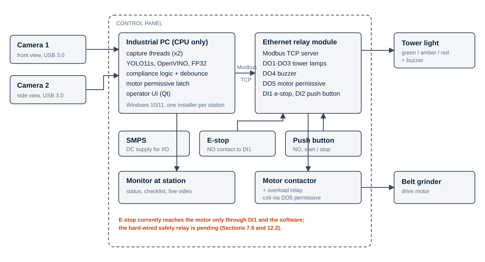
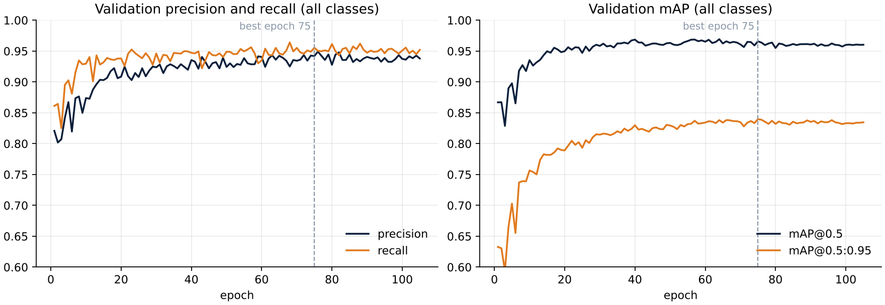
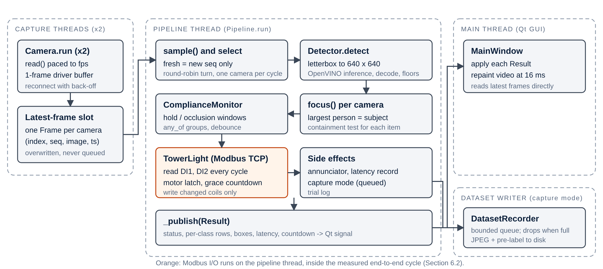
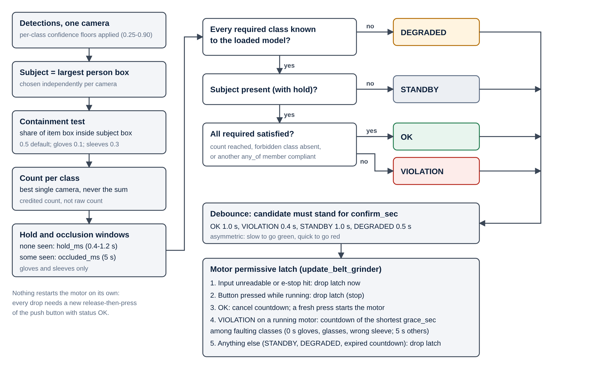
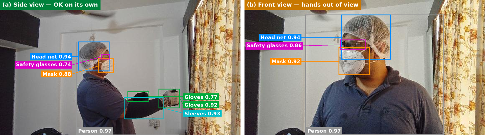
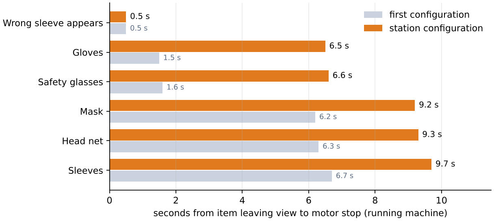
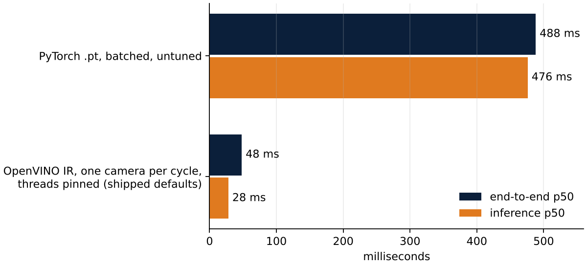
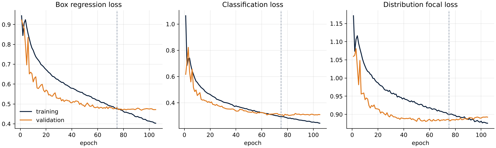
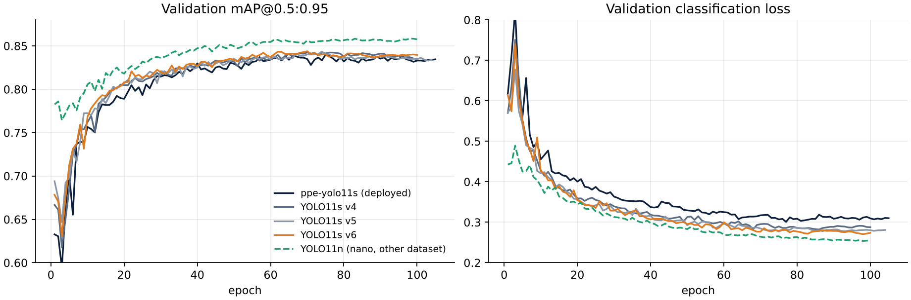
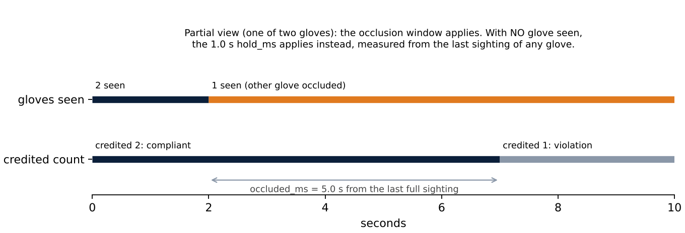

<!-- cover -->
# Vision Guard: A Vision-Based PPE Compliance Interlock for Flat Belt Grinding

**Internship Report** · M.Sc. Robotic Systems, RWTH Aachen University

| | |
| --- | --- |
| Student | Arun Nair |
| Student ID (matriculation number) | [matriculation number] |
| Company | GE Aerospace |
| Company address | [company address, Pune, India] |
| Internship period | [start date] to [end date] |
| Industrial supervisor (trainer) | [name, designation] |
| Academic supervisor | [name, chair] |
| Trainer's stamp and signature | [stamp and signature] |

*Confidential: prepared for academic assessment only. Part numbers, part geometry, production
volumes, cycle times, supplier names, commercial terms, network addresses, hostnames,
credentials and employee names are excluded throughout. No image shows a manufactured
component or an engineering drawing: the station layouts are simplified models, and the only
person shown is the author, who consented.*
<!-- /cover -->

## Abstract

During my internship at GE Aerospace in Pune, India, I designed, built and commissioned **Vision
Guard**, a camera-based interlock that turns PPE compliance at a flat belt grinding station from
an administrative control into an engineering control. Two cameras observe the operator. An
industrial PC without a GPU runs a YOLO11s detector compiled with OpenVINO and decides whether the
required PPE is worn. An Ethernet relay module, addressed over Modbus TCP, drives a tower light and
buzzer and grants or withholds the grinder motor's run permissive.

Migrating inference from PyTorch to OpenVINO cut end-to-end latency from 300–400 ms to about
40 ms. Six model versions were trained. The first deployed version reached a validation precision
of 0.942, a recall of 0.955 and an mAP@0.5 of 0.966, and the station now runs an eight-class
version that adds the apron. On a common test set of 477 station images, that version was the
most accurate of the six (mAP@0.5 0.948). The system passed two Management of Change approvals, was installed and relocated, and was
approved for deployment on every flat belt grinder at the plant.

Observing the system in use showed that operators stand at an angle to the machine to inspect
their work, outside the geometry the cameras were placed for, and this changed how camera
placement is specified for the rollout. A failure-mode review found two faults in the software's
fail-safe behaviour, which I fixed, and confirmed that the emergency stop needs a hard-wired
safety relay to act independently of the software.

## 1. Introduction

### 1.1 Motivation

Flat belt grinding is a manual finishing operation. The operator holds a component by hand
against a moving abrasive belt. The hazards are three:

- abrasive dust;
- sparks;
- contact injury to the hands and forearms.

The station's required PPE answers each of them: safety glasses, gloves, sleeves and a mask. The
deployed system also checks a head net, which the site requires at the station.

Before this project, compliance was assured by training, signage and supervision. In the
hierarchy of controls these are all *administrative* controls. Each depends on a person's
decision at the moment of use, and on a supervisor being present. None of them acts on the
machine. When the decision goes the wrong way, the grinder runs regardless. Vision Guard moves
the control one tier up: it detects missing PPE from camera images and inhibits the machine. It
does not replace the machine's guarding or its emergency stop. It closes the gap between the
rule that PPE must be worn and the fact of the machine running.

### 1.2 Host organisation

GE Aerospace designs and manufactures commercial and military aircraft engines, components and
systems. It has operated as an independent, publicly listed company since April 2024.

[Site-specific description of the Pune facility: its role, products and processes, and the
department in which the internship took place. To be written and verified by the author.]

### 1.3 Origin, scope and objective

The project did not exist when the internship began. In my first two weeks I studied the
shopfloor systematically, covering:

- material flow and the process sequence;
- weld preparation and manual welding;
- the robotic TIG welding cell.

Throughout, I spoke with welders, operators and engineers. The grinding station emerged from
that study as a candidate for an engineering control. The project came from observation, not
from a prepared brief.

The objective was a system that **withholds the grinder's run permissive unless the operator at
the machine wears the required PPE**. It had to do so quickly enough, and steadily enough, to be
accepted by the people who work at the machine. The work covered the whole life of the system:

- dataset, model and inference pipeline;
- compliance logic and interlock;
- hardware, commissioning and safety approval;
- installation, relocation and operator documentation;
- the specification of a plant-wide rollout.

Chapter 9 describes the plant-wide rollout, and Chapter 10 reflects critically on the
internship.

## 2. Technical background

### 2.1 Compliance is a decision, not a detection

An object detector answers *is there a glove in this image, and where?* An interlock must answer
*is this operator, now, protected as the site rules require?* The difference between the two
questions accounts for most of the engineering in this report. It has three dimensions.

- **Ownership.** A glove on a bystander or on a bench protects nobody. The decision needs to know
  *whose* equipment is judged.
- **State.** An object can be present and still not compliant. A glove can be held in the hand
  instead of worn. Prescription spectacles can be worn instead of safety glasses. A sleeve can be
  worn so that it can be caught. In each case the detector may be entirely right about the
  object, and the compliance decision still wrong.
- **Time.** A glove hidden for a few hundred milliseconds behind the workpiece has not been
  removed. A single compliant frame does not prove that the operator is compliant now. The
  decision must integrate evidence over time.

Validation metrics measure only the detection question. They are necessary but not sufficient.

### 2.2 Detector and runtime

YOLO [1] is a single-stage detector: one network pass predicts boxes and class scores for the
whole image, so the inference cost is fixed and predictable. YOLO11 [2] is the Ultralytics
release used here, in its *s* scale (about 9.4 million parameters). Detection transformers such
as DETR [3] and RF-DETR [4] predict object sets directly and need no non-maximum suppression, but
their attention layers are costly on a CPU.

OpenVINO [5] compiles a trained network for a specific CPU. Detection quality is reported as precision $P = TP/(TP+FP)$, recall $R = TP/(TP+FN)$ and
mean average precision (mAP) at an IoU threshold of 0.5, and averaged over thresholds from 0.5
to 0.95 [6].

### 2.3 Two error directions

An interlock can be wrong in two directions, which Table 1 sets out. A single accuracy figure
would weight them equally, which is wrong for both.

**Table 1.** Error directions of the PPE interlock.

| Decision \ truth | Operator protected | Operator not protected |
| --- | --- | --- |
| Machine permitted | Correct | **False permit**: hazard present while the machine runs |
| Machine inhibited | **False stop**: compliant operator stopped | Correct |

A false stop usually follows a *missed detection* (a false negative) of equipment that is worn.
Its cost is lost production, and with it the operator's trust: a station that stops compliant
people gets worked around. A false permit is the exposure the system exists to prevent. Every
parameter in Chapter 6 is a position on this trade-off.

Such a system is a **permissive**: a condition that must hold before the machine may run, layered
on top of the machine's safety functions and never in place of them [7]. It talks to the relay
module over Modbus TCP [8], with the `pymodbus` library [9]. Modbus is stateless and driven by the
client. A device keeps its outputs as last written until it is told otherwise, unless it has its
own communication watchdog.

## 3. System overview

Figure 1 shows the system as built. Two USB cameras view the operator from the front and the
side. The industrial PC, which runs on its CPU only, carries the whole software stack:

- capture;
- detection;
- the compliance logic;
- the motor-permissive latch;
- an operator interface on a monitor at the station.

The relay module's outputs drive the green, amber and red lamps, the buzzer and the motor
permissive (DO1–DO5). Its inputs read the emergency stop and a start/stop push button (DI1,
DI2). A control panel houses the relay module, its power supply, the e-stop, the push button and
the PC. An overload relay protects the motor, and the camera stands were fabricated to measured
dimensions.



The software is a Python application of about 5,800 lines, with a test suite. Its main
dependencies are:

- Ultralytics;
- OpenVINO;
- OpenCV;
- PySide6 (Qt);
- pymodbus.

Library versions are pinned for a Windows installer, so that every station runs an identical
build. Each cycle takes one camera frame through letterboxing, inference, the compliance
decision and the relay write. The result is shown over the live video, with a checklist of the
required items and a countdown whenever a correction window is running.

The emergency stop is wired as a normally open contact into DI1. Until the planned safety relay
is fitted, this input is the only thing the e-stop does, so it acts through the software.
Section 6.4 returns to this point.

## 4. Dataset and model

### 4.1 Class schema and site-specific data

The model described in this report detects seven classes (Table 2). They are five items of
equipment, the person who wears them, and one *non-compliant state*, `Wrong Sleeve`, which the
station treats as a violation whenever it is detected. The station now runs a later version,
`best-apron`, that adds an `Apron` class (Section 4.4). Section 4.3 describes the training of
the seven-class model that was deployed first.

**Table 2.** Class schema and the role of each class.

| Class | Role in the decision | Count required |
| --- | --- | --- |
| Gloves | must be worn | 1 (2 before station tuning) |
| sleeves | must be worn, or an apron instead | 1 (2 before station tuning) |
| Safetyglasses, Mask, headnet | must be worn | 1 each |
| Wrong Sleeve | forbidden: detecting it is the violation | 0 |
| person | identifies whom to judge | — |
| Apron | the sleeves alternative; in the retrained station model | 1 |

All training images were either captured on the shopfloor or taken of working poses recreated in
an isolated environment, and no public PPE dataset was used. Public
datasets centre on construction-site equipment. The station's lighting, background, operator
postures and issued PPE are particular to it, and sleeves are absent from most public sets.
Starting from COCO-pretrained weights and fine-tuning on site data gave the model general
features from a large dataset, and everything station-specific from the station. Images were
deliberately taken from varying camera positions, which proved its worth when the installation
was moved (Section 7.2).

### 4.2 Local annotation and failure-driven expansion

Company data compliance rules forbid uploading shopfloor images to cloud annotation services. I
therefore built an **auto-annotation tool** that pre-labels images locally with the current
model. An annotator corrects the boxes rather than drawing them all, which is several times
faster. One remote day yielded 200 annotated images. The station software later gained a
**capture mode** that keeps frames worth training on during normal operation, pre-labelled, and
never sends them off the site network. Its triggers are:

- a timer;
- a violation;
- a motor start or stop;
- a required item going out of sight.

The dataset grew in rounds, each aimed at failures found in systematic testing of the previous
model. The failures fall into two categories, and the distinction is the conceptual core of the
data work.

- **Detection failures** are cases where the model misses or confuses an object that is there.
  Examples are partly occluded PPE, unusual poses, confusion between gloves and sleeves at the
  wrist, missed items in the side view after the relocation, and erratic detection of people in
  the background. More annotated examples of the hard case are the right fix.
- **Decision failures** are cases where the object is detected *correctly* and the compliance
  decision is still wrong. Examples are prescription spectacles worn in place of safety glasses,
  and gloves carried rather than worn. More data with the same labels cannot fix them, because
  the labels do not encode the distinction. There are only two fixes. The schema can label the
  non-compliant state explicitly, or the decision can test whether the item lies on the body
  part it should cover.

Leaving the non-compliant case unlabelled teaches the model weakly to ignore it. Worse, it makes
the dangerous error unmeasurable, because a missed worn glove and a correctly ignored carried
glove both produce *no box*.

The schema takes the first route for sleeves: `Wrong Sleeve` is an explicit class with the
strictest settings in the system. For glasses and gloves, neither route is in place yet. The relational test checks only that an item's box lies inside
the person's box, relaxed to 10 % containment for gloves, and a glove held in the hand passes it.

### 4.3 Training and convergence

The model is YOLO11s, fine-tuned from COCO weights:

- input 640 × 640, batch size 16;
- cosine learning-rate schedule from 0.01;
- mosaic, colour and ±5° rotation augmentation;
- up to 150 epochs, with early stopping after 30 epochs without improvement.

I trained it on a CUDA GPU in about two hours. Attachment A lists the full configuration.



Figure 2 shows the convergence in three phases:

1. **Rapid adaptation.** The pretrained network reached an mAP@0.5 of 0.867 after one epoch.
2. **Steady gains in localisation.** mAP@0.5 reached 0.96 by about epoch 40, and mAP@0.5:0.95
   kept rising until epoch 75.
3. **Plateau.** The validation losses stopped improving while the training losses kept falling,
   the classic onset of over-fitting.

Early stopping ended training at epoch 105 and kept epoch 75. At that epoch the model reached
precision 0.942, recall 0.955, mAP@0.5 0.966 and mAP@0.5:0.95 0.840, averaged over the seven
classes.

Mosaic switch-off and the final low-learning-rate phase were scheduled against the *planned* 150
epochs, so early stopping meant they never ran. Both are free improvements at the next retraining.

### 4.4 Model selection

Table 3 lists the configurations evaluated.

**Table 3.** Configurations evaluated on the station hardware.

| Model | Runtime | End-to-end latency | Outcome |
| --- | --- | --- | --- |
| YOLO11s | PyTorch | 300–400 ms (inference 200–300 ms) | superseded |
| YOLO11s | OpenVINO | ≈ 40 ms, within budget | **deployed** |
| RF-DETR | — | ≈ 1500 ms | rejected on latency; accuracy good |

**Model versions.** I trained six versions in all (Table 4), one of them on the smaller YOLO11n
scale. Figure A2 in Attachment A shows their training curves.

**Table 4.** Model versions: validation metrics at each run's best epoch, and CPU inference
time after conversion to OpenVINO with the same tool (FP32, 640 × 640, median of 60 calls on one
4-core CPU).

| Version | Trained | Classes | Epochs (best) | P | R | mAP@0.5 | mAP@0.5:0.95 | OpenVINO ms |
| --- | --- | --- | --- | --- | --- | --- | --- | --- |
| v2 (first deployed) | 23 Aug | 7 | 105 (75) | 0.942 | 0.955 | 0.966 | 0.840 | 35.0 |
| nano 3 | 30 Aug | 7 | 100 (98) | 0.969 | 0.967 | 0.985 | 0.858 | 16.5 |
| v4 | 10 Sep | 7 | 100 (70) | 0.945 | 0.952 | 0.970 | 0.842 | 34.5 |
| v5 | 10 Sep | 7 | 104 (74) | 0.948 | 0.955 | 0.975 | 0.843 | 35.1 |
| v6 | 20 Sep | 7 | 100 (70) | 0.941 | 0.964 | 0.972 | 0.844 | 34.1 |
| best-apron (default) | 12 Oct | 8 | 93 (63) | 0.971 | 0.979 | 0.987 | 0.864 | 33.5 |

The table supports three readings:

- **v2 to v6 differ only in their data.** Every training setting is identical. The time per epoch
  on the same GPU grew from about 60 s to 94 s, which fits a dataset that grew round by round, as
  Section 4.2 describes. Each version scored marginally higher in mAP@0.5:0.95 (0.840 to 0.844),
  and v6 had the best recall (0.964). But each was validated on its own, growing, validation
  split, so differences of a few thousandths are not evidence that one version beats another.
- **The nano and the apron model were trained on different data and settings.** The nano used
  a separate copy of the dataset and a shorter schedule; the apron model a combined dataset with
  an eighth class, starting from an earlier fine-tuned run. Their higher figures are therefore
  not comparable with the others.
- **None of the six was compared on common ground during training.** Table 5 therefore scores
  all of them on one test set from station footage, held out from best-apron's training. The scoring is by
  class name, so differences in class order or class count do not matter. Each image is also
  judged with the station's own decision logic, to count false permits and false stops directly.

<!-- evaluation:summary -->
**Table 5.** All model versions on one common test set (477 images, split `test`). mAP over the 7 classes every model detects; decisions from the station's own logic at its configured floors, single frame. *Like for like* leaves out compliant images that need a class the model lacks (an apron worn instead of sleeves).

| Model | Classes | mAP@0.5 | mAP@0.5:0.95 | Mean recall | False permits | False stops | False stops, like for like | ms/frame |
| --- | --- | --- | --- | --- | --- | --- | --- | --- |
| best-apron | 8 | 0.948 | 0.835 | 0.951 | 1.4 % (6/428) | 10.4 % (5/48) | 10.4 % (5/48) | 38.4 |
| v2 (ppe-yolo11s) | 7 | 0.873 | 0.723 | 0.796 | 0.0 % (0/428) | 85.4 % (41/48) | 72.0 % (18/25) | 37.0 |
| yolo11n-nano3 | 7 | 0.863 | 0.711 | 0.837 | 0.9 % (4/428) | 79.2 % (38/48) | 60.0 % (15/25) | 22.7 |
| yolo11s-v4 | 7 | 0.909 | 0.770 | 0.857 | 0.0 % (0/428) | 83.3 % (40/48) | 68.0 % (17/25) | 37.1 |
| yolo11s-v5 | 7 | 0.904 | 0.772 | 0.856 | 0.0 % (0/428) | 77.1 % (37/48) | 56.0 % (14/25) | 36.4 |
| yolo11s-v6 | 7 | 0.922 | 0.808 | 0.877 | 0.2 % (1/428) | 72.9 % (35/48) | 48.0 % (12/25) | 36.3 |
<!-- /evaluation:summary -->

Table 5 settles two questions that the validation scores left open.

**The data rounds paid off, and the validation splits hid it.** On common ground,
mAP@0.5:0.95 rises from 0.723 for v2 through 0.770 (v4) and 0.808 (v6) to 0.835 for best-apron,
where Table 4 showed differences of four thousandths. The gains sit in the classes the rounds
were aimed at (Tables A3–A5): AP@0.5 for gloves rises from 0.77 to 0.97, and recall for safety
glasses from 0.55 to 0.90. The eighth class cost the other seven nothing: best-apron leads on five
of them and is within 0.011 of the leader on the other two. Safety glasses remain the weakest
class for every model.

**The decision errors move in opposite directions.** best-apron falsely stops 5 of the 48
images labelled compliant, against 35 to 41 for the seven-class models. Part of that gap is
structural: a model without an apron class must stop every compliant operator who wears an apron
instead of sleeves, however well it detects. That applies to 23 of the 48 compliant images.
Leaving them out, the seven-class models still falsely stop 12 to 18 of the remaining 25
(48–72 %), against at most 5 for best-apron, so its lead is not an artefact of the apron class.
The like-for-like column also falls steadily from v2 to v6. In the other direction, best-apron falsely permits 6 of
428 non-compliant images, while v2, v4 and v5 permit none. That zero is no merit when it comes
with 77–85 % false stops, since a model that rarely permits anything rarely permits wrongly. For a
safety system, though, the six false permits matter most, and each must be inspected before
best-apron's lead is accepted.

Three limits apply. The counts are per image, from one camera and one frame, while the station
combines two cameras over time, so they are not rates per shift. Only 48 test images are labelled
compliant, so the 10.4 % false-stop rate has a 95 % interval of about 4–22 %, and the 1.4 %
false-permit rate one of 0.6–3.0 %. The test split is held out from best-apron, but whether it was
also held out from v2–v6, trained on earlier splits of the same images, is not recorded; if not,
the older models are flattered, not best-apron.

All five small models cost the same on the CPU (Table 4), so choosing between them is purely a
question of accuracy. On that, Table 5 favours `best-apron`, which the station runs.

RF-DETR's accuracy was good, but closing 1500 ms to 40 ms needs about a fortyfold speed-up, and
the runtime migration gave about tenfold. The useful conclusion is not that RF-DETR is unsuitable.
It is that RF-DETR's accuracy shows **headroom the deployed model does not reach**. The open
question is how to capture that headroom inside the latency budget, for example by distillation.

## 5. Inference pipeline

### 5.1 Threads and stale frames

The pipeline rests on one principle: **no stage waits for a slower one, and no stage works on
stale input.** Each camera thread keeps only its newest frame in a one-frame slot, and older
frames are overwritten, never queued. The pipeline thread takes only frames it has not processed
before. When no camera has delivered for 1.5 s, the station switches to DEGRADED and withdraws the
permissive. A queue would have been the obvious design and the wrong one. Under load it fills, so
every decision is made on an older frame, and for an interlock the age of the frame *is* the
response time.



The Modbus reads and writes run on the pipeline thread (Figure 3). This fixes their order, latch
first and lamps second, but puts network round trips inside every cycle. Their cost on the
station network has not been measured.

### 5.2 Camera scheduling

On a CPU, one camera is served per cycle. A batch of two cost 1.89 times a batch of one, and made
each frame wait for the other. Taking turns therefore halved the latency per frame: 64 ms against
122 ms on the development host.

A scheduling bug starved the slower camera: the round-robin cursor did not advance when a camera
was served alone. A camera with a fresh frame every second cycle was served on only 3 of its 6 chances. After the fix,
both cameras are served whenever they have a frame, alternating strictly when both deliver.

### 5.3 Letterboxing, bandwidth and the rejection of MJPEG

Frames are *letterboxed* to the square 640 × 640 model input:

- scaled by a single factor;
- centred;
- padded with grey.

Boxes are mapped back by the exact inverse. A direct resize would stretch the image, and several
PPE classes are small and are told apart partly by shape.

Two cameras streaming uncompressed video saturated USB. One camera at 1280 × 720 and 30 fps
produces about 55 MB/s. Measured on the cameras, 1280 × 720 delivered only 10 fps, while
640 × 480 delivered the full 30 fps. Capture was changed to **640 × 480 at 30 fps**, a threefold
improvement in temporal resolution, and **detection accuracy was verified to be unaffected**. That
is expected: the letterbox scales a 1280-pixel-wide frame down by half before inference anyway.

Compressed MJPEG transport would have allowed the higher resolution. I established a working
method through the Media Foundation (MSMF) backend, which reached 30 fps at 720p. It required an
operating-system environment variable set before the program starts. Setting it from inside the
program, the obvious fix, was shown on the hardware not to work. That made it a
**machine-dependent, system-level modification**. For a system meant to be reproduced across the
plant, a fix applied host by host is unacceptable. It will be missing on some hosts, lost when IT
re-images a PC, and fail silently when it is. I kept the raw stream on USB 3.0 ports. This was a
rejection of a working solution **on deployment grounds**, and Section 8 shows how that choice
pays off. The station now captures at 640 × 480 (front) and 640 × 360 (side) through DirectShow. Its
configuration still requests MJPEG, which DirectShow was measured to ignore on these cameras, so
the stream is in effect uncompressed, as intended. The repository's default configuration, which
the installer ships, still requests 1280 × 720 and must be aligned before rollout.

Exporting to OpenVINO cut the time per inference call from 145 ms to 28 ms (5.2×), with
detections identical to within 1.2 px. All of this gain came from compilation, because the export
stays at FP32. INT8 quantisation remains available, but it needs calibration on site images.

## 6. Compliance logic and interlock

### 6.1 From detections to a verdict

Figure 4 shows the decision path from detections to the motor permissive.



The verdict takes one of four values:

- **OK:** the operator is compliant;
- **VIOLATION:** an item is missing, or a forbidden class is present;
- **STANDBY:** nobody is present;
- **DEGRADED:** the station cannot judge.

Only OK permits the motor.

Two choices recur throughout. First, **counts come from the best single camera, never the sum**:
two cameras that each see the same two gloves must not report four. Second, **the operator is the
largest person in each camera's view**, which is a cheap and robust proxy for being closest to the
machine. An item counts only if a large enough share of its box lies inside the operator's box:

- 50 % in general;
- 30 % for sleeves;
- 10 % for gloves, which sit at the ends of outstretched arms beyond the person box.

Bystanders and their equipment are ignored. A missed person gives STANDBY, which darkens the lamp
but still stops the motor. The same mechanism explains the large-workpiece problem in
Section 8.3.

Figure 5 shows both rules on photographs of a recreated working pose, taken in an isolated
environment and annotated with best-apron's detections at the station's confidence floors. The
side view (a) holds every required item and on its own would permit the motor; only one sleeve
is visible, which the station's count of one accepts. The front view (b) shows the head net,
glasses and mask clearly but not the hands, so on its own it would be a violation. Judged
together, as the station judges its two cameras, the pair is compliant: the gloves and sleeve
come from the side camera.



### 6.2 The debounce and hold-window trade-off

Early tests showed the person box, and the detections that depend on it, fluctuating from frame
to frame. Driven directly, the interlock would have chattered against a workpiece held to the
belt. Two mechanisms stabilise the verdict, and they pull in opposite directions.

**The debounce** applies a new status only after it has stood for a confirmation period. After
senior management raised response time at the first demonstration, the debounce was *reduced*. The
original counted three agreeing cycles. That was about 1 s at PyTorch cycle rates, but varied with
CPU load. It was replaced by periods in seconds that differ by status:

- 0.4 s to go red;
- 1.0 s to go green;
- 1.0 s to conclude that nobody is there.

The station is quick to alarm and slow to claim compliance. The cost is stability: a shorter
debounce lets briefer detection gaps through.

**Per-class hold windows** restore the stability, but only where it is needed. A class that drops
out keeps its credited count for its hold period, from 0.4 s to 1.2 s. **Gloves and sleeves** also
get a separate 5 s *occlusion window* that applies only while *some but not all* of the pair are
visible. One visible glove is evidence that the pair is worn, so the tolerance is granted on
evidence. Safety glasses, rarely occluded the same way, get only their 1.1 s hold. Tests confirmed
that the revised logic handles occlusion of gloves and sleeves well.

Testing also found a defect, which I measured rather than assumed. Both windows had been timed
from the last *full* sighting, so a partial view silently consumed the dropout hold. After one
second of seeing a single glove, the configured 1.0 s hold was zero, on exactly the classes the
occlusion window was added for. Timing each window from its own evidence fixed it.

The trade-off had an honest cost. An operator who removed one glove while the other stayed
visible was still credited for up to about 5.4 s. This bounded exposure was accepted in exchange
for not stopping operators whose second glove was behind the workpiece.

**Station tuning has since moved this trade-off further.** The station configuration now requires
**one** glove and **one** sleeve, not two. That removes the false stops of the side view, which
can rarely see both hands at once. Because a set of one cannot be partly visible, the occlusion
window, now 8 s, no longer applies. The cost is that **an operator with one bare hand is judged
compliant indefinitely**: in simulation, removing one of two gloves never stopped the motor. The
station also raised:

- the person confidence floor from 0.25 to 0.70, which suppresses background people at the cost
  of losing the operator more easily;
- the `Wrong Sleeve` hold from 0.4 s to 1.2 s.

These are risk decisions, not only tuning decisions, and they belong in the risk assessment.
Attachment B tabulates every class's thresholds and timings.

### 6.3 Warning before inhibition

A violation on a *running* machine opens a **correction window** instead of stopping it at once.
The lamp turns red, the buzzer warns, and the screen counts down. If the operator puts the item
back, the machine never stops. Otherwise the permissive is withdrawn at the end of the window.

This is a **deliberate safety trade-off: for the length of the window the machine runs with a
detected violation.** As implemented, the window has four properties:

- it was first set at 5 s, with no window at all for safety glasses, gloves and Wrong Sleeve,
  whose absence *is* the immediate hazard;
- on the station it is now **8 s by default, 5 s for safety glasses and gloves**, and still
  **0 s for Wrong Sleeve**;
- the shortest window among the current violations applies, so a missing head net cannot shelter
  a missing glove;
- it is set once and never renewed, so flickering PPE cannot hold the machine open.

Figure 6 shows the resulting stop times. I obtained them by running the station's compliance and
latch code on its configuration with simulated detections. The same method reproduces the times
recorded earlier for the first configuration (1.5 s for gloves, 6.3 s for a mask). A detected
wrong sleeve still stops a running machine in 0.5 s. But a missing glove or missing safety glasses
now keep it running for about 6.5 s, and a missing mask, head net or sleeves for about 9.5 s. The
station is configured this way to let an operator correct a glove that has slipped. That is a
defensible choice for nuisance stops, but it reverses the earlier decision to give no window
to the items whose absence is the immediate hazard. **It needs an explicit, documented EHS
position before rollout.**



The permissive is a **latch**, like the seal-in contact of a motor starter. Pressing the button
starts the motor only when four conditions hold:

- the operator is compliant;
- the e-stop is not pressed;
- the press is a genuine release-then-press edge that the software observed;
- the machine is idle.

Pressing the button while the motor runs stops it. Nothing restarts the motor on its own. The
coils are written only when they change, the inputs are polled every cycle, and every output is
switched off at connection and at shutdown.

### 6.4 Failure behaviour

I analysed what the code does when each part fails (Attachment C), and confirmed two paths by
running the real pipeline against a stubbed model. Both were software faults, and I fixed them.
The behaviour divides as follows.

**Fail-safe paths:**

- loss of all cameras;
- a model that fails to load;
- an unreadable input;
- the operator leaving the cell.

**Paths that could leave the grinder enabled while detection was not working:**

1. **One camera stops while the other runs (fixed).** Its last detections stayed in force
   indefinitely: in simulation the status stayed OK while the live camera saw no gloves. Now a
   camera without a new frame for 1.5 s counts as down, its results are discarded, and the station
   goes DEGRADED, naming the camera on screen. A camera that keeps streaming a *frozen image* still
   looks live to the software.
2. **An exception during inference (fixed).** The pipeline thread ended without switching the
   relay off, and the window stayed open, so the supervisor did not restart it. Now every failed
   cycle switches the motor off; after five in a row the station closes the relay connection and
   exits with an error code, so the supervisor restarts it.

Each fix came with a test that fails on the old code. The remaining paths need hardware or device
configuration rather than code:

3. **Loss of communication, a hang, or a PC crash or power loss.** The relay module keeps its
   last outputs unless its own communication watchdog is enabled. The deployment guide relies on
   that watchdog, but nothing records that it was tested.
4. **The emergency stop depends on the software path.** Whenever that path fails or stalls, the e-stop
   cannot stop the motor either, and a broken wire to its normally open contact goes unnoticed. ISO 13850
   [10], IEC 60204-1 [11] and IEC 60947-5-5 [12] require a hard-wired e-stop with normally closed,
   direct-opening contacts. **Until the pending safety relay is fitted, the station's e-stop
   should not be relied upon as an emergency stop.**

None of these concerns the model. Each lies at the boundary between software and machine, where
a permissive must be most conservative.

## 7. Deployment and commissioning

### 7.1 Hardware and commissioning

I researched industrial PCs against two sets of requirements:

- **compute:** a multi-core x86 CPU without a GPU, as the measurements had shown;
- **the shopfloor:** dust, panel mounting, and two separate USB ports for the cameras.

I obtained quotations, and evaluated the IT department's standard configuration so that the
station would sit inside existing support arrangements. The chosen unit was tested on the
shopfloor before commissioning. [IPC specification: to be completed.]

Electrical commissioning was done with the maintenance department. I verified the wiring of the
vendor-built panel (tower light, relay module, e-stop and push button) before installation.
Modbus was commissioned in **two separate stages**:

1. **Network connectivity.** The module is reachable and its Modbus TCP port accepts connections.
2. **Protocol-level communication.** Using `pymodbus`, I wrote each coil, confirmed the physical
   actuation, and read the inputs with the switches operated.

Separating the stages makes failures unambiguous. A module can accept a TCP connection and still
drive the wrong relay, because Modbus addresses start at 0 while the module's labels start at 1.

### 7.2 Installation and relocation

The station was installed at one grinder. Three items of scope remained at that point:

- camera cable routing;
- the overload relay;
- mounting the PC in the panel.

Management then decided to move the installation to a more accessible position. That required a
new Management of Change request, measurement of the new location, and re-finalisation of the
camera positions from the model's performance there. Maintenance carried out the move.

The relocation **exposed a dependency on camera geometry**: in the side view, the model began to
miss gloves, glasses and masks. Capturing training images from varied positions limited the
damage, but did not eliminate it.

### 7.3 Safety approval, documentation and reviews

The system went through the site's **Management of Change** (MOC) process [14]. An EHS meeting
reviewed its features, the station's existing safety practices and the expected requirements, and
identified scope for further development. A **second MOC** covered the relocation [15]. I obtained
the station's **EHS Risk Assessment** from the responsible High Performance Team, updated it to
reflect the system, and submitted it for approval [13]. I wrote a **Standard Operating Procedure**
for operator training, which was reviewed and revised [16]. A 3D model of the installation was
requested from the design department.

The system was demonstrated to four audiences in turn. Each review changed something.

1. **Shopfloor staff.** Their feedback shaped later iterations.
2. **Site senior management.** They raised the size of the control panel and the response time.
3. **Site executives.**
4. **The CEO of Unison Industries,** a GE Aerospace subsidiary.

The plant then decided to deploy the system on all flat belt grinders, and to present it as a
**safety moment to the global CEO of GE Aerospace**.

## 8. Results and evaluation

### 8.1 Latency

**End-to-end latency on the station fell from 300–400 ms to about 40 ms**, measured from camera
grab to relay write. A controlled benchmark on a 4-core development host reproduced the effect
(Figure 7):

- the median fell from 488 ms to 48 ms;
- the cycles completed in 25 s rose from 56 to 793.



Per-stage instrumentation decided the fix. In the untuned pipeline, inference took **98.6 %** of
each cycle, and all the code I had written myself took under 2 %. Only the forward pass was worth
optimising, through the runtime, the model size or the input size. The second-largest gain came
from noticing that two measurements which should have agreed did not: inference inside the
application was three times slower than in the benchmark, because the capture threads'
OpenCV pools competed with the model for the cores. Pinning capture to one thread per camera
closed the gap. One honest qualification applies. The
pipeline grew while it was being optimised, so the intermediate measurements are not comparable,
and I report only the two endpoints measured under identical conditions.

### 8.2 Detection performance

The validation figures (P 0.942, R 0.955, mAP@0.5 0.966) are strong for a seven-class site
detector, but they carry four limits:

- they are averages over the classes;
- they come from the split used to select the model;
- they share their viewpoints with the training data;
- they measure detection, not decision.

The common test set removes the second limit: on it, v2 scores an mAP@0.5 of 0.873 rather than
0.966, and best-apron 0.948 (Table 5). Neither set of figures says anything about carried gloves
or prescription spectacles. In operation the model is no
longer the main source of risk. The false stops that mattered came from viewpoints it was not
designed for, and the false permits come from decisions the schema cannot express (Section 4.2)
and from the software–machine boundary (Section 6.4).

### 8.3 The operator feedback finding

The most consequential result came from watching the deployed system in use and talking to the
operators. Three things emerged.

- **Posture.** Operators customarily stand *at an angle* to the machine, to inspect the flatness of
  the trim. That is outside the cameras' favourable viewing angle, so items are missed and the
  machine stops falsely.
- **Aprons.** Operators want to wear aprons against grinding dust, and the model had no apron
  class.
- **Large workpieces.** Larger parts force the operator to stand further back, partly out of frame.
  The station then finds nobody, and the machine cannot start.

Three remedies were identified:

- reposition the cameras for large workpieces;
- angle them so that every class stays observable in the posture operators actually adopt;
- retrain with an apron class. This has since been done: the station runs `best-apron`, an
  eight-class version (Table 4), and its configuration accepts an apron in place of sleeves.

**This is a requirements failure, not a model failure.** The model correctly reported that it
could not see a glove turned away from it. The camera placement had been derived from an *assumed*
posture, not the *observed* one. Every downstream step inherited that assumption, including the
validation set, so no metric could reveal it. The finding generalises: across the plant, **camera
placement cannot be specified from the machine layout alone**. It must be derived from how each
operation is actually performed, which is why the rollout began with a gemba walk.

### 8.4 Evaluation against the objective

Section 1.3 set four requirements. Measured against them, the system meets two in full, one in
part, and one only with qualifications that the rollout must close.

- **It withholds the run permissive.** Met. Only the OK status permits the motor. Every other
  status, an unreadable input and the e-stop all withdraw it. Nothing restarts the motor without
  a fresh press of the button. The correction window delays the stop on purpose for every item except
  a wrong sleeve, by 5–8 s. That delay is a documented trade-off, but one that still needs its EHS
  position.
- **It judges the operator at the machine.** Met, with one known limitation. The largest-person
  filter and the containment test ignore bystanders and their equipment, but the person *nearest
  the camera* is judged. That is usually, though not necessarily, the person at the belt.
- **It responds quickly enough.** Met. At about 40 ms, the pipeline is no longer what limits the
  response. The station declares a violation in 0.4 s plus the class's hold. Its response time is
  now a choice made in the logic rather than a limit set by the hardware, which is the honest
  answer to management's concern.
- **It is steady enough to be accepted.** Partly met. The hold and occlusion windows, and later
  the single-glove requirement, removed the chatter caused by occluded gloves and sleeves. The false stops caused by the angled working
  posture and by large workpieces remain, until the cameras are repositioned.

Two properties the objective took for granted are not yet met:

- **Fail-safe behaviour at the boundary between software and machine** (Section 6.4). The two
  software faults are fixed; the hard-wired e-stop and the relay watchdog are not.
- **Detection of decision failures** such as carried gloves (Section 4.2).

Neither is a matter of model accuracy, and both are on the list of open items in Chapter 11.

## 9. Plant-wide rollout

The rollout to every flat belt grinder at the plant is to be carried out through an external supplier. I developed the specification package over
several rounds of review:

- **The RFQ.** I added a *sequence of operations* to it, because the system is not a catalogue
  item and the split of responsibility between supplier and site had to be unambiguous.
- **A Bill of Quantities and Scope of Work** for each station.
- **Acceptance test protocols**, with a pulled-wire test on each switch input.

I also evaluated industrial cameras to replace the consumer webcams, which are not defensible in a
dusty environment. The specification asked for USB 3 direct to the PC on a 2 m cable, and working
distances of 0.5–1.0 m for the front camera and 1.0–1.5 m for the side camera. A **gemba walk**
surveyed every grinder in the condition in which it actually operates.

Standardisation rests on a single self-testing Windows installer whose only per-station input is
the machine number. Here two earlier decisions pay off: rejecting the machine-dependent MJPEG
setting saves an operating-system change at every station, and local annotation lets every station
contribute failure cases without an exception to the data rules.

The station was also redesigned as an integrated tower that fits within the grinder's own envelope
(Figure 8): 0.76 m³ against 1.63 m³ for the prototype's separate units, a 53 % reduction in
volume. The monitor and tower light move onto the grinder, and the control panel onto its
pedestal, so nothing stands on the floor beside the machine. This answers management's comment
on the size of the panel.


## 10. Critical reflection

### 10.1 Supervision

[To be written by the author. The guidelines ask for a critical reflection on supervision. For
example: how often and in what form you met your industrial supervisor; how much independence you
had, and whether it suited the project; the support you received from EHS, maintenance and IT; what
worked well; and what you would have wanted differently.]

### 10.2 Learning achievements

**Deployment is most of the work.** The model passed 0.96 mAP@0.5 early. Most of the internship
went on what stands between that number and an operator starting a machine.

**Diagnose before optimising.** Instrumentation showed inference at 98.6 % of the cycle. Without it
I would have optimised my own code, which cost under 2 %.

**Requirements come from watching the operation.** No metric revealed the angled working posture.
Observation and conversation did, just as observation had produced the project in the first place.

**Take the deployment constraint seriously, even when it costs performance.** The MSMF route worked,
and rejecting it still proved the right decision once the rollout was in view.

**A safety system lives inside a process.** The system became a control when the risk assessment
described it, not when the code ran. The questions EHS asked (what happens when a camera, the
network or the PC fails?) led to the analysis that found my own code's weakest points.

**Different audiences need different accounts of the same system.** Explaining a part of it to
someone who would never read its code was the best test of whether I understood it.

### 10.3 Problems and what I would do differently

- **Camera placement was decided too early.** I would observe operators at work before fixing the
  camera positions and before capturing training data, not after deployment.
- **Requirements drifted away from the documents.** The correction window, the switch wiring and
  the scheduler all changed after they had been documented, and the specifications had to follow.
  Keeping one owner for those documents, and a record of each change, would have saved review
  rounds.
- **Safety integration lagged behind the software.** The hard-wired e-stop is still pending, and
  two software failure paths were found only in the final review. A failure-mode analysis written
  *before* the first installation, not after it, would have found them earlier.

## 11. Conclusion and outlook

The internship delivered a working, approved and replicable PPE interlock:

- a two-camera, CPU-only station with about 40 ms latency;
- a site-specific detector, now with eight classes, compared with its predecessors on one test
  set;
- compliance logic that separates detection from decision and balances responsiveness against
  stability class by class;
- two MOC approvals, an updated risk assessment and an SOP;
- two fail-safe faults found in review and fixed, each with a test;
- a rollout package for every flat belt grinder at the plant.

It also produced a finding that changed how the rollout is specified, and an honest list of what
must be fixed before the system is relied upon.

The open items, in order of priority, are:

1. **Fit the hard-wired emergency-stop safety relay.**
2. **Verify the relay module's communication watchdog.**
3. Document the EHS position on the 5–8 s correction windows and the single-glove requirement.
4. Inspect best-apron's six false permits on the common test set, and re-run the evaluation for
   the like-for-like false stops.
5. Reposition the cameras for the observed posture.
6. Keep model comparisons like for like: one export tool, one benchmark, one test set.

Attachment D lists all open items. Beyond them, the outlook is:

- use the latency headroom to capture the accuracy that RF-DETR showed is available;
- make the decision failures measurable with a targeted evaluation set, then fix them with a
  relational test of each glove against the detected hands;
- close the loop from the capture mode to periodic retraining;
- aggregate stop records across the fleet into evidence for tuning;
- apply the approach to other manual operations, starting each time from how the operation is
  actually performed.

## References

[1] J. Redmon, S. Divvala, R. Girshick and A. Farhadi, "You Only Look Once: Unified, Real-Time
Object Detection," in *Proc. IEEE CVPR*, 2016, pp. 779–788. arXiv:1506.02640.

[2] G. Jocher and J. Qiu, "Ultralytics YOLO11," Ultralytics, 2024. [Online]. Available:
https://docs.ultralytics.com/models/yolo11/

[3] N. Carion, F. Massa, G. Synnaeve, N. Usunier, A. Kirillov and S. Zagoruyko, "End-to-End
Object Detection with Transformers," in *Proc. ECCV*, 2020, pp. 213–229. arXiv:2005.12872.

[4] "RF-DETR: a real-time object detection transformer," software repository, 2025. [Online].
Available: https://github.com/roboflow/rf-detr

[5] Intel Corporation, "OpenVINO Toolkit documentation," 2026. [Online]. Available:
https://docs.openvino.ai/

[6] T.-Y. Lin *et al.*, "Microsoft COCO: Common Objects in Context," in *Proc. ECCV*, 2014,
pp. 740–755. arXiv:1405.0312.

[7] *Safety of machinery — General principles for design — Risk assessment and risk reduction*,
ISO 12100:2010.

[8] Modbus Organization, "MODBUS Application Protocol Specification V1.1b3," 2012.

[9] PyModbus contributors, "PyModbus," version 3.16. [Online]. Available:
https://github.com/pymodbus-dev/pymodbus

[10] *Safety of machinery — Emergency stop function — Principles for design*, ISO 13850:2015.

[11] *Safety of machinery — Electrical equipment of machines — Part 1: General requirements*,
IEC 60204-1:2016+A1:2021.

[12] *Low-voltage switchgear and controlgear — Part 5-5: Electrical emergency stop device with
mechanical latching function*, IEC 60947-5-5.

[13] GE Aerospace, Pune, "EHS Risk Assessment, flat belt grinding station," doc. no. [EHSRA
reference]. Internal.

[14] GE Aerospace, Pune, "Management of Change record: PPE detection interlock," no. [MOC
reference 1]. Internal.

[15] GE Aerospace, Pune, "Management of Change record: relocation," no. [MOC reference 2].
Internal.

[16] GE Aerospace, Pune, "Standard Operating Procedure: PPE detection station," doc. no. [SOP
reference]. Internal.

<!-- attachments -->
## Attachments

### Attachment A — Training details

**Table A1.** Training configuration of the first deployed model (v2).

| Parameter | Value | Parameter | Value |
| --- | --- | --- | --- |
| Initial weights | `yolo11s.pt` (COCO) | Image size | 640 (square, `rect: false`) |
| Epochs planned / run | 150 / 105 | Patience | 30 (best epoch 75) |
| Batch | 16 | Optimiser | `auto` |
| `lr0` / `lrf` | 0.01 / 0.01, cosine | Momentum / weight decay | 0.937 / 0.0005 |
| Warm-up | 3 epochs | Loss gains box / cls / dfl | 7.5 / 0.5 / 1.5 |
| HSV h / s / v | 0.015 / 0.7 / 0.4 | Rotation / translate / scale | ±5° / 0.1 / 0.5 |
| Flip left–right / up–down | 0.5 / 0 | Mosaic / mixup / copy-paste | 1.0 / 0 / 0 |
| Auto-augment / erasing | RandAugment / 0.4 | AMP / seed | on / 0 (deterministic) |
| Device | CUDA GPU 0 | Duration | 7,180 s (≈ 2 h) |
| Ultralytics (train / export / run) | 8.4.126 / 8.4.130 / 8.3.253 | Export | OpenVINO IR, FP32, batch 1, static 640 × 640 |

**Table A2.** Validation metrics of the seven-class model (v2) at its best epoch (75), all
classes. Table 4 gives the other versions, including the apron model the station now runs.

| Precision | Recall | F1 | mAP@0.5 | mAP@0.5:0.95 |
| --- | --- | --- | --- | --- |
| 0.942 | 0.955 | 0.949 | 0.966 | 0.840 |

Per-class results on the common test set are in Tables A3–A5. [Dataset composition (images per
split): to be added.]





<!-- evaluation:detail -->
**Table A3.** AP@0.5 per class on the common test set. — means the model has no such class.

| Class | Instances | best-apron | v2 (ppe-yolo11s) | yolo11n-nano3 | yolo11s-v4 | yolo11s-v5 | yolo11s-v6 |
| --- | --- | --- | --- | --- | --- | --- | --- |
| person | 476 | 0.987 | 0.971 | 0.962 | 0.985 | 0.983 | 0.986 |
| headnet | 319 | 0.994 | 0.989 | 0.993 | 0.995 | 0.995 | 0.995 |
| Gloves | 421 | 0.971 | 0.772 | 0.814 | 0.898 | 0.885 | 0.904 |
| Mask | 281 | 0.965 | 0.944 | 0.916 | 0.976 | 0.959 | 0.970 |
| Safetyglasses | 296 | 0.866 | 0.724 | 0.658 | 0.791 | 0.769 | 0.822 |
| sleeves | 378 | 0.923 | 0.828 | 0.784 | 0.842 | 0.838 | 0.883 |
| Wrong Sleeve | 77 | 0.928 | 0.881 | 0.913 | 0.873 | 0.898 | 0.892 |
| Apron | 76 | 0.990 | — | — | — | — | — |

**Table A4.** AP@0.5:0.95 per class on the common test set.

| Class | Instances | best-apron | v2 (ppe-yolo11s) | yolo11n-nano3 | yolo11s-v4 | yolo11s-v5 | yolo11s-v6 |
| --- | --- | --- | --- | --- | --- | --- | --- |
| person | 476 | 0.973 | 0.891 | 0.868 | 0.906 | 0.928 | 0.952 |
| headnet | 319 | 0.922 | 0.862 | 0.871 | 0.901 | 0.867 | 0.917 |
| Gloves | 421 | 0.866 | 0.651 | 0.680 | 0.758 | 0.756 | 0.803 |
| Mask | 281 | 0.849 | 0.773 | 0.747 | 0.830 | 0.823 | 0.863 |
| Safetyglasses | 296 | 0.638 | 0.503 | 0.454 | 0.561 | 0.567 | 0.605 |
| sleeves | 378 | 0.817 | 0.695 | 0.672 | 0.726 | 0.729 | 0.781 |
| Wrong Sleeve | 77 | 0.776 | 0.684 | 0.687 | 0.709 | 0.735 | 0.731 |
| Apron | 76 | 0.934 | — | — | — | — | — |

**Table A5.** Recall per class at each model's best mean-F1 confidence threshold.

| Class | Instances | best-apron | v2 (ppe-yolo11s) | yolo11n-nano3 | yolo11s-v4 | yolo11s-v5 | yolo11s-v6 |
| --- | --- | --- | --- | --- | --- | --- | --- |
| person | 476 | 0.989 | 0.916 | 0.971 | 0.966 | 0.964 | 0.968 |
| headnet | 319 | 0.997 | 0.950 | 0.981 | 0.997 | 0.988 | 0.989 |
| Gloves | 421 | 0.967 | 0.670 | 0.753 | 0.804 | 0.815 | 0.862 |
| Mask | 281 | 0.979 | 0.796 | 0.897 | 0.940 | 0.858 | 0.900 |
| Safetyglasses | 296 | 0.895 | 0.554 | 0.577 | 0.631 | 0.675 | 0.668 |
| sleeves | 378 | 0.934 | 0.816 | 0.797 | 0.828 | 0.847 | 0.894 |
| Wrong Sleeve | 77 | 0.896 | 0.870 | 0.883 | 0.831 | 0.845 | 0.857 |
| Apron | 76 | 1.000 | — | — | — | — | — |

**Table A6.** Station decisions against the labels, per image (single frame, configured floors).

| Model | Agree | False permits | False stops | of which need a missing class | Other | Labels: OK / violation / nobody |
| --- | --- | --- | --- | --- | --- | --- |
| best-apron | 465/477 | 6 | 5 | 0 | 1 | 48 / 428 / 1 |
| v2 (ppe-yolo11s) | 433/477 | 0 | 41 | 23 | 3 | 48 / 428 / 1 |
| yolo11n-nano3 | 434/477 | 4 | 38 | 23 | 1 | 48 / 428 / 1 |
| yolo11s-v4 | 430/477 | 0 | 40 | 23 | 7 | 48 / 428 / 1 |
| yolo11s-v5 | 435/477 | 0 | 37 | 23 | 5 | 48 / 428 / 1 |
| yolo11s-v6 | 436/477 | 1 | 35 | 23 | 5 | 48 / 428 / 1 |
<!-- /evaluation:detail -->

### Attachment B — Compliance parameters and Modbus map

**Table B1.** Per-class settings of the station configuration, and the time from an item
leaving view to the motor stopping, simulated with the station's own logic on a running machine.
Values from the first configuration are given in brackets where they changed.

| Class | Confidence | Containment | Hold | Count | Correction window | Motor stops after |
| --- | --- | --- | --- | --- | --- | --- |
| Head net | 0.50 | 0.5 | 0.8 s | 1 | 8 s (5 s) | 9.3 s (6.3 s) |
| Safety glasses | 0.60 | 0.5 | 1.1 s | 1 | 5 s (0 s) | 6.6 s (1.6 s) |
| Mask | 0.60 | 0.5 | 0.7 s | 1 | 8 s (5 s) | 9.2 s (6.2 s) |
| Gloves | 0.67 (0.60) | 0.1 | 1.0 s | 1 (2) | 5 s (0 s) | 6.5 s (1.5 s); one of two removed: never (5.5 s) |
| Sleeves | 0.75 | 0.3 | 1.2 s | 1 (2) | 8 s (5 s) | 9.7 s (6.7 s); one of two removed: never (10.5 s) |
| Apron | 0.60 | 0.5 | 1.2 s | 1 | 8 s | as sleeves (alternative) |
| Wrong Sleeve (forbidden) | 0.90 | 0.5 | 1.2 s (0.4 s) | 0 | 0 s | 0.5 s after it appears |
| Person (subject) | 0.70 (0.25) | — | 1.0 s | — | — | STANDBY, motor stops after ≈ 2 s |

Other settings: confirmation periods OK 1.0 s, VIOLATION 0.4 s, STANDBY 1.0 s, DEGRADED 0.5 s;
occlusion window 8 s (5 s), which no longer applies with a count of one; runtime NMS IoU 0.50;
global confidence floor 0.35.

**Table B2.** Modbus map of the relay module (addresses 0-based).

| Signal | Object | Address | Channel | 1 means |
| --- | --- | --- | --- | --- |
| Green / amber / red lamp | Coil | 0 / 1 / 2 | DO1–DO3 | lamp on |
| Buzzer | Coil | 3 | DO4 | sounding |
| Motor permissive | Coil | 4 | DO5 | permissive granted |
| E-stop | Discrete input | 0 | DI1 | operated (normally open) |
| Push button | Discrete input | 1 | DI2 | pressed (normally open) |

Lamps: red means an e-stop or a violation; green means compliant and running; amber means
compliant and idle, or DEGRADED; dark means STANDBY.



### Attachment C — Fail-safe analysis

**Table C1.** Behaviour of the implemented code under failure.

| Failure | What the code does | Grinder ends up |
| --- | --- | --- |
| Both cameras stop | DEGRADED after 1.5 s stale + 0.5 s confirm; latch dropped | Inhibited (≈ 2 s) |
| One camera stops, other runs | Camera counted down after 1.5 s; its results discarded; DEGRADED, camera named | Inhibited (≈ 2 s; fixed) |
| Camera streams a frozen image | Treated as fresh frames | **Can stay enabled** |
| Model fails to load | Board blanked before load; pipeline closes the board | Inhibited |
| Inference throws mid-run | Each failed cycle sets DEGRADED; after 5 in a row, board closed and process exits | Inhibited; supervisor restarts (fixed) |
| Relay unreachable | Latch dropped in software; write cannot arrive | **Last state** unless module watchdog |
| Crash or kill | Supervisor restarts after ≥ 2 s; board blanked on connect | **Enabled until restart** |
| Hang, PC power loss, cable pulled | Nothing detects it | **Last state** unless module watchdog |
| E-stop pressed | Read on DI1; latch dropped | Inhibited, via software only |
| E-stop wire broken (normally open) | Reads as "not pressed" | **E-stop ineffective** |
| Operator leaves | STANDBY after ≈ 2 s | Inhibited |

### Attachment D — Open items

**Table D1.** Open technical items.

| # | Item | Next action |
| --- | --- | --- |
| 1 | Hard-wired e-stop | Fit the safety relay; normally closed, direct-opening contacts in the contactor circuit |
| 2 | Single stopped camera | Fixed: results older than 1.5 s discarded, station DEGRADED. A camera streaming a frozen image is not yet detected |
| 3 | Inference exception | Fixed: motor off on every failed cycle; exit after five, so the supervisor restarts |
| 4 | Module watchdog | Enable; test by pulling the network cable with the motor running |
| 5 | Modbus on the critical path | Measure the relay stage on the station |
| 6 | Apron model | Inspect its six false permits on the common test set (Table 5); confirm in the risk assessment that an apron replaces sleeves |
| 7 | Spectacles and carried gloves | Targeted evaluation set; relational hand test |
| 8 | Camera geometry | Reposition and angle for the observed posture |
| 9 | Correction windows and counts | Document the EHS position on 5 s for gloves and glasses, 8 s for the rest, and one glove instead of two |
| 10 | Default capture configuration | Align the shipped default with the station (640 × 480) before rollout |
| 11 | Library version split | Align at the next retraining |
| 12 | Test-split independence | Confirm the common test images were held out from v2–v6 as well |

### Attachment E — Code and configuration

The station software is held in the project repository (`ppe/`, `main.py`, `config.yaml`).
The key excerpts are the compliance decision (`ppe/tower.py:209-216`), the Modbus write
(`ppe/tower.py:557-577`), the camera scheduler (`ppe/pipeline.py:238-243`) and the letterbox
(`ppe/letterbox.py:45-65`). They are reproduced, with the configuration and the training
hyperparameters, in Appendices A and B of the full working draft
(`docs/report/internship-report-full-draft.md`). The relay module's network address is redacted
there.

```python
# ppe/pipeline.py:238-243 — camera scheduler (one camera per cycle on a CPU)
if self.detector.batches:
    return fresh
n = len(self.cameras)
chosen = min(fresh, key=lambda f: (f.index - self._turn) % n)
self._turn = (chosen.index + 1) % n
return [chosen]
```

```python
# ppe/tower.py:209-216 — the verdict
def _evaluate(self) -> Status:
    required = [c for c in self.classes if c.required]
    if not required or self.unavailable():
        return Status.DEGRADED
    if self._subject is not None and not self._subject.present:
        return Status.STANDBY
    return Status.OK if all(c.satisfied for c in required) else Status.VIOLATION
```

### Attachment F — Figures still required

- **F1.** Operator interface in operator mode, with no person in frame.
- **F2.** A photograph of the installed station, if the site permits one (the layout models are
  Figure 8).
- **F3.** Further examples of correct operation: an occluded glove credited; a bystander set
  aside. (A compliant pair of views is Figure 5.)
- **F4.** Three-panel examples of failure cases: a side-view miss; glove–sleeve confusion; the
  angled posture.
- **F5.** Normalised confusion matrix from the validation run.
- **F6.** The annotation workflow.

Faces other than the author's must be blurred, and no component may be visible.
